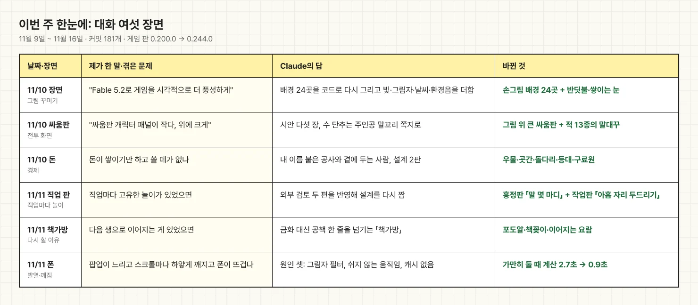
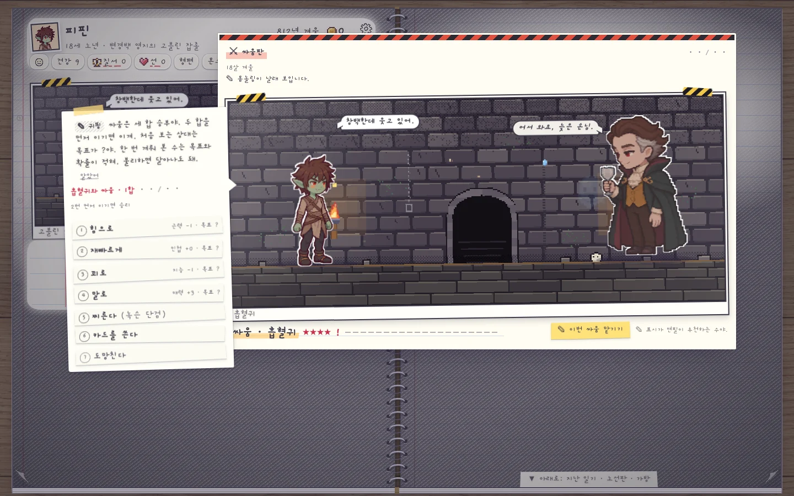
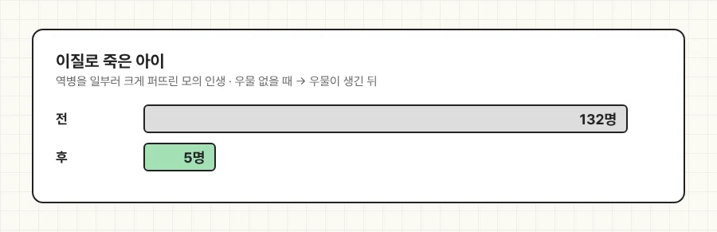
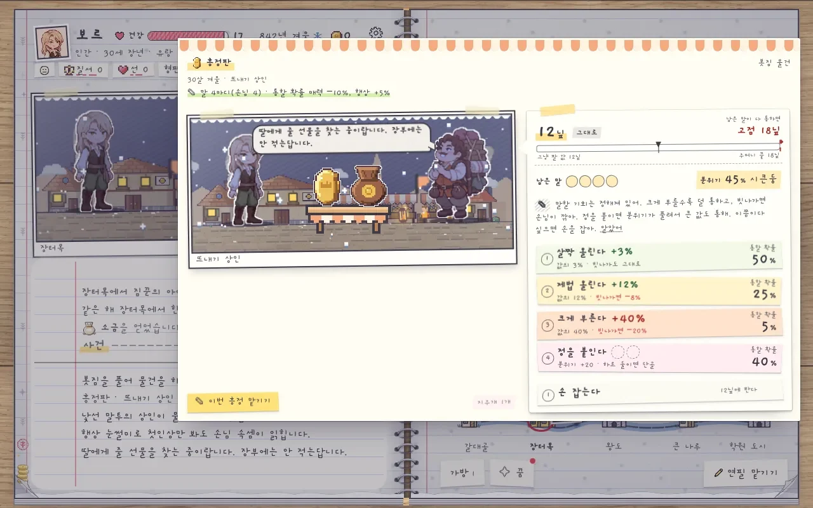
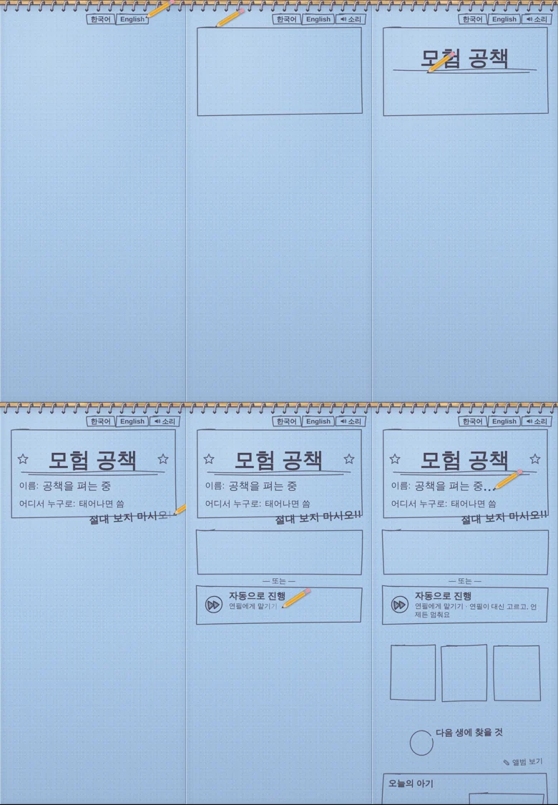

[지난주]()에 이어 넷째 주 일지입니다. 11월 9일 오후부터 오늘까지 게임 저장소에 커밋 181개가 쌓였고 게임 판 버전은 0.200.0에서 0.244.0까지 올라갔습니다. 이번 주는 유난히 "보기엔 멀쩡한데 뭔가 허전하다"는 말을 많이 했습니다. 그 허전함을 하나씩 메운 한 주였습니다.

<figure><figcaption>이번 주를 대화 여섯 장면으로 줄이면 이렇습니다. 절반이 화요일에 몰렸습니다.</figcaption></figure>

## "Fable 5.2로 게임을 시각적으로 더 풍성하게"

화요일에 모델 이름까지 콕 집어서 이렇게 주문했습니다. Claude는 지역 배경 24곳을 픽셀 하나하나 코드로 다시 그렸습니다. 장터 차양에 줄무늬가 생기고 왕도 성문에는 쇠창살이 내려왔죠. 인물 발밑에는 그림자가, 밤에는 등불 빛이 얼굴에 비치고, 여름밤엔 반딧불이 날고 겨울엔 눈이 땅에 쌓입니다.

물론 한 번에 된 건 아닙니다. 처음엔 꽃잎과 눈송이가 화면을 뒤덮어서 "파티클 너무 많다"고 했고 줄여 놓으니 이번엔 세 토막씩 똑같이 반복되는 게 눈에 거슬렸습니다. **조각은 적게, 불규칙하게**가 이날 얻은 교훈입니다. 코드로 만든 빗소리도 두 번 들어 봤지만 어색해서 녹음본을 그대로 쓰기로 했습니다.

<figure><figcaption>왼쪽이 예전, 오른쪽이 새 그림입니다. 같은 자리인데 동네에 사람이 이사 온 것 같습니다.</figcaption></figure>

## 흡혈귀가 말대꾸를 합니다

같은 날 싸움판도 손봤습니다. "싸움판 캐릭터 패널이 작다, 위에 크게"라고 했더니 시안이 다섯 장 왔고, 저는 장면 그림 위에 판을 크게 얹는 E안을 골랐습니다. 고르는 수는 이제 주인공 입에서 나온 말꼬리 쪽지로 뜨고 주사위가 그 쪽지 위에서 굴러갑니다.

내친김에 싸움 중에 가만히 있으면 나오는 대사도 늘렸습니다. 58줄이던 것이 830줄쯤으로 불었고, 말이 통하는 적 13종은 주인공 말에 대꾸까지 합니다. 처음엔 두 말풍선이 겹쳐서 "대사가 겹침"이라고 했더니 이제는 한 번에 한 사람만 말합니다. **싸움에도 대화 예절이 생긴 셈**이죠.

<figure><figcaption>"어서 와요, 늦은 손님." 흡혈귀가 먼저 인사를 건넵니다. 반갑지는 않습니다.</figcaption></figure>

## 금화가 쌓이기만 하는 부자의 고민

오래 살다 보면 금화가 자꾸 쌓이는데 정작 쓸 데가 없었습니다. 통장에 돈은 많은데 동네에 가게가 하나도 없는 기분이었죠. 이 고민을 털어놓자 Claude는 설계서를 두 판 써 왔고, 저는 2판대로 가자고 했습니다.

이제 내 이름을 붙인 우물을 파거나 살림 맡는 사람을 들일 수 있습니다. 흉년을 버티는 곳간과 강을 건너는 돌다리, 바닷가 등대도 지을 수 있죠. 전생에 공사를 끝까지 해낸 영혼은 석수 인맥 덕분에 다음 생에 공사 값을 덜 내고 여러 생이 임종 때마다 돈을 보태야 겨우 올라가는 큰 구료원도 생겼습니다. 숫자로 재 보니 우물 하나가 제법 많은 아이를 살렸습니다.

<figure><figcaption>돈을 쓰니 마을이 달라집니다. 가난이 죽음으로 이어지던 사슬을 금화로 끊는 셈이죠.</figcaption></figure>

## 직업마다 작은 놀이판

수요일에는 직업마다 고유한 놀이가 있으면 좋겠다고 했습니다. 다른 AI 두 곳에서 받은 검토를 함께 건넸더니 Claude가 꼼꼼히 비교해 설계를 다시 짰습니다. 첫 판은 행상의 흥정판입니다. 말할 기회가 몇 마디뿐이라 얼마나 세게 부르고 언제 손을 잡을지 머리를 굴려야 합니다. PC에서 좌판이 너무 커서 "좌판 쪽은 조금 줄여줘"라고 한 번 더 다듬었습니다.

다음 날에는 대장장이 작업판이 들어왔습니다. 주사위 두 개를 굴려 칼날 아홉 자리를 두드리는데, 다 채우면 이름을 새긴 걸작이 나옵니다. 흥정판과는 다른 손맛을 내 달라고 했는데, 말 대신 망치 소리가 나는 판이 됐습니다.

<figure><figcaption>흥정판입니다. 크게 부를수록 덜 통하고 빗나가면 손님이 깎자고 덤빕니다.</figcaption></figure>

## 폰이 손난로가 됐습니다

수요일엔 아이폰으로 해 보다가 하소연을 했습니다. 팝업은 느리게 뜨고 스크롤할 때마다 아래가 하얗게 깨지는 데다 폰이 뜨끈뜨끈했거든요. Claude가 찾아낸 범인은 셋이었습니다. 스크롤 칸마다 겹겹이 걸린 그림자 효과, 화면에 보이지 않을 때도 쉬지 않고 돌던 움직임, 그리고 들를 때마다 그림을 다시 받아 오던 설정입니다. 고치고 나니 폰이 가만히 있을 때 하는 계산이 4초 동안 2.7초에서 0.9초로 줄었습니다.

로딩 화면도 바뀌었습니다. 연필이 끄적이는 모습이 재미있다고 했더니 아예 연필이 칸을 긋고 제목을 한 자씩 써 내려가는 밑그림 화면이 됐습니다. 기다리는 시간이 조금은 덜 지루해졌습니다.

<figure class="narrow"><figcaption>연필이 표지를 처음부터 그려 나갑니다. 로딩이 끝나면 그리던 중이라도 바로 넘어갑니다.</figcaption></figure>

이 밖에도 다음 생에 공책 한 줄을 들고 가는 「책가방」이 들어왔고, 주 후반엔 게임 속 대사를 한곳에서 찾아 고치는 대사 작업대가 생겨서 그걸로 문장을 대대적으로 손봤습니다. 다음 주엔 이번에 들인 놀이판들을 직접 두드려 보며 값을 맞출 생각입니다.

## 세 줄 요약

1. 넷째 주에는 배경 24곳을 다시 그리고 금화를 쓸 공사와 직업별 놀이판, 책가방을 들였습니다.
2. 효과를 더할 땐 "너무 많다", "규칙적이다"처럼 느낀 그대로 말해 보세요. AI는 그 한마디로 꽤 정확히 고칩니다.
3. 폰이 뜨겁다는 하소연도 AI에게 그대로 넘기세요. 원인을 찾아 숫자로 재 오면 고칠 곳이 또렷해집니다.
