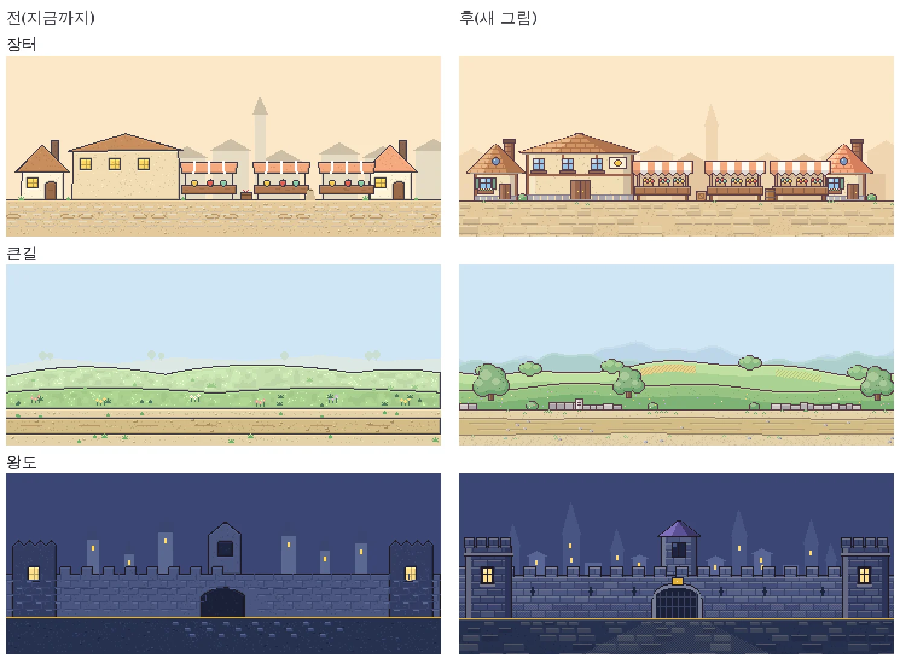

이번 주 내내 제가 입에 달고 산 말이 하나 있습니다. "보기엔 멀쩡한데, 뭔가 허전해."

[지난주]()에 굵직한 기능들을 실어 놓았더니, 11월 9일 오후부터 오늘까지 커밋 181개(버전 0.200.0 → 0.244.0)를 쌓는 동안은 그 허전한 구석을 하나씩 채우는 시간이 됐습니다.

<figure><figcaption>이번 주를 대화 여섯 장면으로 줄이면 이렇습니다. 절반이 화요일 하루에 몰렸습니다.</figcaption></figure>

## "Fable 5.2로 게임을 시각적으로 더 풍성하게"

화요일에는 아예 모델 이름까지 콕 집어 이렇게 주문했습니다. 그러자 Claude가 지역 배경 24곳을 코드로 픽셀 하나하나 다시 그려 왔습니다. 밋밋하던 장터 차양에 줄무늬가 생겼고, 왕도 성문에는 묵직한 쇠창살이 내려왔죠. 캐릭터 발밑에는 그림자가 드리워지고, 밤이면 등불 빛이 얼굴에 은은하게 번집니다. 여름밤엔 반딧불이 날아다니고 겨울엔 땅에 눈이 소복이 쌓이고요.

물론 단번에 마음에 쏙 든 건 아닙니다. 처음엔 꽃잎과 눈송이가 화면을 뒤덮어 버려서 "파티클 너무 많다"고 줄였고, 줄여 놓으니 이번엔 세 토막씩 똑같은 패턴이 반복되는 게 눈에 걸렸습니다. **조각은 적게, 흩뿌릴 땐 불규칙하게**가 이날 건진 요령입니다. 코드로 합성한 빗소리도 두 번 들어 봤지만 영 어색해서, 결국 원래 녹음본을 그대로 쓰기로 했습니다.

<figure><figcaption>왼쪽이 예전, 오른쪽이 새 그림입니다. 똑같은 자리인데 동네에 사람이 이사 온 기분입니다.</figcaption></figure>

## 흡혈귀가 말대꾸를 합니다

같은 날 싸움판도 뜯어고쳤습니다. "싸움판 캐릭터 패널이 작다, 위에 크게"라고 던졌더니 시안이 다섯 장 돌아왔고, 장면 그림 위에 판을 큼직하게 얹는 E안을 골랐습니다. 이제 선택지는 주인공 입에서 나온 말꼬리 달린 쪽지로 뜨고, 주사위도 그 쪽지 위에서 굴러갑니다.

내친김에 싸움 중 가만히 있을 때 나오는 대기 대사도 대폭 늘렸습니다. 58줄이던 게 830줄 안팎으로 불어났고, 말이 통하는 적 13종은 주인공의 혼잣말에 대꾸까지 합니다. 처음엔 두 말풍선이 겹쳐 떠서 "대사가 겹침"이라고 짚어 줬더니, 이제는 한 번에 한 사람씩 차례로 말합니다. **싸움판에도 드디어 대화 예절이 생겼습니다.**

<figure><figcaption>"어서 와요, 늦은 손님." 흡혈귀가 먼저 인사를 건넵니다. 딱히 반갑지는 않습니다.</figcaption></figure>

## 금화가 썩어나는데 쓸 데가 없다

캐릭터가 오래 살다 보면 금화가 차곡차곡 쌓이는데, 정작 돈을 쓸 곳이 마땅치 않았습니다. 통장은 두둑한데 동네에 가게가 하나도 없는 격이었죠. 이 고민을 털어놓자 Claude가 설계안 두 개를 가져왔고, 저는 두 번째 안을 골랐습니다.

이제 마을에 내 이름을 붙인 우물을 파거나, 집안 살림을 맡아 줄 사람을 들일 수 있습니다. 흉년을 버티는 곳간, 강을 건너는 돌다리, 바닷가 등대도 지을 수 있고요. 전생에 공사를 끝까지 마친 영혼은 석수 인맥 덕분에 다음 생에 공사비를 할인받고, 여러 생이 임종 때마다 조금씩 보태야 겨우 완공되는 큰 구료원도 생겼습니다. 숫자로 재어 보니 우물 하나가 생각보다 훨씬 많은 아이를 살렸습니다.

<figure><figcaption>돈을 푸니 마을의 운명이 바뀝니다. 가난에서 죽음으로 이어지던 사슬을 금화로 끊어 낸 결과입니다.</figcaption></figure>

## 직업마다 작은 놀이판을 하나씩

수요일에는 직업마다 고유한 미니 게임이 있으면 좋겠다고 주문했습니다. 다른 AI 두 곳에서 받아 온 검토를 함께 넘겼더니, Claude가 꼼꼼히 비교해 설계를 다시 짰습니다. 첫 주자는 행상의 흥정판입니다. 주고받을 말이 몇 마디뿐이라 얼마나 세게 부르고 언제 손을 잡을지 눈치 싸움을 해야 합니다. PC 화면에서 좌판이 지나치게 커서 "좌판 쪽은 조금 줄여줘"라고 한 차례 더 다듬었습니다.

다음 날에는 대장장이 작업판이 들어왔습니다. 주사위 두 개를 굴려 칼날 아홉 자리를 두드리는데, 아홉 칸을 다 채우면 내 이름을 새긴 걸작이 완성됩니다. 흥정판과는 손맛이 확 달라야 한다고 주문했더니, 말싸움 대신 망치 소리가 울리는 판이 나왔습니다.

<figure><figcaption>흥정판입니다. 욕심껏 높게 부를수록 통할 확률이 떨어지고, 빗나가면 손님이 값을 깎자고 덤벼듭니다.</figcaption></figure>

## 폰이 손난로가 됐습니다

수요일엔 아이폰으로 직접 해 보다가 하소연을 쏟아냈습니다. 팝업이 굼뜨고, 스크롤할 때마다 화면 아래가 하얗게 깨지고, 폰 뒷면은 뜨끈뜨끈했거든요.

Claude가 뒤져서 찾아낸 범인은 셋이었습니다. 스크롤 칸마다 겹겹이 얹힌 그림자 효과, 화면 밖에 숨어 있을 때도 쉬지 않고 돌던 애니메이션, 그리고 들를 때마다 이미지를 새로 내려받던 설정이죠. 셋을 손보고 나니 가만히 놔뒀을 때 4초 동안 폰이 처리하던 작업 시간이 2.7초에서 0.9초로 뚝 떨어졌습니다.

로딩 화면도 새 옷을 입었습니다. 연필이 사각사각 끄적이는 느낌이 좋다고 했더니, 아예 연필이 빈 종이에 칸을 긋고 제목을 한 글자씩 써 내려가는 밑그림 화면이 됐습니다. 기다리는 시간이 전보다 훨씬 덜 지루합니다.

<figure class="narrow"><figcaption>연필이 표지를 처음부터 그려 나갑니다. 로딩이 끝나면 그리던 중이라도 곧장 넘어갑니다.</figcaption></figure>

이 밖에도 다음 생으로 공책 한 줄을 챙겨 가는 「책가방」 기능이 붙었고, 주 후반에는 게임 속 모든 대사를 한곳에서 찾아 고치는 대사 작업대까지 만들어 문장을 대대적으로 손봤습니다. 다음 주엔 이번에 들인 놀이판들을 직접 굴려 보며 수치를 맞춰 볼 차례입니다.

## 세 줄 요약

1. 넷째 주에는 지역 배경 24곳을 새로 그리고, 금화를 쓸 마을 공사·직업별 놀이판·책가방을 추가했습니다.
2. 화면 효과를 손볼 땐 "너무 많다", "너무 규칙적이다"처럼 느낀 그대로 말해 보세요. AI는 그 짧은 인상만으로도 제법 정확히 고칩니다.
3. "폰이 뜨겁다"는 막연한 하소연도 그대로 넘겨 보세요. AI가 원인을 찾고 숫자로 재어 오면 고칠 지점이 또렷해집니다.
