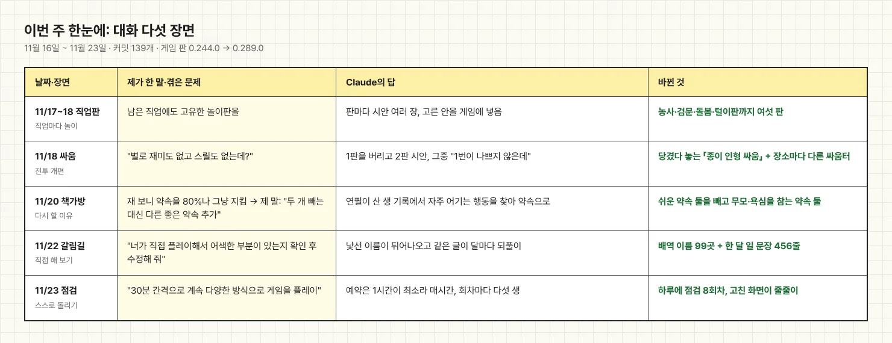
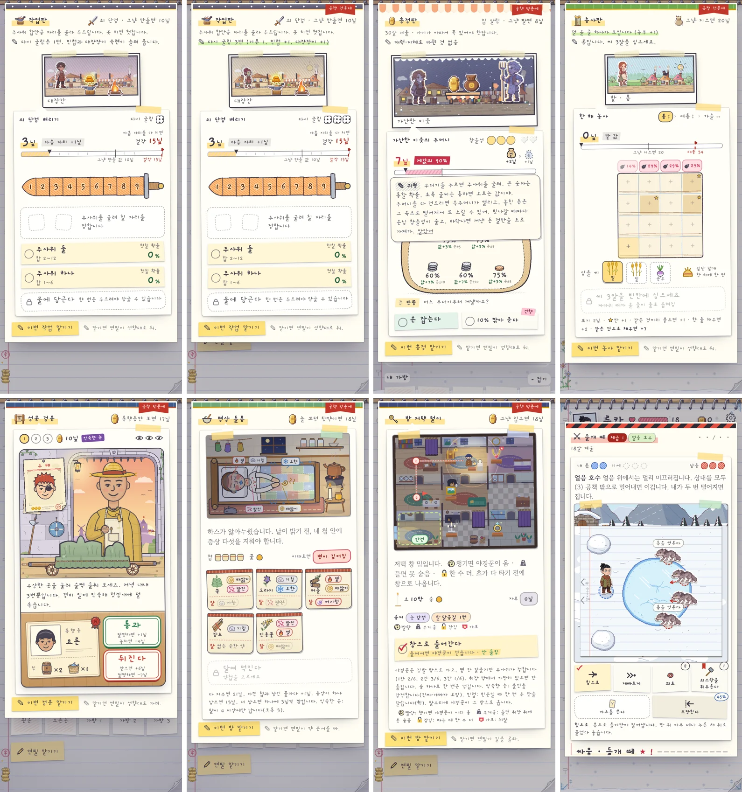
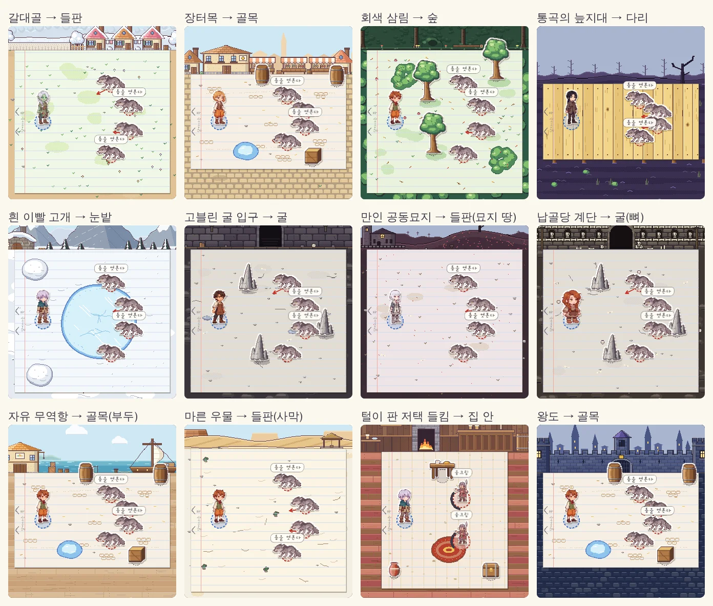
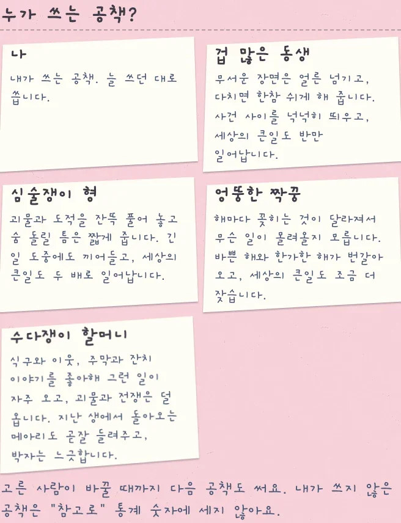
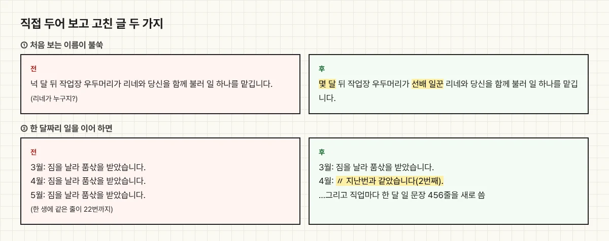
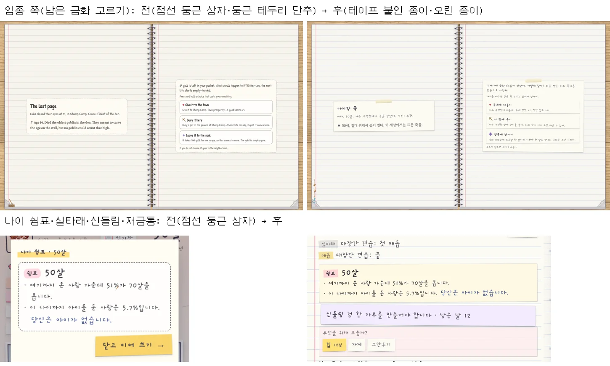

이번 주에 제가 Claude에게 가장 많이 건넨 말은 아마 "직접 해 봐"였을 겁니다. 시안을 받아 고르는 자리에서 한 걸음 더 나가, 아예 AI를 플레이어 자리에 앉혀 놓고 게임을 굴리게 한 한 주였거든요.

[지난주]()에 이어 11월 16일 저녁부터 오늘까지 저장소에 커밋 139개가 쌓였고, 게임 버전은 0.244.0에서 0.289.0까지 올라갔습니다.

<figure><figcaption>이번 주를 대화 다섯 장면으로 줄이면 이렇습니다. 맨 아랫줄은 제가 이 글을 쓰는 지금도 혼자 돌아가는 중입니다.</figcaption></figure>

## 직업판 여섯, 드디어 한 줄로 섰습니다

지난주 흥정판과 대장장이 작업판 두 개로 문을 연 직업 놀이판에 이번 주 네 개가 더 합류했습니다. 농부는 모눈 밭에 씨를 심고, 경비병은 성문 앞에서 수레 덮개를 들춰 밀수품을 찾아냅니다. 약초꾼은 밤새 열이 오르는 환자에게 약을 달여 증상 다섯 개를 지워야 하고, 도둑은 야경꾼 등불이 스쳐 지나가는 틈을 타 저택을 털죠.

판마다 Claude가 시안을 여러 장 뽑아 오면 제가 하나를 고르는 식으로 만들었습니다. 그중 성문 검문판은 그림 구도만 무려 여덟 번을 갈아엎은 끝에, 창구 안에서 바깥 수레를 내다보는 시점으로 겨우 정착했습니다. **여섯 판이 나란히 서니, 직업을 고르는 일이 처음으로 "이번 생엔 무슨 놀이를 해 볼까"처럼 느껴집니다.**

<figure class="narrow"><figcaption>위는 작업·흥정·농사판, 아래는 검문·돌봄·털이판과 새 싸움판입니다. 공책 한 권 안에 동네 문방구 놀이 세트가 통째로 들어앉았습니다.</figcaption></figure>

## "별로 재미도 없고 스릴도 없는데?"

직업판에 손맛이 붙기 시작하자, 정작 기존 싸움판이 유난히 초라해 보였습니다. Claude에게 자동 진행(연필 모드)으로 108생을 돌려 싸움 861번을 까 보게 했더니, 플레이어가 무려 88%를 이겼고 그중 42%는 2:0으로 맥없이 끝났더군요. 목숨 건 전투라기보다 거의 출석 체크 수준이었습니다.

그래서 싸움도 통째로 갈아엎자고 했는데, 첫 시안을 받아 들자마자 튀어나온 말이 바로 저 소제목입니다. 주사위를 칸에 올려 두는 방식이었는데, 아무리 봐도 숫자 맞추기 이상으로 느껴지지 않았거든요.

다행히 두 번째 시안에서 "1번이 나쁘지 않은데"라는 말이 나왔습니다. 손가락으로 내 종이 인형을 당겼다 놓아 상대를 공책 밖으로 튕겨 내는 방식이었죠. 여기에 몬스터 덩치와 무게에 따라 밀리는 정도를 다르게 하고, 밋밋한 동그라미 말 대신 원래 캐릭터 그림을 그대로 얹자고 덧붙였습니다.

그렇게 「종이 인형 싸움」이 들어왔고, 다음 날에는 게임 속 모든 장소마다 바닥과 장애물이 다른 전용 싸움터를 맞췄습니다. 얼음 호수에선 쭉 미끄러지고, 숲에선 나무에 쿵 부딪힙니다. 오늘은 적 23종에게 약점 단서를 달아 맞는 카드를 고르면 「단서」 표시가 뜨게 손봤습니다.

<figure><figcaption>장소 이름 옆 화살표가 그곳의 싸움터입니다. 늑대들은 장소를 안 가리고 늘 무리 지어 빈틈을 노립니다.</figcaption></figure>

## 약속을 너무 잘 지키는 플레이어들

다음 생으로 무언가를 챙겨 가는 「책가방」도 이번 주에 부쩍 몸집을 키웠습니다. 접어 둔 한 쪽, 알림장, 학급 문고가 새로 생겼고, 겁 많은 동생이나 심술쟁이 형처럼 내 공책을 대신 써 주는 이야기꾼 자리에는 오늘 수다쟁이 할머니가 들어왔습니다.

제일 재밌었던 건 책가방에 걸어 두는 "약속 내기"였습니다. 통계를 내 보니 플레이어들이 약속을 무려 80%나 거저 지키고 있더군요. 내기라기보다 공짜 선물에 가까웠던 거죠. 너무 쉬운 두 개를 빼자는 Claude의 제안에 "두 개 빼는 대신 다른 좋은 약속 추가"라고 답했고, 그렇게 '무모하게 굴지 않기'와 '욕심부리지 않기'가 새로 들어왔습니다. **지키기 좀 버거워야 비로소 약속이 됩니다.** 사람 사이에서나 게임 속에서나 매한가지더군요.

<figure class="narrow"><figcaption>할머니가 공책을 쓰면 괴물은 덜 나오고 잔치 이야기가 늘어납니다. 글의 박자도 한결 느긋해집니다.</figcaption></figure>

## "너가 직접 플레이해서 어색한 부분이 있는지 확인 후 수정해 줘"

새 일을 시작한 지 두어 달쯤 지나면 직업마다 첫 갈림길이 찾아옵니다. 윗사람의 실수를 눈감아 줄지, 남의 공을 슬쩍 가로챌지, 뒷돈을 받을지 같은 찜찜한 선택들이죠. 직업 묶음 여덟 곳에 다 심어 둔 뒤, Claude에게 직접 플레이해 보라고 맡겼습니다.

돌아온 보고서가 제법 민망했습니다. 앞 장면에선 "선배 일꾼"으로 나오던 인물이 다음 장면에선 설명도 없이 덜렁 이름만 "리네"로 튀어나와 누군지 알 길이 없었고, 실제로는 몇 달 뒤에 뜰지 모르는 사건인데 문장엔 "넉 달 뒤"라고 못 박아 둔 곳도 수두룩했습니다. 이런 구멍을 각각 99곳, 61곳씩 고쳤습니다.

다음 날 "이어서 진행해 줘"라고 했더니 이번엔 다른 문제가 걸려들었습니다. 한 달짜리 일을 계속하면 똑같은 문장이 달마다 도돌이표처럼 찍히고 있었는데, 심지어 한 생에 같은 줄이 22번이나 나온 기록까지 있더군요. 결국 69개 일에 한 달 일 문장을 대량으로 보태 달라고 주문해 456줄을 새로 채워 넣었습니다.

<figure><figcaption>아래 짐 나르기 문장은 설명용 예시입니다. 실제로 게임에서 줄어드는 방식은 똑같습니다.</figcaption></figure>

## 이제 게임이 스스로 게임을 합니다

오늘은 아예 한 발 더 나갔습니다. "30분 간격으로 계속 다양한 방식으로 게임을 플레이하여 오류나 개선점을 다각도로 점검"하라고 맡겼거든요. 예약 작업 최소 간격이 1시간이라 매시간 도는 걸로 타협했고, 처음엔 한 회차에 딱 1생만 살길래 "한 생만 살지 말고 5생 정도는 살면서 점검"하라고 눈높이를 올렸습니다.

오늘 하루에만 벌써 8회차가 돌았습니다. 폰에서 꿈 고르기 제목이 닫기 단추에 가려진 것, PC 스케치북에서 판 맡기기 단추가 아래 막대에 깔린 것 같은 자잘한 결함들을 한 회차씩 건져 올려 고쳤습니다. 같은 날 화면 곳곳에 남아 있던 옛날식 점선 상자도 테이프 붙인 종이나 오린 종이 같은 공책 재료로 말끔히 갈아치웠고요. **월급도 안 받는 야간 경비원을 한 명 고용한 기분입니다.** 밤새 혼자 공책 구석구석을 순찰합니다.

<figure><figcaption>한 생을 끝까지 플레이하며 찾아낸 옛 점선 상자들입니다. 왼쪽이 전, 오른쪽이 후입니다.</figcaption></figure>

이 밖에도 가난한 집 출신이 부모님께 달마다 돈을 부치고, 보증인 없는 가난한 출신은 장인이 될 때 조합 가입비를 내는 식으로 돈 균형을 세 단계에 걸쳐 다듬었습니다. 업데이트 뒤에도 쓰던 공책을 그대로 이어 쓸 수 있게 됐고, 첫 화면도 한결 가벼워졌습니다. 다음 주에는 매시간 순찰이 물어 오는 숙제들을 계속 정리하면서, 새로 넣은 종이 인형 싸움판의 승률을 맞춰 볼 생각입니다.

## 세 줄 요약

1. 다섯째 주에는 직업판 넷을 마저 채우고 「종이 인형 싸움」을 들였으며, 책가방에 약속과 새 이야기꾼을 보탰습니다.
2. 시안이 마음에 안 들면 "재미도 스릴도 없다"처럼 느낀 그대로 솔직하게 던지세요. 두 번째 시안이 놀랄 만큼 가까워집니다.
3. AI에게 직접 게임을 플레이해 보라고 시켜 보세요. 사람 눈엔 슬쩍 지나가는 어색한 문장과 깔린 단추를 생각보다 훨씬 부지런히 찾아냅니다.
