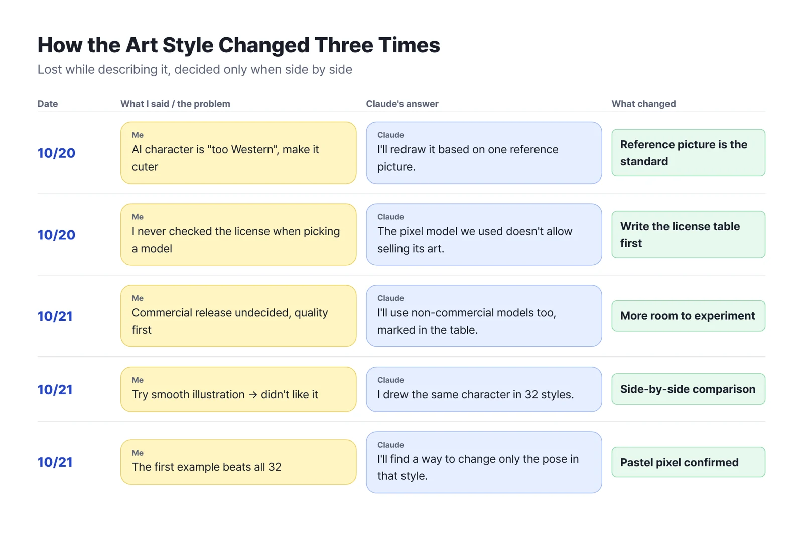
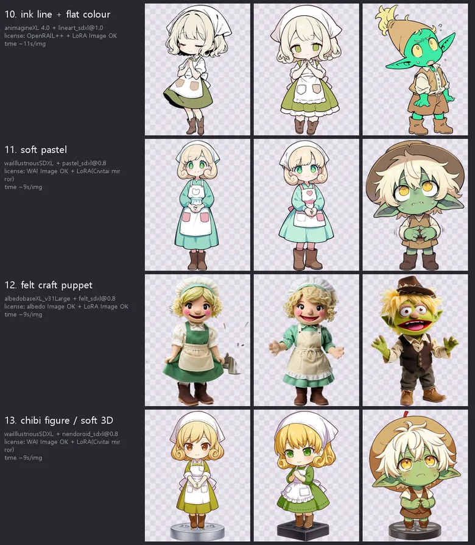
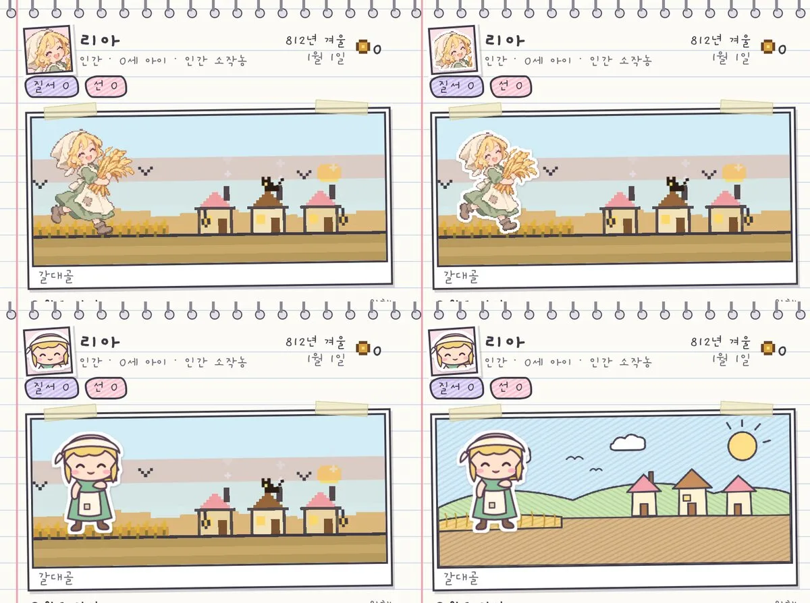
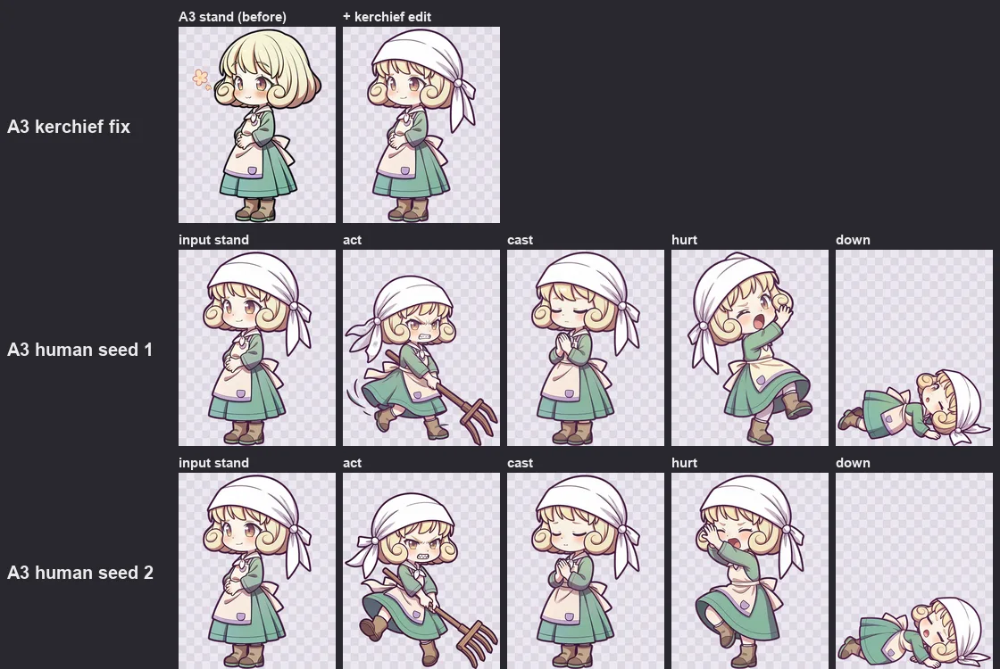

While generating game characters with AI, I tore up the art style three times in just a few days. Looking back, the reason I kept wandering in circles was always the same: I was trying to describe a vague feeling in my head **in words**.

<figure><figcaption>Five rounds of back-and-forth with AI just to settle on one art style.</figcaption></figure>

## "It's just... too Western..."

The first character the AI proudly brought back was classic Western fantasy, packed with heavy muscles and dramatic shading. I wanted that Japanese indie-game feel—big head, sparkling eyes—but when I tried to type that into a prompt, the words just wouldn't come.

All the feedback I managed was vague stuff like **"too Western"** and **"make it a bit cuter."** Naturally, no matter how many times I regenerated, the art went nowhere.

Out of sheer frustration, I tossed in one example image with the vibe I usually like, and suddenly we spoke the same language. Claude picked that image apart, worked out the colors, head-to-body proportions, and facial features on its own, and regenerated to match. One picture really did beat a hundred words.

## Oops, we couldn't sell that art

On a day when I was thrilled with how pretty the art was looking, Claude gently poured cold water on the party.

It had checked the terms of the pixel art model we were happily using, and it turned out **the license didn't allow commercial use without the original author's permission.** I'd assumed that if the art looked good, we were golden, and never even glanced at the license. If I'd kept going and later released the game as a paid title, hundreds of images would have gone straight into the trash overnight.

Since that day, before downloading any new image model, Claude always reports its license terms in a table. When I said, "I haven't decided whether to release it as paid yet, so quality comes first for now," it suggested a smart compromise: use non-commercial models for testing too, just stick a red tag on them in the table so we don't mix them up later.

## Only after tasting all 32 flavors

At one point, pixel art started feeling cramped, so I yanked the wheel over to smooth, regular illustration. Once I'd generated it, though, that didn't feel right either.

Seeing me waffle, Claude went all out and **generated the same character in 32 versions, changing only the art style, and laid them all out on one sheet.** Character settings, pose, and size were locked identical, with "art style" as the sole variable—basically an ice-cream tasting counter.

<figure class="narrow"><figcaption>A slice of the 32-style tasting counter. We tried everything from ink pen lines to wool felt dolls to 3D figurines.</figcaption></figure>

I crossed my arms, stared at all 32 for a long while, and reached a conclusion that was both anticlimactic and dead certain.

**"Forget all 32—the pastel pixel from the very beginning is still the prettiest."**

It looks like a pointless detour, but it was actually essential. Seeing the other options with my own eyes and crossing them off was what finally made me 100% sure of the first style. If I'd charged ahead without this comparison, I'd have spent the whole project second-guessing myself: "Maybe I should've gone with illustration after all?"

The few finalists got their final interview right on top of a real game background. Art that looks great alone on white paper and art that actually belongs on the game screen turned out to be two completely different things.

<figure><figcaption>Putting four character sticker treatments onto the actual game screen for the final interview.</figcaption></figure>

## Same face, different poses

Once the style was locked in, the next hurdle was waiting right around the corner. One character needs several poses—standing, casting a spell, hurt—but whenever I asked for a fresh drawing per pose, a total stranger wearing the same name showed up each time.

After experimenting back and forth, Claude found that **taking one standing image as the original and editing only the posture** kept the face and outfit the most consistent. Lately it's evolved a step further, drawing the head and body separately and snapping them together like Lego. That kit-style asset story continues in the [asset workbench post](/en/2026/10/27/ai-assets/).

<figure><figcaption>Keeping the face and clothes of the original on the far left, only the pose changes: working, casting, hurt, and knocked out.</figcaption></figure>

## Three-line summary

1. Don't struggle to explain the art style you want in words. Showing one reference image you like is a hundred times faster.
2. Laying several styles side by side on one screen is the fastest way to be sure of your taste with zero regrets.
3. Have the AI check the commercial-use license of an art model before you get attached to it. Otherwise you'll end up throwing it all out later.
