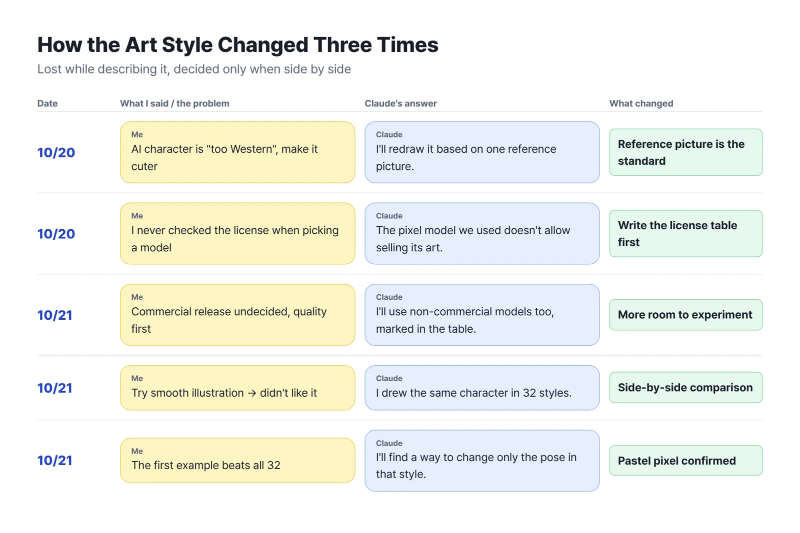

I tore up my game's art style three times in just a few days. Looking back, I kept wandering in circles for the exact same reason every time: I was trying to describe a fuzzy vibe in my head using only words.

<figure><figcaption>Five rounds of back-and-forth with AI just to settle on one art style.</figcaption></figure>

## "It's just... too Western..."

The first character the AI proudly handed me was classic Western fantasy—heavy muscles, dramatic shading, the whole deal. I wanted that Japanese indie-game feel with big heads and sparkling eyes, except I had no idea how to put that into a prompt.

All I could cough up was **"too Western"** and **"make it a bit cuter."** Unsurprisingly, every regeneration went nowhere.

Out of sheer frustration, I tossed in one reference image with the vibe I actually liked, and suddenly we were speaking the same language. Claude broke down the palette, head-to-body ratio, and facial features on its own, then regenerated to match. One picture really did beat a hundred words of flailing.

## Oops, we couldn't sell that art

Just when I was thrilled with how pretty the sprites were looking, Claude gently poured cold water on the party.

It had checked the terms of the pixel art model we'd been happily using, and **the license didn't allow commercial use without the original author's permission.** I'd assumed good-looking output meant we were golden and hadn't even glanced at the license. If I'd kept going and released the game as a paid title, hundreds of sprites would've gone straight into the trash overnight.

Since that scare, Claude logs the license terms in a table before downloading any new image model. I told it I hadn't decided whether the game would be paid yet, so quality came first for now. Its compromise was pretty smart: keep non-commercial models in the test pool, just slap a red tag on them in the table so we don't accidentally ship them later.

## Only after tasting all 32 flavors

At one point, pixel art started feeling a bit cramped, so I yanked the wheel hard toward smooth, regular illustration. Once the renders came back, though, those didn't feel right either.

Seeing me waffle, Claude went all out and generated the exact same character in 32 versions—character settings, pose, and size locked identical, with "art style" as the sole variable. Basically an ice-cream tasting flight.

<figure class="narrow"><figcaption>A slice of the 32-style tasting flight. We tried everything from ink pen lines to wool felt dolls to 3D figurines.</figcaption></figure>

I crossed my arms, stared at all 32 for a long minute, and arrived at a conclusion that was both anticlimactic and dead certain:

"Forget all 32—the pastel pixel from day one is still the best."

It looks like a pointless detour, but I needed it. Seeing the other options side by side and crossing them off was what finally cured my second-guessing. Without that lineup, I'd have spent the whole project wondering if I should've gone with illustration after all.

The few finalists got their final audition right on top of a real game background. Art that shines on white paper and art that actually belongs in a game scene are two completely different animals.

<figure><figcaption>Putting four character sticker treatments onto the actual game screen for the final interview.</figcaption></figure>

## Same face, different poses

With the style locked in, the next headache showed up right on cue. One character needs several poses—standing, casting a spell, hurt—and asking for a fresh drawing per pose meant a total stranger wearing the same outfit walked in every time.

After some trial and error, Claude found that **taking one standing image as the base and editing only the posture** kept the face and outfit intact. Lately that's evolved into drawing the head and body separately and snapping them together like Lego, which I wrote about in the [asset workbench post](/en/2026/10/27/ai-assets/).

<figure><figcaption>Keeping the face and clothes of the original on the far left, only the pose changes: working, casting, hurt, and knocked out.</figcaption></figure>

## Three-line summary

1. Don't struggle to explain the art style you want in words. Showing one reference image you like is a hundred times faster.
2. Laying several styles side by side on one screen is the fastest way to be sure of your taste with zero regrets.
3. Have the AI check the commercial-use license of an art model before you get attached to it. Otherwise you'll end up throwing it all out later.
