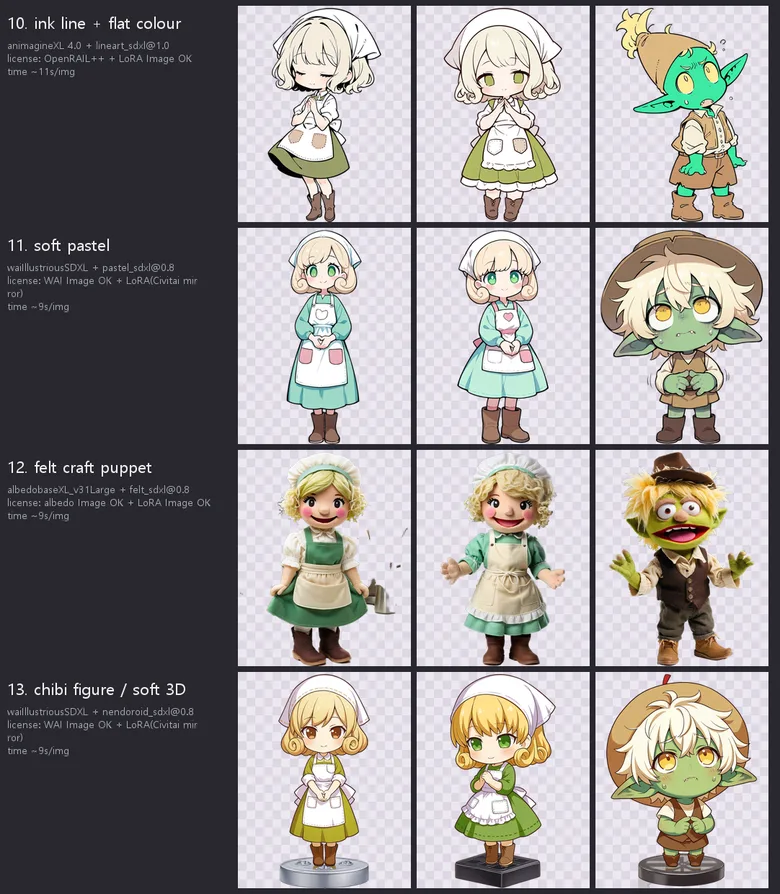
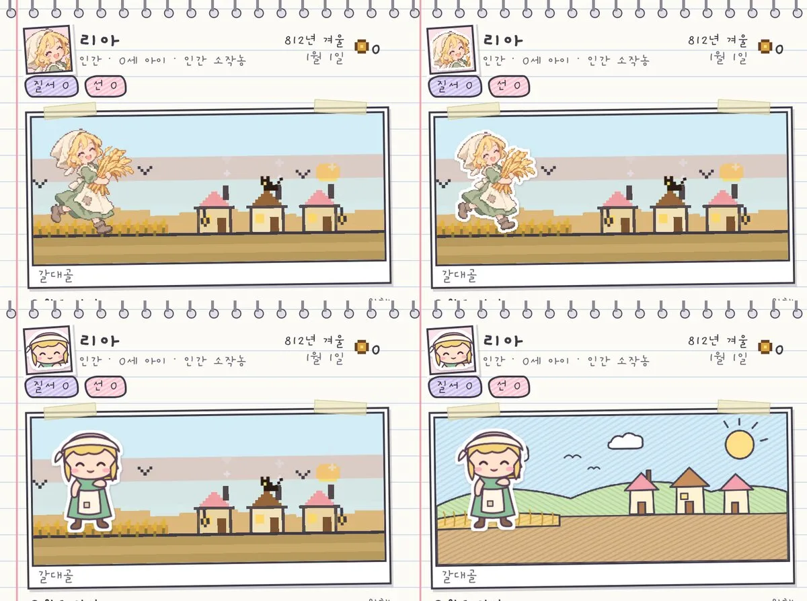
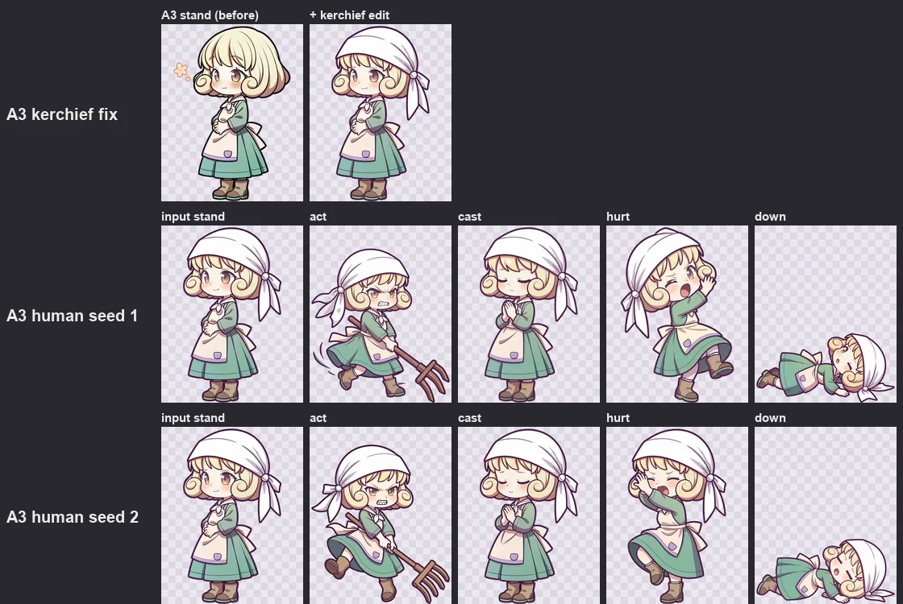

You know the customer who walks into a hair salon and asks for "something natural, just a bit nicer"? During my first week of generating game characters with AI, that customer was me.

I tore up the art style three times in just a few days before spotting the pattern. Every wrong turn had the same cause: I kept trying to describe a fuzzy vibe in my head using nothing but words.

<figure><figcaption>Five rounds of back-and-forth with AI just to settle on one art style.</figcaption></figure>

## "It's just... too Western..."

On day one, the AI proudly handed me a classic Western fantasy hero—heavy muscles, dramatic shading, the full package. What I actually wanted was that Japanese indie-game look with big heads and bright eyes, except I had no idea how to translate that into a prompt.

All I could offer was **"too Western"** and **"make it a bit cuter."** Predictably, every regeneration went right back in circles.

Out of frustration, I dropped in a single reference image that had the vibe I liked. Suddenly we were speaking the same language. Claude broke down the color palette, head-to-body ratio, and facial features on its own, then generated a fresh batch to match. One image beat a hundred adjectives.

## Oops, we couldn't sell that art

Right when the sprites started looking good enough to celebrate, Claude gently tapped the brakes.

It had checked the terms for the pixel-art model we'd been happily using, and **the license forbade commercial use without the original author's permission.** I'd assumed pretty output meant we were clear and hadn't glanced at the fine print. Had I kept going and eventually released the game as a paid title, hundreds of sprites would have gone straight to the bin overnight.

From that day on, any new model gets its license logged in a table before we even download it. Since I haven't decided whether the game will be paid yet, I told Claude quality still comes first for now. Its compromise was tidy: keep non-commercial models in the test pool, just slap a red tag on them in the table so we never accidentally ship one later.

## Only after tasting all 32 flavors

Midway through, pixel art started feeling a little cramped, so I yanked the wheel hard toward smooth illustration. Once the renders came back, though, those didn't feel right either.

Watching me waver, we decided to put the exact same character through 32 styles on a single comparison sheet—character traits, pose, and size locked identical, with art style as the lone variable. An ice-cream tasting flight, minus the calories.

<figure class="narrow"><figcaption>A slice of the 32-style tasting flight—everything from ink pen lines to wool felt dolls and 3D figurines.</figcaption></figure>

I crossed my arms, studied all 32 for a long minute, and landed on a verdict that was equal parts anticlimactic and final:

"Forget all 32—the pastel pixel from day one is still the best."

It looks like a wasted detour, yet I needed every step of it. Seeing the alternatives side by side and crossing them off was what finally silenced the second-guessing. Without that lineup, I'd have spent the rest of development wondering if smooth illustration would have looked better.

The handful of finalists got their real audition directly on top of a game background. Art that looks crisp on white paper and art that actually belongs inside a live scene turn out to be very different things.

<figure><figcaption>Testing four character sticker treatments right on top of the actual game screen for the final call.</figcaption></figure>

## Same face, different poses

Once the style settled, the next puzzle showed up on cue. A single character needs multiple poses—standing, casting a spell, getting hurt—and generating each pose from scratch meant a stranger wearing the same outfit walked in every time.

After a bit of trial and error, the fix was simple: **keep one standing drawing as the master reference and edit only the posture from there.** That kept both the face and the outfit steady. Lately we've pushed that idea further by drawing heads and bodies separately and snapping them together like Lego—which I covered in the [asset workbench post](/en/2026/10/27/ai-assets/).

<figure><figcaption>Keeping the face and outfit from the original on the far left, only the pose changes: working, casting, hurt, and knocked out.</figcaption></figure>

## Three-line summary

1. Stop trying to describe an art style with vague adjectives—one reference image that matches your taste gets you there much faster.
2. Put candidate styles side by side on a single sheet so you can rule out the runners-up and commit without lingering doubts.
3. Have the AI check and log a model's commercial license before you fall in love with its output; throwing out hundreds of sprites later hurts.
