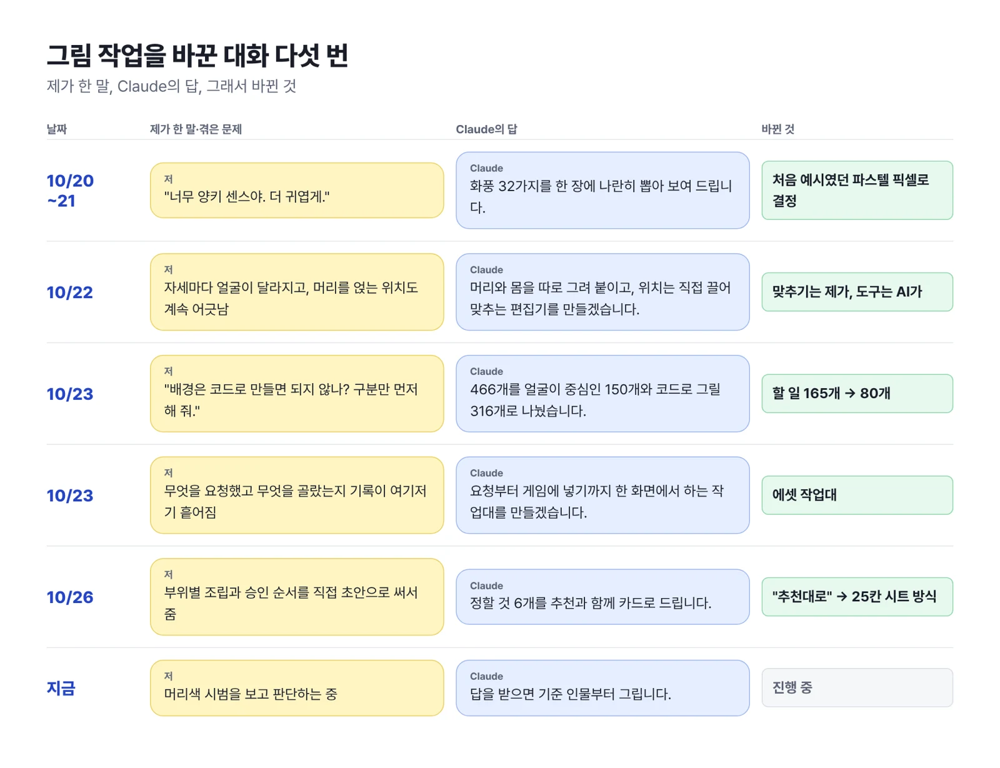
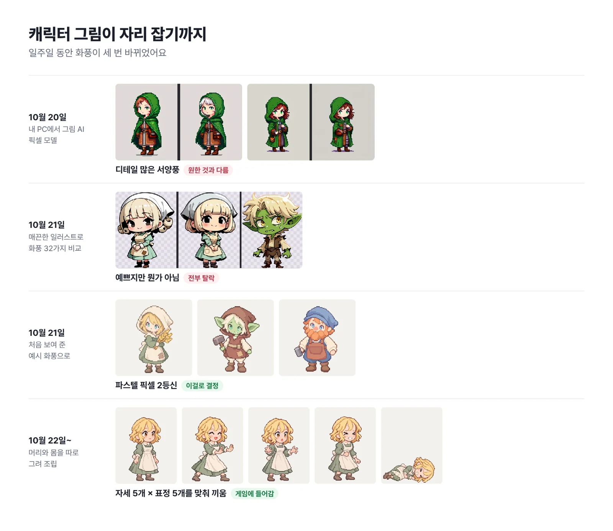
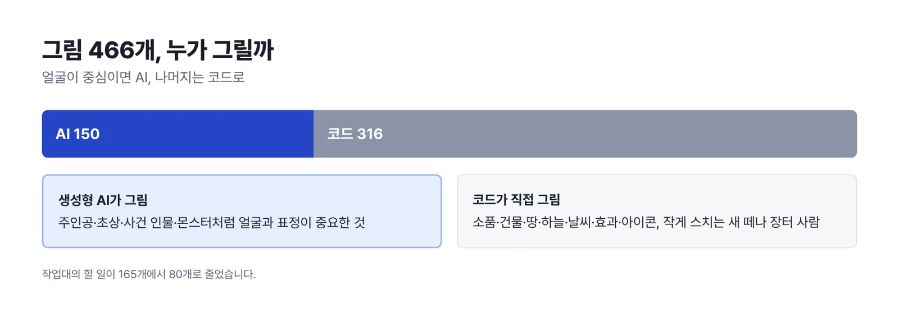
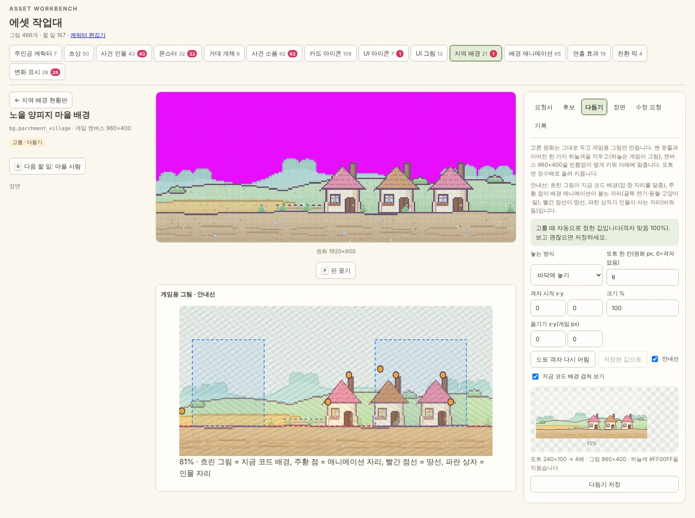

The part of making a game with AI that wore me down most wasn't the code. It was **the art**.

Code has automated checks—one second and you know if it passed or failed. Art still needs a pair of human eyes to sign off on every single sprite. Add the requirement that one character striking five poses has to keep the same face in all five, and things get messy fast. We're still wrestling with it, honestly, but here is how a week of back-and-forth with Claude ended up producing a dedicated asset workbench.

<figure><figcaption>The turning-point conversations that reshaped our art workflow over the past week.</figcaption></figure>

## "Too Western, make it cuter!"

Day one's character came back in full Western fantasy mode, sculpted armor folds and all. I wanted a cute two-heads-tall Japanese indie-game look, except I had no vocabulary for that vibe. All I managed to say was, "Too Western, make it cuter."

So Claude laid out 32 art styles on a single sheet. Crossing them off one by one led straight back to the "pastel pixel" reference I'd shown at the start. When you're hazy on what you want, spreading options side by side beats arguing with prompts every time.

<figure><figcaption>A week of character makeovers. After going in circles, we landed on the pastel pixel hero at the bottom.</figcaption></figure>

## Fine, I'll line up the neck myself

No sooner had we settled on a style than the next wall appeared. Drawing the head and body together meant a slightly different stranger stepped in every time the pose changed.

So I switched to a **kit approach—draw the head and body separately, then snap them together.** Except now the AI couldn't nail the placement coordinates. In pixel art, two or three pixels off turns your hero into a giraffe or gives them a hunched turtle neck.

After a few rounds of asking it to nudge numbers up and down, I changed tactics:

"I'll line it up by eye—just build me an editor where I can drag it with a mouse."

In the editor Claude built, I drag the head onto the body, hit save, and get a clean composite immediately. Letting human eyes handle what human eyes do in a second—and having AI build the tool for it—saves everyone's sanity.

## One question cut the workload in half

When I counted every image the game needed, the total came to **466**. Right as I started dreading the weeks of generating and reviewing all of them, a thought struck me:

"Wait—couldn't we draw backgrounds and props in code instead of with AI? Don't draw anything yet. Just sort them first."

Hitting pause to sort first produced a clean dividing line: AI draws living creatures whose face and expression carry the scene; code draws backgrounds and geometric pieces.

That single rule cut the AI sprite count from 466 down to 150, and sliced the workbench backlog in half too, from 165 to 80.

<figure><figcaption>Only characters that live and die by their expressions go to AI. The other 316 are drawn cleanly in code.</figcaption></figure>

## Gathering scattered sprites onto one workbench

Once generated images swelled into the hundreds, bookkeeping collapsed. Which prompt made which sprite, which candidate won, and why another got tossed—the trail was scattered everywhere.

So we built a dedicated web app: the **asset workbench.** Each asset gets its own folder, and everything from writing the order sheet to picking candidates and previewing them over real game scenes happens on one screen.

Now I flip through candidates with number keys, drop the winner onto a game background, and stick a pin with the mouse on anything weird—leaving a note like "six fingers here." The next AI session reads those pin notes first and gets straight to fixing them.

<figure><figcaption>The asset workbench we built. Ground height and the character's standing spot show as guide overlays, so anything out of place jumps out right away.</figcaption></figure>

## I pitch the rough idea, AI organizes the decisions

On October 26, I tossed over a rough sketch of an idea: "What if we split character parts by body area and require my sign-off at each step?" Claude unpacked it into six decision cards—short option summaries with its recommended picks—and I happily stamped them all: "Go with your recommendations."

That became the **25-cell expression sheet** below. Instead of generating eyes and mouths one by one, it renders five expressions across five eye shapes on one grid so the style stays consistent across all 25 parts. I flag only the odd-looking cells for a retake, and once 20 or more pass, the sheet goes straight into the game.

<figure><figcaption>The 25-cell parts sheet review screen. Each cell gets a pass or fail stamp, and only failed cells retake the test.</figcaption></figure>

## A wrestling match still in progress

Right now I'm looking into keeping one base hairstyle and recoloring it in code. Mushy hands still have to be caught by eye one by one, and non-human races haven't even started yet.

Still, the early days of staring at the screen wondering, "Where did yesterday's character go, and who is this guy?" are behind us. Next time, I'll share how our first finished character walks out of this workbench.

## Three-line summary

1. When you can't put an art style into words, have AI generate several options side by side on one sheet and choose with your eyes.
2. Stop forcing AI to do finicky pixel alignment it's bad at; ask it to build a quick mouse-driven editor so you can align things yourself in one second.
3. Before generating everything blindly, asking AI to "sort what belongs in code vs. AI first" cut our workload in half.
