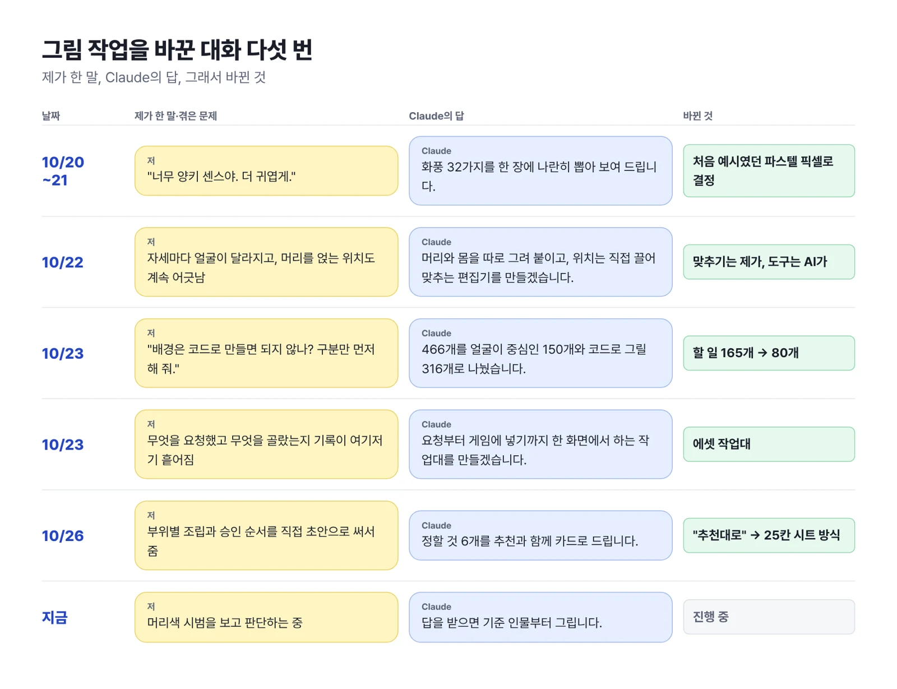
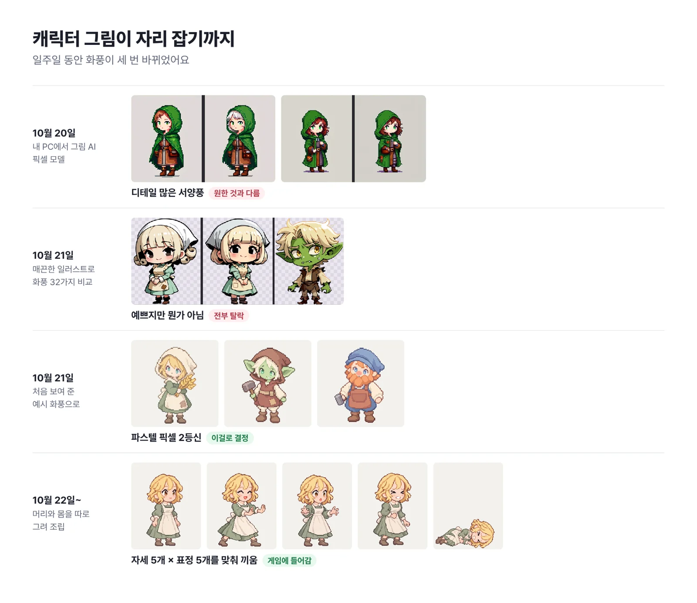
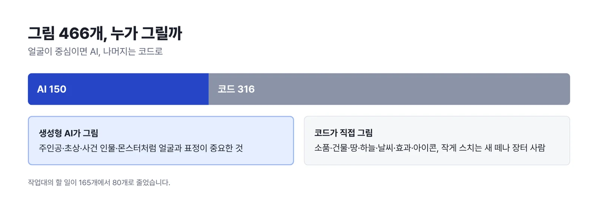
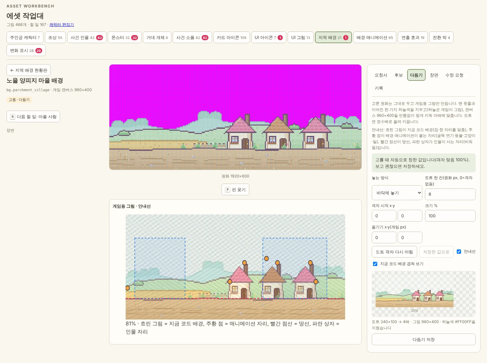
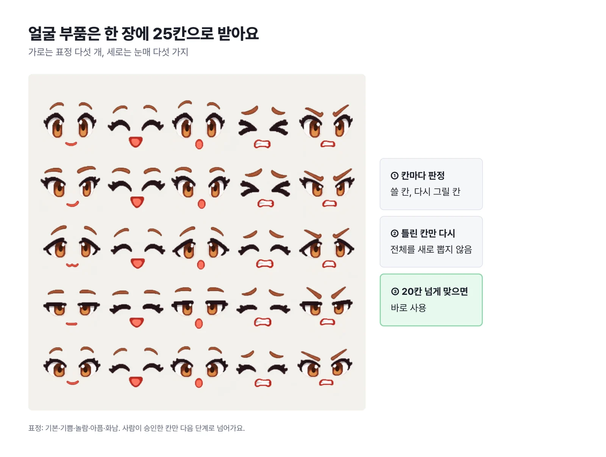

What drained me most while making a game with AI wasn't the code. Surprisingly, it was **the art**.

With code, an automatic check tells you pass or fail in one second. With art, I'm the human who has to squint with my own two eyes before I can sign off. On top of that, when one character strikes five poses, all five images have to keep the exact same face. I'm still wrestling with it, but here's how a week of back-and-forth with Claude ended with us setting up a dedicated workbench.

<figure><figcaption>The key conversations that changed the course of the art work over the past week.</figcaption></figure>

## "Too Western, make it cuter!"

The character I got on day one was classic Western fantasy, down to the detailed armor folds. I wanted a cute two-heads-tall character like in a Japanese indie game, but I had zero talent for putting that subtle vibe into words. All I could manage was **"too Western, make it cuter."**

So Claude generated 32 art styles on a single sheet. I laid them out in front of me and crossed them off one by one, only to realize that the "pastel pixel" I'd shown as an example on day one was still the best. When I'm not sure what I want, the answer isn't wrestling with words—it's spreading options side by side and picking with my eyes.

<figure><figcaption>A week of character makeovers. After going around in circles, we settled on the pastel pixel hero at the bottom.</figcaption></figure>

## Fine, I'll line up the neck myself

No sooner had we settled on a style than the next headache arrived. When I had it draw body and face in one go, the face turned into a subtly different person every time the pose changed.

So I tried a trick: **draw the "head" and the "body" separately, then snap them together like a kit.** Except now the AI couldn't get the coordinates right for placing the head on the body. In pixel art, being off by just two or three pixels gives you a giraffe neck or a hunched turtle neck.

After a few rounds of telling the AI to tweak the coordinates, I got fed up and changed tactics. **"I'll line up the position myself by eye—just build me an editor where I can drag it with a mouse."**

In the editor it built, I drag the head onto the body, hit save, and a clean composite pops out right away. **Do the parts a human eye does faster yourself, and have the AI build the tool that makes that job effortless.** That turned out to be the real nugget of collaboration advice.

## One question cut the workload in half

When I counted every image the game needed, there were **466**. Just as I was staring into the abyss of generating and reviewing all of them with AI, a thought hit me:

**"Wait, couldn't we just draw backgrounds and props in code instead of with AI? Don't draw anything yet—just sort them first."**

Because I hit the brakes and said "sort first" instead of charging ahead, Claude came back with a crystal-clear rule: **"If a living creature's face and expression are the point, draw it with AI. Draw everything else—backgrounds and geometric elements—in code."**

That single rule cut the images we had to generate with AI from 466 down to 150, and the backlog piled up on the workbench was halved too, from 165 to 80.

<figure><figcaption>Only characters that live and die by their expressions go to the AI. The other 316 are drawn cleanly in code.</figcaption></figure>

## All the scattered images, on one workbench screen

Once the generated images swelled into the hundreds, the records of which prompt I'd used, which candidate I picked, and why I'd rejected one got scattered everywhere and became impossible to track.

So I had Claude build a whole web screen—the **"asset workbench."** Each image gets its own folder, and it's a one-stop command center for everything: writing the order sheet, picking a candidate, even testing it composited onto the real game screen.

Now in the browser I pick the candidate I like with number keys, drop it over a real game background, and stick a pin with the mouse on anything that looks off, leaving a note like **"six fingers here."** The next AI on the job reads those pin notes first, then starts fixing.

<figure><figcaption>The asset workbench we built. Ground height and the spot where the character stands show as overlaid guidelines, so I can tell at a glance whether it looks off in the game.</figcaption></figure>

## I throw out the big picture, the AI sorts the details

On October 26, I wrote up an idea and handed it over first. My draft said: "What if we draw character parts split by body area, and move on only after I approve each step?" Claude analyzed the draft and came back with six detailed decisions laid out as cards with recommendations, and I coolly approved with **"go with your recommendations."**

The result is the **25-cell expression sheet** below. Instead of drawing eye and mouth parts one by one, it draws five expressions and five eye shapes all at once on a single checkerboard sheet. Drawing them together keeps the style of all 25 parts from wobbling. Looking at the board, I just point at the cells that came out weird and have them redrawn, and once 20 or more cells pass, it goes straight into production.

<figure><figcaption>The 25-cell parts sheet review screen. I stamp pass or fail on each cell, and only the failed cells get a retake.</figcaption></figure>

## A wrestling match that's still ongoing

Right now I'm looking into an experiment where we keep one basic hairstyle and just dye it with code (changing the color). Mushy hands still have to be caught one by one by my eagle eye, and the non-human races haven't even been touched yet.

Still, the early days of staring blankly and thinking "where did that handsome guy from yesterday go, and who's this stranger?" are now ancient history. Soon I'll bring you the story of the first finished character coming out of this workbench.

## Three-line summary

1. When you can't put the look you want into words, have the AI generate several styles side by side on one sheet and choose with your eyes.
2. Don't force the AI to do fine position alignment, which it's terrible at. Have it build an editing tool that lets you line things up in one second with a mouse.
3. Before telling it to draw everything blindly, one question—"first sort out what to draw in code and what to draw with AI"—cut the workload in half.
