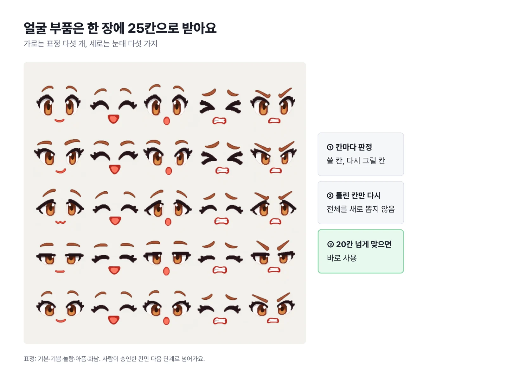

What drained me most while making a game with AI wasn't the code. Surprisingly, it was **the art**.

With code, an automated check tells you pass or fail in one second. With art, a human—meaning me—has to squint at every sprite before signing off. Worse, when one character strikes five poses, all five have to share the exact same face. We're still wrestling with it, honestly, but here's how a week of back-and-forth with Claude ended with us building a whole workbench.

<figure><figcaption>The key conversations that changed the course of the art work over the past week.</figcaption></figure>

## "Too Western, make it cuter!"

Day one's character was classic Western fantasy, right down to the sculpted armor folds. I wanted a cute two-heads-tall indie-game look, except I had zero vocabulary for that vibe. All I managed was "too Western, make it cuter."

So Claude laid out 32 art styles on a single sheet. Crossing them off one by one made it obvious that the "pastel pixel" reference I'd shown at the very start was still the winner. When you're fuzzy on what you want, spreading options side by side beats arguing with prompts every time.

<figure><figcaption>A week of character makeovers. After going around in circles, we settled on the pastel pixel hero at the bottom.</figcaption></figure>

## Fine, I'll line up the neck myself

No sooner had we picked a style than the next headache arrived. Drawing the body and face together meant a subtly different stranger showed up every time the pose changed.

So I switched to a **kit approach—draw the head and body separately, then snap them together.** Except now the AI couldn't get the placement coordinates right. In pixel art, two or three pixels off turns a hero into a giraffe or gives them a hunched turtle neck.

After a few rounds of nagging it to nudge coordinates, I gave up and changed tactics:

"I'll line it up myself by eye—just build me an editor where I can drag it with a mouse."

In the editor it built, I drag the head onto the body, hit save, and a clean composite pops out. Letting human eyes handle what human eyes do fast, and having the AI build the tool for it, saves everyone's sanity.

## One question cut the workload in half

Counting every image the game needed gave me **466**. Just as I was staring into the abyss of generating and reviewing all of them, a thought hit me:

"Wait—couldn't we draw backgrounds and props in code instead of with AI? Don't draw anything yet. Just sort them first."

Hitting the brakes with "sort first" gave us a clean rule: AI draws living creatures whose face and expression matter; code draws backgrounds and geometric pieces.

That single rule dropped the AI sprite count from 466 to 150, and cut the workbench backlog in half too, from 165 to 80.

<figure><figcaption>Only characters that live and die by their expressions go to the AI. The other 316 are drawn cleanly in code.</figcaption></figure>

## All the scattered images, on one workbench screen

Once generated sprites swelled into the hundreds, tracking which prompt produced what, which candidate won, and why another got rejected became impossible.

So we built a dedicated web screen—the **asset workbench.** Every asset gets its own folder, and everything from writing the order sheet to picking candidates and previewing composites on real game backgrounds happens in one place.

Now I pick candidates in the browser with number keys, drop them over a game scene, and stick a pin with the mouse on anything weird, leaving a note like "six fingers here." The next AI on shift reads those pin notes first, then starts fixing.

<figure><figcaption>The asset workbench we built. Ground height and the spot where the character stands show as overlaid guidelines, so I can tell at a glance whether it looks off in the game.</figcaption></figure>

## I throw out the big picture, the AI sorts the details

On October 26, I handed over a rough idea: "What if we split character parts by body area and only move forward after I approve each step?" Claude broke that down into six decision cards with recommendations, and I happily signed off: "Go with your recommendations."

The result is the **25-cell expression sheet** below. Instead of generating eyes and mouths one by one, it draws five expressions and five eye shapes on one checkerboard sheet so the style doesn't wobble across 25 parts. I point at whichever cells look off for a retake, and once 20 or more pass, the sheet ships straight to the game.

<figure><figcaption>The 25-cell parts sheet review screen. I stamp pass or fail on each cell, and only the failed cells get a retake.</figcaption></figure>

## A wrestling match that's still ongoing

Right now I'm testing whether we can keep one base hairstyle and just recolor it in code. Mushy hands still need my eagle eye one by one, and non-human races haven't even been touched yet.

Still, the early days of staring blankly and wondering "where did yesterday's cute character go, and who's this guy?" are behind us. Next up, I'll share the story of the first finished character walking out of this workbench.

## Three-line summary

1. When you can't put the look you want into words, have the AI generate several styles side by side on one sheet and choose with your eyes.
2. Don't force the AI to do finicky alignment, which it's terrible at. Have it build an editing tool that lets you line things up in one second with a mouse.
3. Before telling it to draw everything blindly, one question—"sort out what to draw in code vs. AI first"—cut the workload in half.
