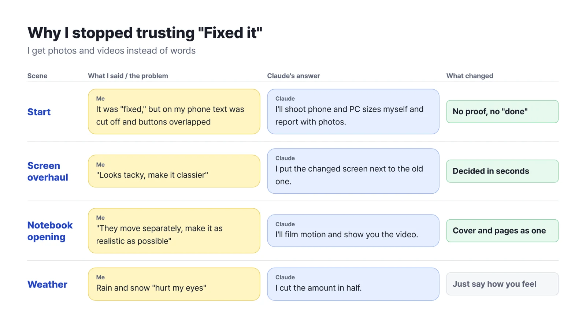
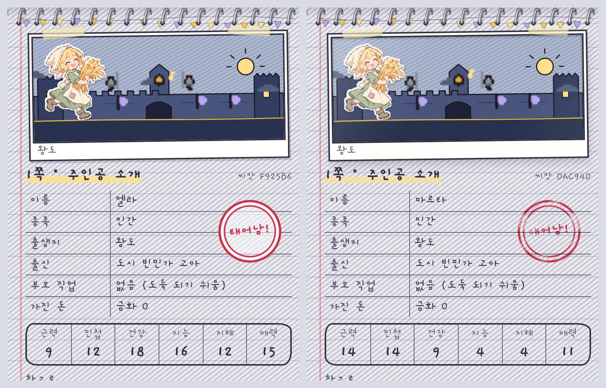

Early on, whenever Claude declared "I've cleaned up the screen!", I took its word for it. Then I'd open the page on my phone, full of hope, only to find half a sentence chopped off or two buttons sitting politely in each other's laps. No errors in the code meant the AI genuinely thought the job was done. Hard to blame it for not having eyes.

So I stopped accepting verbal completion reports. Any time a task touches the UI, the AI has to open a headless browser, capture the screen itself, and come back with photo or video proof.

<figure><figcaption>How the "no verbal done-reports" rule took shape across four conversations.</figcaption></figure>

## No photo, no "done"

The first rule was blunt: touch a screen, bring back one phone-sized screenshot and one PC-sized screenshot. No pair, no sign-off.

Layouts that look razor-sharp on a desktop monitor love to fall apart the instant they hit a narrow phone screen. Making both sizes a mandatory pair saved me from endless rounds of opening my phone and sending broken screens back.

There was an unexpected bonus, too. While taking those proof shots, Claude started **spotting its own broken layouts**, quietly fixing them, and only then turning in a clean image. Nothing cures overconfidence quite like having to look at a photo of your own work.

<figure><figcaption>The PC-size proof shot Claude captured and delivered. A phone-ratio capture always arrives with it.</figcaption></figure>

## Before and after, side by side

Once, after seeing a redesigned screen, I offered the deeply technical critique: "Ugh, this looks kind of lame. Make it sleeker."

Ever since, Claude stopped handing over the "after" shot by itself and began stitching Before and After into a single side-by-side image. Staring at a new screen in isolation makes it weirdly hard to tell whether it's actually better or just different. Put them next to each other, and you know in three seconds: "Yep, much better. Approved."

<figure><figcaption>The phone screen before (left) and after (right). Side by side, there's nothing to second-guess.</figcaption></figure>

## Anything that moves comes as a video

When I first added the opening animation where the notebook flips open, the cover and the pages drifted apart like total strangers. I told Claude they weren't moving together and asked it to feel like turning a real notebook—and from that day on, anything animated had to come back as an mp4 recording of the phone screen.

A hundred still frames won't tell you how an animation actually feels. Video also made giving feedback effortless. When a rain-and-snow weather clip arrived, I replied with three words—**"Hurts my eyes."**—and Claude immediately cut the raindrop count in half and sent a fresh clip. You don't need CSS properties or frame-rate math when you can point at a video and say what bothers your eyes.

(If you're curious how we stopped headless browser recordings from stuttering like a slideshow, I wrote up the frame-by-frame trick in [the post about making video one frame at a time](/en/2026/10/27/ai-clip/).)

## Three-line summary

1. For UI changes, require the AI to capture both phone and PC screenshots itself before saying "done"—it often catches its own bugs while shooting.
2. Have it stitch before and after side by side so you can approve or reject in three seconds.
3. Ask for video whenever motion is involved; plain gut-reaction feedback like "they're drifting apart" or "hurts my eyes" is all you need.
