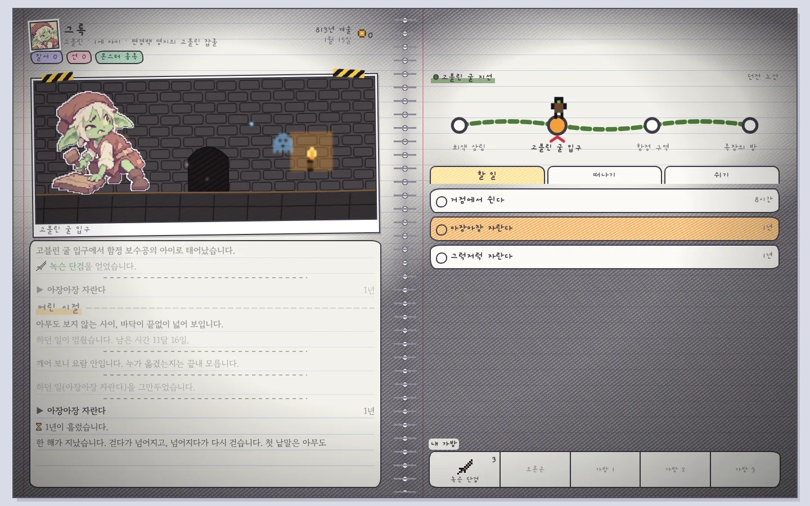

Early on, whenever Claude announced "I've cleaned up the screen!", I'd take its word for it. Then I'd open the page on my phone, all excited, only to find half a sentence chopped off or two buttons sitting in each other's laps. No errors in the code meant the AI genuinely thought it was done. Hard to blame it when it doesn't have eyes.

So I stopped taking "done" at face value. Any time a task touches the UI, the AI has to spin up a headless browser, take screenshots itself, and bring back photo or video proof.

<figure><figcaption>How the "no more done-reports in words only" rule came to be, as a conversation.</figcaption></figure>

## No photo, no "done"

The first rule was dead simple: if you touched a screen, bring a phone-sized capture and a PC-sized capture. No pair of screenshots, no sign-off.

Layouts that look crisp on a desktop monitor have a habit of collapsing the second they hit a narrow phone screen, so making the two sizes a mandatory combo saved me a lot of grief. Best side effect? Claude started **catching its own broken layouts while taking the screenshots**, quietly fixing them, and only then handing over a clean picture. Nothing cures overconfidence like having to look at your own work.

<figure><figcaption>The PC-size proof shot Claude took and handed over. A phone-ratio capture always comes paired with it.</figcaption></figure>

## Plastic-surgery style: before and after, side by side

At one point I looked at a redesigned screen and gave the deeply technical feedback: "Ugh, this looks kind of lame. Make it sleeker."

Ever since, Claude stopped dropping off the "after" shot by itself and started stitching Before and After into a single side-by-side image. When you stare at a new screen in isolation, it's surprisingly hard to tell if it's actually better or just different. Put them next to each other, and you can call it in three seconds: "Yep, way better. Ship it."

<figure><figcaption>The phone screen before (left) and after (right). Side by side, you don't even have to squint.</figcaption></figure>

## Anything that moves comes as a video

When I first added the opening animation where the notebook flips open, the cover and the pages moved like they weren't even in the same scene. I told Claude they were drifting apart and to make it feel like turning a real notebook—and from that day on, anything animated had to come back as an mp4 recording of the phone screen.

You can't judge timing or weight from a still frame, no matter how many screenshots you take. Video made feedback ridiculously effortless, too. When a rain-and-snow weather clip came back, I replied with three words—**"Hurts my eyes."**—and Claude immediately halved the raindrop count and sent a fresh clip. You don't need CSS jargon or frame-rate math when you can just point at a video and say what bothers your eyes.

(If you're wondering how we stopped those headless browser recordings from stuttering like a slideshow, I wrote up the time-freezing trick in [the post about making video one frame at a time](/en/2026/10/27/ai-clip/).)

## Three-line summary

1. For UI work, make the AI capture at phone and PC resolutions itself, and don't accept a verbal "done" without proof photos. (It catches its own bugs while shooting.)
2. Have it report every fixed screen with before and after side by side, and the sign-off takes three seconds.
3. For motion like animation, ask for a video—gut-reaction feedback like "they're drifting apart" or "hurts my eyes" is plenty, no jargon required.
