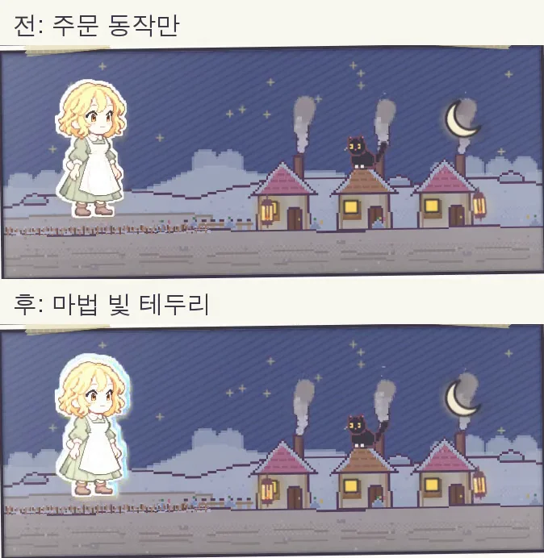
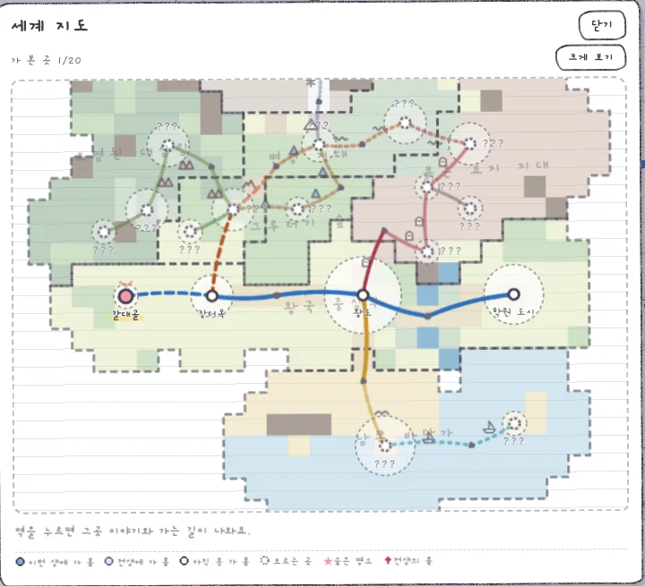

While surfing the web, I stumbled on a treasure trove of 700-some videos, with their prompts, of animations people had AI write in code ([reference sites](/en/2026/10/27/reference-sites/)).

The problem: with over 700 videos, I couldn't bring myself to play every one with my own eyes. So I coolly copied one link, tossed it to Claude, and said, **"pick out only the effects from these that we could use in our game."**

<figure><figcaption>The flow of conversation from tossing over one link to getting two game effects for free.</figcaption></figure>

## Out of 700, only 6 survived

My whole assignment was one line: "Skim that whole site and find anything that would suit our game UI or the blog."

Claude's report a bit later was crisp. Most of the 700 were flashy 3D graphics or shopping-mall product promos, which didn't fit the humble "Notebook RPG" feel. It also filtered out the techniques already in our game, and **brought back only the 6 real gems, each with a one-line summary of "why it fits" and "where it would go."**

At the very end of the report, as always, was a multiple-choice card asking "Which should we apply first?", and I picked the package Claude strongly recommended (**game effects 1 and 3 plus blog tool 4**). That's how these got adopted: a pencil-line effect that jitters as if hand-drawn, a mysterious glow (rim light) around the character's outline while casting a spell, and a technique for filming comparison videos smoothly with no stutter.

## Recording kept stuttering, so I stopped time

Once new effects were in, I'm not satisfied until I compare before and after in a video. But when I just recorded the virtual browser screen in real time, frames dropped in chunks whenever the computer lagged, and I couldn't tell what had changed.

So Claude pulled a clever trick and whipped up a neat recording tool. Instead of recording in real time, **it freezes browser time completely, manually ticks the clock forward 1/30 of a second at a time, takes a photo at each step, and stitches them into a video.**

With this method, the video came out silky smooth every single time, regardless of computer specs, and I could line up the before and after videos to the hundredth of a second for comparison.

<figure><video src="/assets/img/posts/ai-clip/board-compare.mp4" poster="/assets/img/posts/ai-clip/board-compare.jpg" controls muted playsinline preload="none"></video><figcaption>Comparison video of the travel route board. Top is before, bottom is after. Look closely and the lines and circles in the bottom one jitter with an analog feel, as if redrawn 8 times a second.</figcaption></figure>

## The white sticker border swallowed the magic glow

The second effect I added was a blue glow around the edge of the character's body while casting magic. But when I applied it and filmed a video, I couldn't see any glow no matter how hard I looked.

It turned out that our game characters have a thick white border around the edge like scrapbook stickers, and the magic glow was sitting inside that white border, completely swallowed by the white. Only after Claude zoomed in on a capture it had taken itself did we catch the culprit. Once we moved the glow to the outer edge of the sticker, a lovely sky-blue light finally sparkled during the 0.7 seconds of chanting.

<figure><figcaption>The moment the magic glow swells brightest. In the fixed version at the bottom, a sky-blue light clearly runs along the character's head and shoulder line.</figcaption></figure>

<figure><video src="/assets/img/posts/ai-clip/rim-compare.mp4" poster="/assets/img/posts/ai-clip/rim-compare.jpg" controls muted playsinline preload="none"></video><figcaption>The actual screen when casting a spell twice in a row.</figcaption></figure>

## No matter how pretty, if it's heavy, it's out

I liked the jittering pencil-line effect so much that I tried applying it to the big "world map" too.

But redrawing a huge picture that covers the entire screen 8 times a second made the whole screen noticeably sluggish. Claude measured the performance and suggested, **"On the world map, let's keep only the hand-drawn feel of being traced over twice in pencil, and drop the live jitter animation."**

In the end, I kept the jittery effect only on the small travel route board and boldly removed it from the big map. I also made sure the small route board stays still for users who've turned on "reduce motion" in their device settings.

<figure><figcaption>The world map screen. It keeps the analog line feel of being traced twice in pencil, but the jitter was dropped to lighten the load on devices.</figcaption></figure>

## Three-line summary

1. For a reference collection too huge to go through alone, just toss over the link and tell the AI "pick out only what suits our project."
2. The director only picks from multiple-choice cards with the reasons attached, and checks the results with before-and-after videos lined up frame-for-frame.
3. However pretty an effect is, it's safer to have the AI measure performance too and trim it when the screen slows down.
