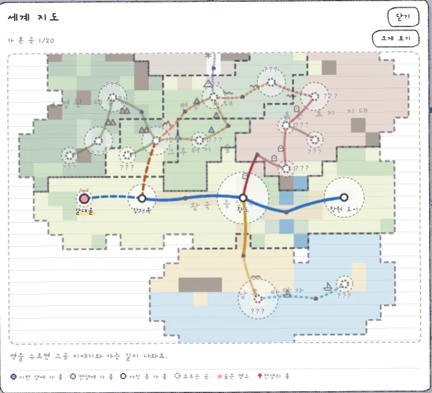

While poking around online, I stumbled onto a goldmine: a collection of over 700 AI-coded animation clips, each complete with its prompt ([reference sites](/en/2026/10/27/reference-sites/)).

One tiny catch—there were 700 of them, and my scroll wheel wasn't surviving that marathon. So I copied the URL, tossed it to Claude, and asked it to fish out whatever would actually look good in our game.

<figure><figcaption>The flow of conversation from tossing over one link to getting two game effects for free.</figcaption></figure>

## Out of 700, only 6 survived

The whole brief was one sentence: "Skim that site and see if anything fits our game UI or the blog."

Claude came back with a surprisingly sharp filter. Most of the 700 were flashy 3D showpieces or e-commerce product promos—way too loud for a cozy "Notebook RPG." It also weeded out tricks we'd already built, leaving **just 6 real contenders, each tagged with why it fits and where it'd live**.

At the bottom sat the usual multiple-choice card asking which to build first. I went with Claude's recommended bundle (game effects 1 and 3, plus blog tool 4): a jittering, hand-drawn pencil line; a faint rim-light glow around characters when they cast a spell; and a stutter-free way to record comparison clips.

## Recording kept stuttering, so I stopped time

Whenever a new effect goes in, I want a side-by-side video of before and after. Trouble is, recording a headless browser in real time drops frames the moment your CPU blinks, turning subtle animations into a guessing game.

Claude's workaround was delightfully sneaky: stop the browser's internal clock completely, step time forward manually by 1/30th of a second, snap a screenshot, repeat, and stitch the frames into an mp4.

Now the output is silky smooth no matter how busy my machine is, and I can line up before-and-after clips down to a hundredth of a second.

<figure><video src="/assets/img/posts/ai-clip/board-compare.mp4" poster="/assets/img/posts/ai-clip/board-compare.jpg" controls muted playsinline preload="none"></video><figcaption>Comparison video of the travel route board. Top is before, bottom is after. Look closely and the lines and circles in the bottom one jitter with an analog feel, as if redrawn 8 times a second.</figcaption></figure>

## The white sticker border swallowed the magic glow

Next up was a blue rim-light around the character during spellcasting. I applied it, hit record, squinted at the playback—and saw nothing. Not even a pixel of blue.

The culprit turned out to be almost comical. Our characters have thick white borders around them, like die-cut stickers, and the glow was rendering *inside* that border, completely swallowed by the white. Only after Claude zoomed way in on its own screenshot did we spot what happened. Moving the glow to the outer edge of the sticker finally let a crisp sky-blue outline shimmer for the 0.7 seconds of chanting.

<figure><figcaption>The moment the magic glow swells brightest. In the fixed version at the bottom, a sky-blue light clearly runs along the character's head and shoulder line.</figcaption></figure>

<figure><video src="/assets/img/posts/ai-clip/rim-compare.mp4" poster="/assets/img/posts/ai-clip/rim-compare.jpg" controls muted playsinline preload="none"></video><figcaption>The actual screen when casting a spell twice in a row.</figcaption></figure>

## No matter how pretty, if it's heavy, it's out

I liked the jittering pencil line enough that I tried slapping it onto the full-screen world map too.

Big mistake—or at least a heavy one. Redrawing a giant map eight times a second made the whole screen noticeably sluggish. Claude benchmarked it and gently suggested keeping the double-traced pencil look on the map while dropping the live jitter.

So the wobble stayed on the compact route board and got cut from the world map, with a "reduce motion" check on top so anyone with motion sensitivity gets a still route board as well.

<figure><figcaption>The world map screen. It keeps the analog line feel of being traced twice in pencil, but the jitter was dropped to lighten the load on devices.</figcaption></figure>

## Three-line summary

1. For a reference collection too huge to go through alone, just toss over the link and tell the AI, "Pick out only what fits our project."
2. You just pick from multiple-choice cards with reasons attached, and verify the results with frame-aligned before-and-after videos.
3. No matter how pretty an effect is, have the AI benchmark performance too and cut it without hesitation if it drags the screen down.
