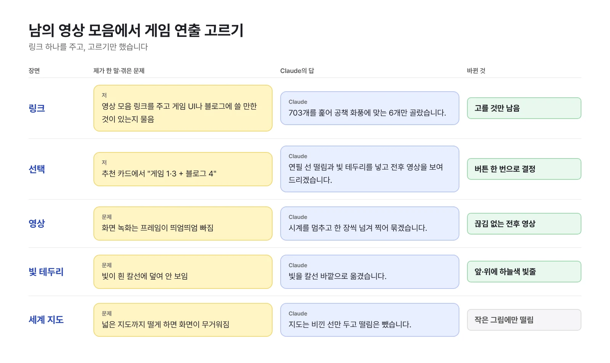
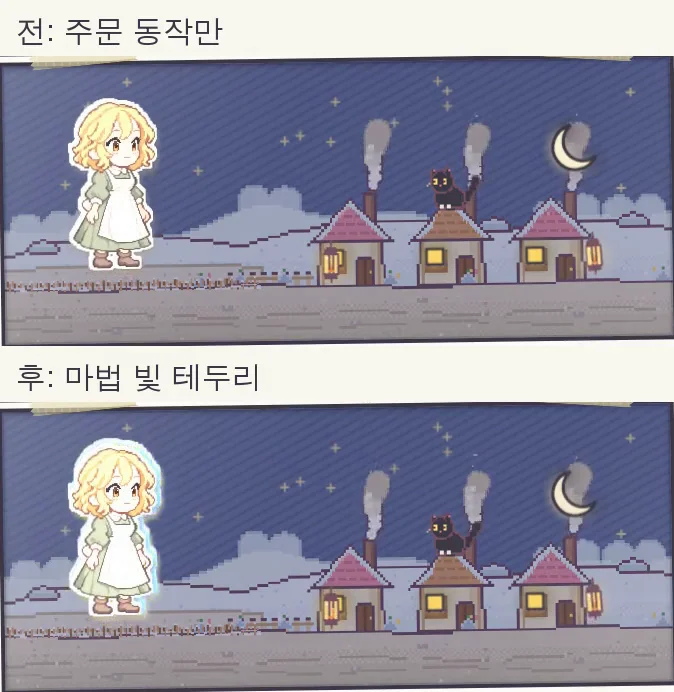

While browsing online, I stumbled onto a treasure chest: a site collecting over 700 AI-coded animation clips, each paired with its prompt ([reference sites](/en/2026/10/27/reference-sites/)).

The thrill lasted about five seconds, until the math kicked in. Seven hundred clips—my scroll wheel wasn't surviving that marathon. So I copied the URL, tossed it to Claude, and asked it to fish out whatever would actually belong in our game.

<figure><figcaption>From dropping a single link to landing two new game effects.</figcaption></figure>

## Out of 700, only 6 survived

The whole brief was one line: "Skim that site and see if anything fits our game UI or the blog."

Claude came back with a sharp filter. Most of the 700 were flashy 3D showpieces or e-commerce product promos—way too loud for a cozy, hand-drawn "Notebook RPG." It also weeded out tricks we'd already built, leaving **just 6 real contenders, each tagged with why it fits and where it would live**.

At the bottom sat the usual multiple-choice card asking which to build first. I picked Claude's recommended bundle (game effects 1 and 3, plus blog tool 4): a jittering, hand-drawn pencil line; a rim-light glow around characters while casting spells; and a stutter-free way to record comparison clips.

## Recording kept stuttering, so we stopped time

Whenever a new effect goes in, I want a side-by-side before-and-after video. Trouble is, recording a headless browser in real time drops frames the moment your CPU hiccups, turning subtle animations into a guessing game—was that the effect, or just lag?

Claude's workaround was delightfully sneaky: freeze the browser's internal clock, advance time manually by 1/30th of a second, snap a frame, repeat, and stitch the stills into a video.

Now every clip comes out smooth no matter how busy my machine is, and before-and-after videos line up down to 0.01 seconds.

<figure><video src="/assets/img/posts/ai-clip/board-compare.mp4" poster="/assets/img/posts/ai-clip/board-compare.jpg" controls muted playsinline preload="none"></video><figcaption>Comparison video of the travel route board. Top is before, bottom is after. Look closely and the lines and circles below jitter subtly, as if redrawn 8 times a second in pencil.</figcaption></figure>

## The white sticker border swallowed the magic glow

Next came the blue rim-light around the character during spellcasting. I added it, hit record, watched the playback—and saw nothing. Not a trace of blue anywhere.

The culprit turned out to be almost comical. Our characters wear thick white borders like paper stickers, and the magic glow was rendering *inside* that border, completely drowned out by the white. Only after Claude zoomed in on its own screenshot did we spot what had happened. Moving the glow to the outer edge of the sticker finally let a crisp sky-blue outline shimmer through the 0.7 seconds of chanting.

<figure><figcaption>The peak of the spellcasting glow. In the fixed version at the bottom, sky-blue light traces the character's head and shoulders cleanly.</figcaption></figure>

<figure><video src="/assets/img/posts/ai-clip/rim-compare.mp4" poster="/assets/img/posts/ai-clip/rim-compare.jpg" controls muted playsinline preload="none"></video><figcaption>The live screen when casting two spells back to back.</figcaption></figure>

## No matter how pretty, if it's heavy, it's out

I liked the jittering pencil line so much that I tried slapping it onto the full-screen world map too.

I got greedy. Redrawing a giant map eight times a second made the whole screen noticeably sluggish. Claude benchmarked it and drew the line: keep the double-traced pencil look on the world map, drop the live wobble.

So the jitter stayed on the compact route board and got cut from the world map—with a "reduce motion" check on top so anyone who prefers less motion gets a calm, still route board as well.

<figure><figcaption>The world map screen. It keeps the double-traced pencil texture while dropping the jitter to stay light on devices.</figcaption></figure>

## Three-line summary

1. When a reference gallery is too big to sift through yourself, pass the link to AI and ask it to shortlist only what fits your project's vibe.
2. Let the human pick from short option cards with reasons attached, then review the results with frame-aligned before-and-after videos.
3. Have AI benchmark performance alongside visual polish—if a pretty effect slows the screen down, cut it without hesitation.
