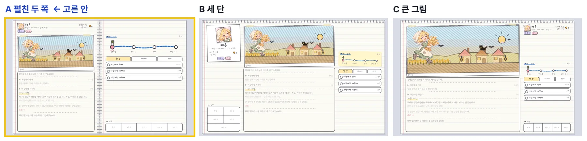

About 80% of what I type into my AI chat window all day looks roughly like this:

**"Hmm, let's go with B."**

I can't read code, and I can't write it. Getting a playable-looking game together in a week came down to one strict division of labor: at every major fork in the road, I point the way, and the AI paves it.

<figure><figcaption>Four turning points where I dropped long explanations and switched to picking from options.</figcaption></figure>

## Explaining in words got me nowhere

At first, I tried to describe the PC screen layout straight out of my head—"put this here, widen that a bit..." After several rounds of revisions that still missed the mark, I realized the bottleneck wasn't the AI. It was me. I didn't actually know what I wanted yet, and I was tossing vague wishes into the chat.

So I flipped the script: **"Build three working mockups that feel genuinely different from each other, and put them side by side."** Ten seconds after seeing them, I pointed at option A and said, "That's the one."

<figure><figcaption>Three PC layout mockups side by side. Option A—the open two-page notebook spread—won on the spot.</figcaption></figure>

The magic words here are **"genuinely different from each other."** Skip those, and the AI plays it safe and hands back three identical twins with slightly different button colors.

## Don't grab the shovel on big jobs

While playtesting, a pacing issue surfaced: random events were firing so often that the game felt sluggish. Normally I would have blurted out "make fewer events," but this time I tapped the brakes.

**"Don't touch the code yet. Brainstorm ways to fix this first, and look up how similar games handle it."**

Claude came back with seven ideas neatly grouped into three strategies, complete with its top recommendation. I greenlit that pick and told it to build in stages with check-ins rather than rewriting everything in one go. That's way faster—and far less painful—than launching a huge overhaul only to scrap it all at the end.

## Bundle questions like approval paperwork

I also set ground rules for how the AI asks me questions:

- Narrow each question to two or three options
- Give a one-line summary of the pros and cons for each
- Always flag the AI's own top recommendation

On top of that, if there are several questions, don't drip-feed them one at a time—stack them up like approval forms and send them in one batch. And if I step away from my desk, the AI is free to move ahead with its top pick as long as the change is easy to undo.

When questions trickled in one by one, I was chained to my monitor all day. Now I can run errands, come back, skim a few decision cards, say "approved," and keep moving.

<figure><figcaption>The finished PC home screen built from option A. The open-notebook feel really landed.</figcaption></figure>

## What the human has to keep hold of

After a week of trial and error, the line between my job and the AI's job became unmistakable.

I keep a firm hand on the game's overall feel, picking the winning mockup, and **anything painful to undo**—like changing deployment settings or bulk-deleting data. Everything else—building mockups, running reversible experiments, hunting down technical bugs—goes to the AI. My only job is deciding whether the result feels right.

Every now and then I ignore the AI's recommendation and pick a different option. Honestly, those overrides are where my real taste as a director shows up. Whenever I do that, I add one line: **"Jot down in your notes why I picked this instead of your recommendation."** Next time a similar call comes up, the AI's top pick lands right in my lane. I wrote more about training its memory in [the memory post](/en/2026/10/27/ai-memory/).

## Three-line summary

1. When you can't put a look or layout into words, ask for three genuinely different working mockups side by side and choose with your eyes.
2. On big changes, hold off on coding: brainstorm first, narrow the options, and build in stages.
3. Have AI batch its questions into multiple-choice cards with recommendations, and log the reason whenever you override its pick.
