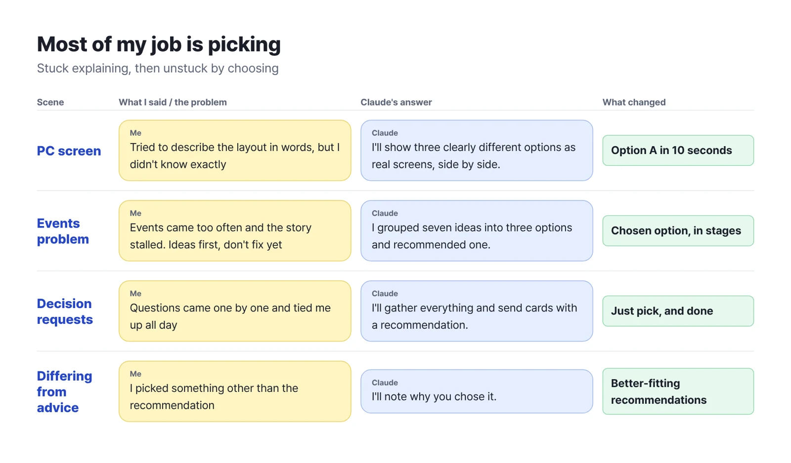
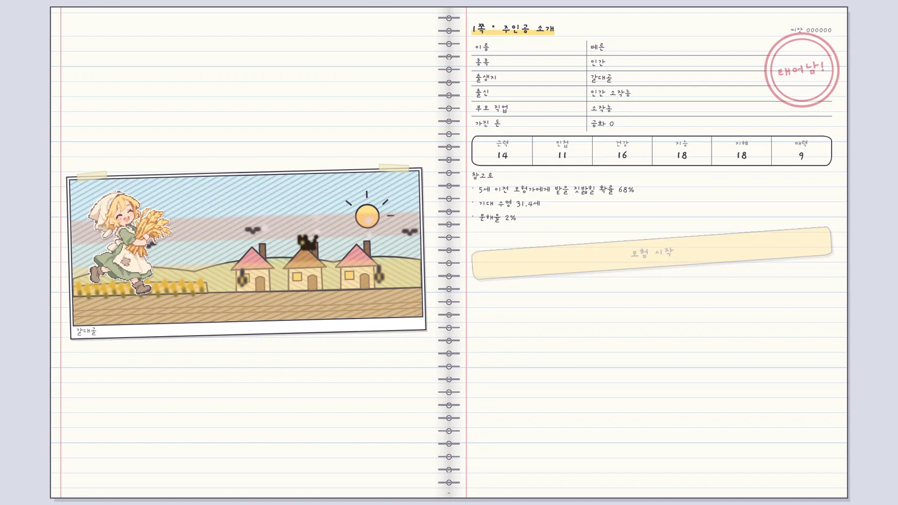

I can't read code, and I can't write it. Yet I managed to pull a decent-looking game together in a week, all thanks to a strict division of labor.

The rule is simple. At every major fork in the road, I point the way, and the AI paves the road. In fact, about 80% of what I type into the chat window all day is something like **"Hmm, let's go with B."**

<figure><figcaption>The turning points where I gave up on long-winded explanations and switched to multiple-choice picking.</figcaption></figure>

## I nearly lost my mind explaining it in words

At first, I tried to describe the PC layout straight from my head. "Put this here, move that there..." I sent the AI back to redo it several times, and the results were still off. Looking back, the culprit wasn't the AI—it was me. I didn't really know what I wanted yet, and I was just reciting vague wishes.

So I changed tactics. I said, **"Build three working mockups that feel genuinely different from each other, and put them side by side."** And, like magic, ten seconds after seeing them, I said, "That's the one!" and picked option A.

<figure><figcaption>The three PC screen mockups, side by side. The moment I saw them, I fell for option A (the open notebook spread) with no second thoughts.</figcaption></figure>

The key phrase here is **"genuinely different from each other."** Leave that out, and the AI gets cute and brings back three identical twins with only the button color tweaked.

## Don't break out the shovel for big jobs

While playtesting, a problem popped up: "random events trigger too often and the pacing drags." Normally I would have blurted out "make fewer events" right away, but this time I hit the brakes.

**"Don't touch the code yet. Brainstorm ways to fix this first, and look up how similar games handle it."**

Claude came back with seven ideas neatly grouped into three strategies, and even flagged its top pick. I greenlit that one, then told it to build in stages with check-ins along the way instead of rewriting everything in one shot. That's way faster and safer than kicking off a massive overhaul, hating it, and scrapping the whole thing.

## Questions come like approval paperwork, all at once

I also set rules for how the AI asks me questions.

- Narrow each question down to two or three options
- Summarize the pros and cons of each option in one line
- Always mark the AI's own top pick (recommendation)

And if there are multiple questions, don't drip-feed them one by one—bundle them up like a stack of forms for sign-off. Even if I step away and reply late, the AI is free to go ahead with its top pick as long as the work is easy to undo.

Back when questions trickled in one at a time, I was chained to my monitor all day. Now I can run errands, come back, skim a few decision cards, hit "approve," and call it a day.

<figure><figcaption>The final screen, after polishing option A. Pretty decent, right?</figcaption></figure>

## What this human has to keep a grip on

After a week of trial and error, the line between what I decide and what I delegate became crystal clear.

I always keep a firm grip on the game's overall tone and feel, picking the winning mockup, and **anything painful to undo** (like changing deployment settings or bulk-deleting data). Everything else—churning out mockups, running reversible experiments, and checking for technical bugs—goes straight to the AI. All I have to do is decide if the result feels right.

Sometimes I ignore the AI's top pick and stubbornly choose another option. Honestly, that's when my real taste as the director comes through. Whenever I do that, I tack on one line: **"Jot down in your notes why I picked this over your recommendation."** Sure enough, the next time a similar choice comes up, the AI's recommendation is right in line with my taste. I covered this memory-training method in more detail in [the memory post](/en/2026/10/27/ai-memory/).

## Three-line summary

1. When it's hard to put a vibe into words, tell the AI to "build three clearly different mockups as real screens, side by side," and just pick one.
2. For big jobs, don't jump straight into code. Keep the reins tight: brainstorm ideas, narrow the options, and build in stages.
3. Have the AI bundle its questions into multiple-choice cards with recommendations, and make it note down the reason whenever your taste overrides its pick.
