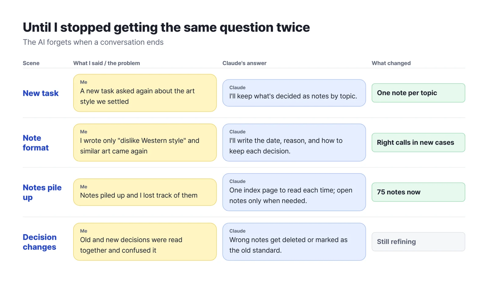
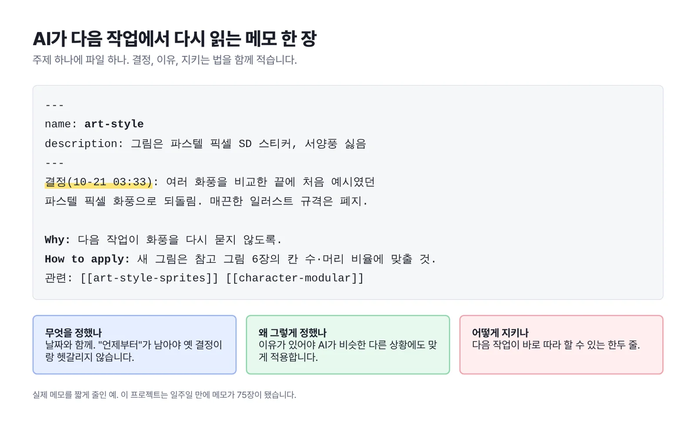

Imagine working with a teammate who walks in every morning, forgets everything from yesterday's handover, and cheerfully asks, "So, what team are we on again?" That was the very first burnout I hit while working with AI: **repeating myself.**

Yesterday I spent hours wrestling with the character art style until we finally locked it in. Today I open a new session, and the slate is wiped clean—it asks everything from scratch. That is just how Claude Code works: close the chat, and its memory resets to zero.

<figure><figcaption>Four conversations that turned repeated questions into a working handover system.</figcaption></figure>

## Making it write handover notes before clocking out

Before I ran out of patience, I started having the AI leave **"handover notes"** whenever we made an important call. One memo file per topic—art direction, data storage, battle rules, blog writing—paired with a rule that every new session has to read them before touching anything.

Claude Code gives you two main places to store memory: a rules file a human writes by hand like a constitution (`CLAUDE.md`), and a memo folder the AI manages itself. I split their jobs cleanly. **"Non-negotiable rules for all future work"** go into the rules file, while running history—**"what we decided, when, and why"**—goes into the memo folder.

## "Western style: no" wasn't nearly enough

Even with handover notes in place, the same misfires kept popping up for a while. I opened the memo to see what went wrong, and all it said was **"Western style: no."** It logged what I hated, skipped what I actually wanted and why, and left the AI with nothing to extrapolate from.

From then on, every memo had to include **three things as a set:**

1. **What was decided (with the date)**
2. **Why (the reasoning and taste behind it)**
3. **How to apply it next time (concrete action guideline)**

<figure><figcaption>A condensed example of an actual memo file. Decision, reasoning, and action guideline always travel together.</figcaption></figure>

Once it began recording the *why*—such as "aiming for a Japanese indie-game feel with big heads and round eyes"—it started hitting my taste even on brand-new tasks.

The **date** mattered far more than I expected. Our art style changed three times in a single week; without dates, the AI couldn't tell which note was current and ended up arguing with ghosts of past decisions.

## At 75 memos, we needed a table of contents

Once the memos crept past 70, a new snag hit: reading every single note at the start of every session started chewing through time and tokens.

So I put a **"one-line index file"** right at the front, like a library card catalog. At the start of a session, the AI skims that lightweight index and opens only the memos relevant to today's work. We're up to 75 memos now, yet token use stays light and repeat questions have practically disappeared.

## Side effects I'm still ironing out

It wasn't smooth from day one. The trickiest bug was the **"edited memo."** Whenever a decision changed, the AI would append the new rule right underneath the old one. The next session would read both and pick whichever line it felt like—turning handover notes into a coin flip.

Now, when a call changes, I have it delete the old line outright—or, if the history needs to stay, stamp it boldly with `[Retired old standard]`. I also added a rule to search the index before creating a new memo so duplicate files on the same topic don't quietly multiply.

## Three-line summary

1. For an AI that wipes its memory between chats, have it write per-topic handover notes and skim an index at the start of each session.
2. Don't just log the conclusion—bundle the date, the reasoning, and the next action together so the AI can actually generalize from it.
3. When a decision reverses, never just tack the new rule onto the bottom; delete the old line or mark it unmistakably as retired.
