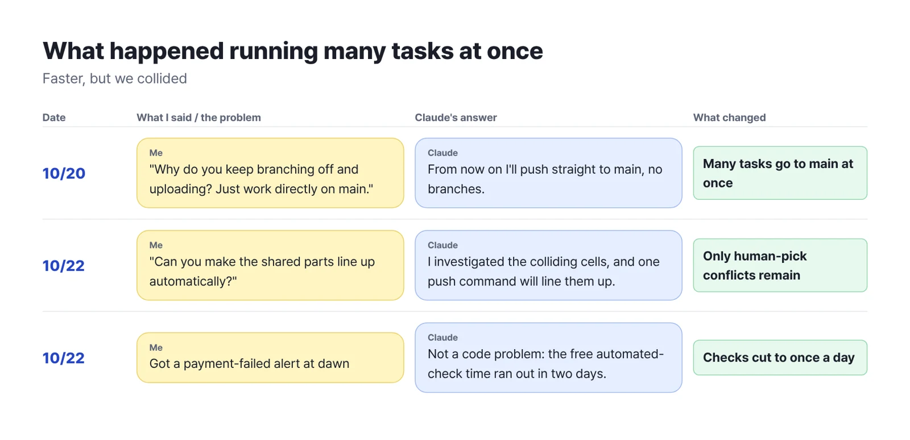
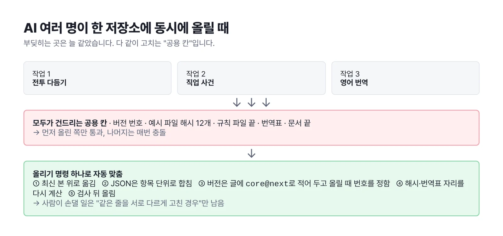

I'm not the most patient person, so when building this game I keep several Claude windows open and run them in parallel. Window 1 tunes battle balance, Window 2 writes class events, Window 3 handles the English translation, and so on.

Progress was dazzlingly fast compared to going one task at a time, but you know what they say about too many cooks. The moment multiple AIs started sharing one codebase, all sorts of bizarre collisions broke out.

<figure><figcaption>Three crises I went through running the multi-job setup, and how they got solved.</figcaption></figure>

## "Too much hassle, just push straight to main!" (the calm before the storm)

At first, Claude did things by the book: for every job it made a separate branch and asked me for permission to merge it (a PR). But this is a solo project anyway, and clicking a confirm button every time was a chore.

So on October 20, I laid down the law: **"Why do you keep making branches? It's a hassle—just push straight to `main`!"** I thought I was opening up a nice expressway. I didn't see the multi-car pile-up waiting just ahead.

## They had totally different jobs, so why were they at each other's throats?

As soon as everything started going straight to `main`, merge-conflict alarms went off everywhere. One AI was tweaking battles and another was updating translations—how on earth were they colliding?

The culprit was **the shared spots everyone had to touch**. The content version number, the file integrity hash, the translation index, the bottom line of the patch notes—no matter the task, every AI had to stamp those exact same files on the way out. After two days of playing traffic cop, I hit my limit and asked: **"Can't we make these shared files merge themselves automatically on push?"**

<figure><figcaption>The accident-prone zones were always the same: the shared cells where everyone stamps their seal on the way out.</figcaption></figure>

Claude dug through the recent conflict records, put the repeat-offender zones in a table, and set up two traffic rules.

1. **Values you can calculate mechanically**, like version numbers or file hashes, aren't touched mid-task. They get computed and stamped at the very last second, right at upload time.
2. For files like docs or translation tables where **both sides simply appended lines at the end**, don't fight over them—keep both lines and stitch them together cleanly.

I wrapped those two rules into a dedicated "upload command" and pinned a line to the very top of our shared constitution (`CLAUDE.md`): **"Always use this command to push code."** Now it only stops for my ruling in the rare case where two AIs rewrote the exact same line differently. Every minor fender-bender resolves itself.

## The mysterious "payment failed" message at dawn

Just when I thought peace had finally arrived, at dawn on October 22, GitHub hit me with a **"payment failed"** alert. I woke up with my heart in my throat, assuming the codebase had exploded. I sent Claude to investigate, and the culprit was somewhere I never would have guessed.

We had **burned through GitHub's entire 2,000-minute monthly free CI allowance for private repos—in just two days**.

<figure><figcaption>The math is honest. Every upload evaporates 50 minutes, so just 40 uploads turn the monthly free coupon to dust.</figcaption></figure>

When I ran the numbers, my jaw dropped. Every single push triggered a 25-minute full test suite across two environments (50 minutes total). With multiple AIs unleashed and pushing dozens of times a day, a whole month's quota vanished in 48 hours.

I scrambled to dial the heavy server-side CI back to once a day, and had each AI run the checks locally on my machine before pushing instead. If I had multiplied **"pushes × minutes per run"** just once before flipping on automation, I could have skipped that heart-stopping wake-up call.

## Three-line summary

1. Even when multiple AIs work on completely different tasks, they'll still collide at shared bottlenecks like version numbers and index files.
2. Have the AI audit your repeat-conflict zones and wrap an auto-merge routine into a single dedicated upload command.
3. Before giving eager AIs unlimited push access, do the multiplication first so you don't melt through your free cloud CI minutes.
