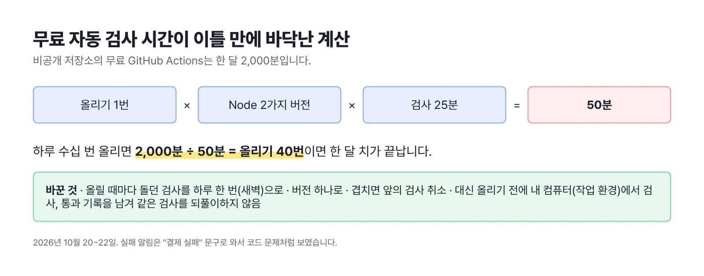

I am not a patient person, so while building this game I keep several Claude windows open at the same time. Window 1 tunes battle balance, Window 2 writes class events, Window 3 handles the English translation, and so on.

Compared to working sequentially, the pace was intoxicating. Put multiple AIs in the same codebase, though, and you quickly discover a brand-new category of problems.

<figure><figcaption>Three crises from running Claude sessions in parallel, and how each one was resolved.</figcaption></figure>

## "Too much hassle—just push straight to `main`"

At first, Claude behaved like a textbook engineer: one fresh branch per task, followed by a pull request waiting for my click. On a solo project, approving my own bots twenty times a day got old fast.

On October 20, I had enough. **"Why do you keep making branches? It's a hassle—just push straight to `main`."** I thought I was building a nice expressway. What I actually built was an expressway with no lanes.

## Different tasks, same fender-bender

The moment every session started pushing straight to `main`, merge-conflict warnings began firing from every direction. One AI was editing combat math and another was updating translations—how were they even in the same file?

The culprit was **the shared doorway everyone had to pass through on the way out**: the content version number, the file integrity hash, the translation index, the last line of the patch notes. No matter what a session actually worked on, it had to stamp those exact same lines before finishing. After two days of playing traffic cop, I asked Claude: **"Can't we make these shared files merge themselves on push?"**

<figure><figcaption>The accident zones never changed: the shared files every task had to stamp at the end.</figcaption></figure>

Claude audited our recent conflicts, listed the repeat offenders in a table, and wrote two traffic rules:

1. **Anything that can be computed mechanically**—version numbers, file hashes—stays untouched during the task and gets calculated at the last second on upload.
2. **Append-only files** like docs and translation tables, where both sides just added new lines at the bottom, keep both additions and stitch them together instead of fighting.

We wrapped both rules into a single dedicated "upload command" and pinned a line to the very top of `CLAUDE.md` (the project rules every session reads first): **"Always use this command to push code."** Now it only pauses for my judgment in the rare case where two sessions rewrite the exact same sentence differently. Every minor scrape sorts itself out.

## The dawn "payment failed" alert

Just when things felt calm again, GitHub woke me up at dawn on October 22 with a **"payment failed"** notification. Half-asleep, I assumed the repository had caught fire. I sent Claude to look into it, and the real cause was much simpler—and slightly embarrassing.

We had **burned through GitHub's entire 2,000-minute monthly free CI quota for private repos in two days**.

<figure><figcaption>The arithmetic doesn't lie: 50 minutes per push means 40 pushes wipe out a whole month's free tier.</figcaption></figure>

Once I did the math, there was no mystery left. Every push kicked off a 25-minute full test suite across two environments—**50 minutes** per upload. Multiply that by several eager AIs pushing dozens of times a day, and 48 hours was all it took to zero out the meter.

I scaled the heavy server-side CI back to once a day and told each AI to run the checks locally on my machine before pushing instead. Multiplying **pushes × minutes per run** just once before turning on parallel pushes would have saved me a very rude awakening.

## Three-line summary

1. Even when parallel AI sessions work on unrelated features, they'll still pile up at shared bottlenecks like version numbers, hashes, and index files.
2. Have the AI audit your repeat-conflict files and fold an auto-merge routine into one dedicated upload command.
3. Before letting multiple AI sessions push freely, multiply `pushes × CI minutes per run`. A month of free cloud minutes disappears faster than you think.
