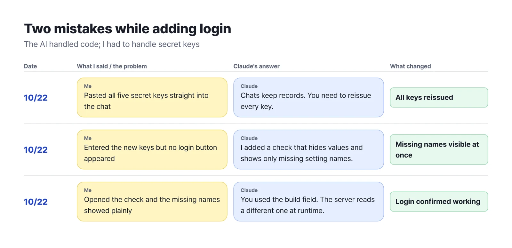
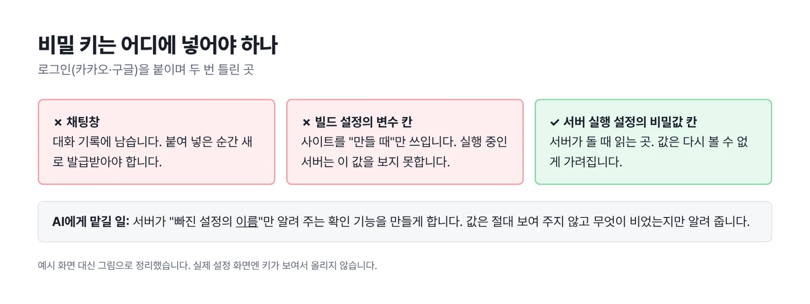

I decided to add Kakao and Google login to the game so players' records could be stored safely on the server.

Claude wrote all the complicated integration code on its own, but for security reasons, getting the **"secret keys"** issued and plugging them in was something only a human—me—could do. And sure enough, I managed to blow it twice in a row.

<figure><figcaption>A record of sweating over secret keys during one day, October 22.</figcaption></figure>

## Accident #1: I pasted five secret keys straight into the chat

I copied the five freshly minted secret keys from the Kakao and Google developer consoles and, without a second thought, pasted them straight into Claude's chat window. My innocent logic was: "I don't really know what I'm doing, so you put them where they belong."

Claude turned serious and issued a warning.

**"A secret key that has been typed into a chat window even once must be treated as already leaked. Discard all five right now and get new ones issued."**

Talk about a wake-up call. I rushed back to the developer consoles, revoked every key I had just created, and generated five brand-new ones. That day I set one iron rule: **never show the AI a secret key's value—only ask where the blank field lives.**

## Accident #2: I put them in, so why is there no login button?

I carefully pasted the brand-new keys into the server settings myself. Then I launched the game, and... no login button. Just staring at the screen gave me zero clues about what had gone sideways.

Seeing me stuck, Claude built a tiny **"self-diagnosis" feature** into the server. It never exposes any actual key values on screen—it just gives a safe yes/no readout of **"which named keys the server currently sees as missing."**

I opened the diagnostic page and, absurdly, all five keys I had just entered showed up as "missing."

The culprit was the confusing server admin UI. There were two sets of input fields stacked one above the other with nearly identical names. Instead of **the fields the live server reads at runtime (runtime variables)**, I had diligently typed my keys into **the fields used only while building the site (build variables)**. The moment I moved them to the right box, the login button popped right up.

<figure><figcaption>The proper resting place for secret keys. I used a drawing instead of capturing the real server screen, for fear of causing another accident.</figcaption></figure>

## What I learned by causing accidents

Managing secret keys is one job even the smartest AI can't take off your hands—it's 100% on the human. But **a diagnostic tool that pinpoints your mistake without ever exposing the keys** is something an AI can build in minutes. Without that "hide the values, just flag what's missing" check, I'd probably still be up all night typing and erasing keys in the wrong box.

While I was at it, I also asked Claude to lay out the safe way to rotate keys down the road. You have to cross it like stepping stones: **"add the new key first, verify it works, disable the old key, and only then delete it."** Delete the old key too early and everyone's login breaks mid-swap—definitely glad I asked ahead of time.

## Three-line summary

1. Never paste a secret key into an AI chat window. If you slip up even once, revoke it immediately and issue a new one.
2. Ask the AI where the key goes, never what it is—and when it fails, have it build a diagnostic that hides values and only flags missing names.
3. When rotating keys later, follow "add new, verify, disable old, delete" so login never goes dark mid-swap.
