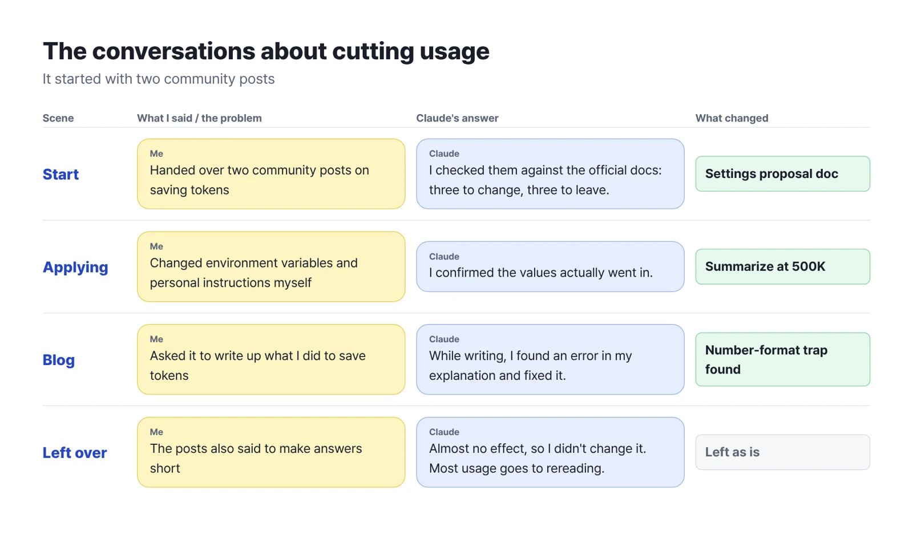
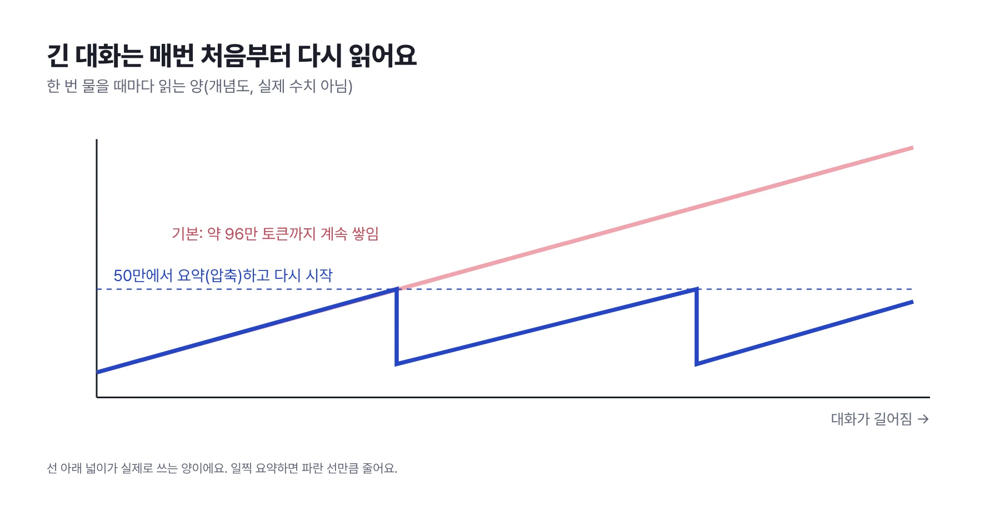
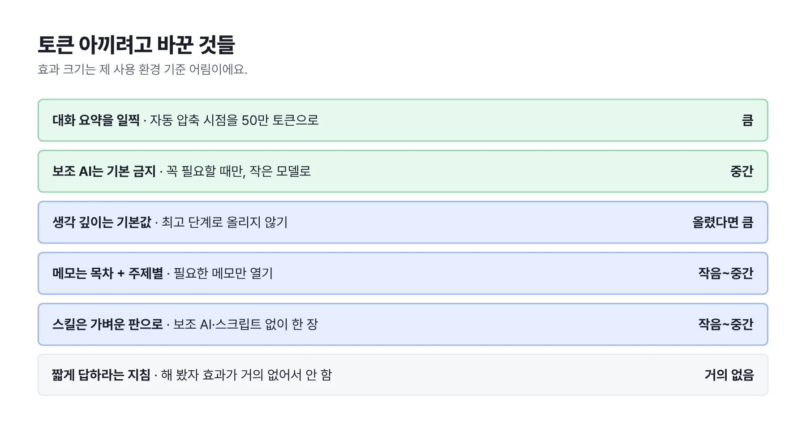

Just as Claude Code and I were getting into a good rhythm on the game, the "usage limit reached" warning started cutting me off far sooner than I expected.

Getting locked out mid-flow is annoying enough to send anyone hunting for workarounds. I found two developer-community posts full of token-saving tips, and normally I would have copy-pasted half of them on sight. This time I handed both posts straight to Claude instead: **"Check these against the official docs and tell me what actually matters for our workflow."**

<figure><figcaption>The conversation that kicked off the token diet.</figcaption></figure>

## Fact-check against the manual before copying anyone's setup

Claude read both posts, checked every claim against its own documentation, and came back with two tidy buckets: **three settings that make an immediate difference**, and **three that aren't worth touching**. Taking two minutes to sanity-check someone else's setup kept me from cargo-culting tweaks that didn't fit how I work.

## The real culprit was the snowballing session

Claude's explanation made the problem painfully obvious in hindsight.

Every time I send a prompt, Claude Code **rereads the entire chat history from the moment that session opened**. Keep one session running from morning until evening, and even a one-line request like "change this button color" forces the model to haul the whole day's conversation uphill all over again.

Nagging the AI to give shorter replies barely dents the bill. **Shrinking the history it has to reread on every turn** is where the real savings live.

<figure><figcaption>A concept chart of token usage. Compacting early, before the chat snowballs, keeps every subsequent turn much lighter.</figcaption></figure>

## The two changes that moved the needle

The biggest win was **triggering automatic conversation summaries (Compact) much earlier**. By default, Claude waits until a session balloons to around 967,000 tokens before summarizing. I cut that threshold nearly in half to **500,000 tokens**, shaking off the snowball before it gets out of hand.

The second was **reining in helper AIs (subagents)**. To move faster, the main AI liked spawning several subagents at once—and each one opened its own session, multiplying the token burn. I added a clear rule to my personal instructions: **"Only call a helper AI when truly necessary, and use a lighter model (like Haiku) when you do."**

For security, I edited the settings file myself, and Claude verified on the next run that the new numbers had actually taken effect.

<figure><figcaption>All six changes I applied and how much each helped. The popular "answer briefly" rule barely registered.</figcaption></figure>

## The 1,000x unit trap we caught while drafting this post

The funniest twist happened while I was writing this very post: Claude spotted a scary bug in its own earlier report and turned itself in.

When configuring the compact threshold, typing `"500"` as a chat command means **500K**—but writing `"500"` in the settings file (as an environment variable) is read literally as **500**. Off by a factor of **a thousand**. Out of sheer paranoia I had typed out all five zeros (`500000`) from the start and dodged the bullet, but it was a good reminder: whenever numbers and units are involved, double-check even a confident AI's math.

## Advice I left on the cutting-room floor

I skipped the crowd-favorite instruction to **"keep every reply to two or three sentences."** Over 90% of the token spend goes into rereading past context, not generating the next reply. I also left thinking depth (`effort`) untouched—the default already struck the best balance.

## Three-line summary

1. Don't copy community tweaks on faith; hand them to the AI to verify against the official docs and keep only what fits your workflow.
2. Long-running sessions are the real token drain—cutting the auto-compact threshold in half and curbing subagent spawns fixes the problem at the source.
3. Even plausible AI instructions can be off by 1,000x on units, so always double-check numeric settings before saving them.
