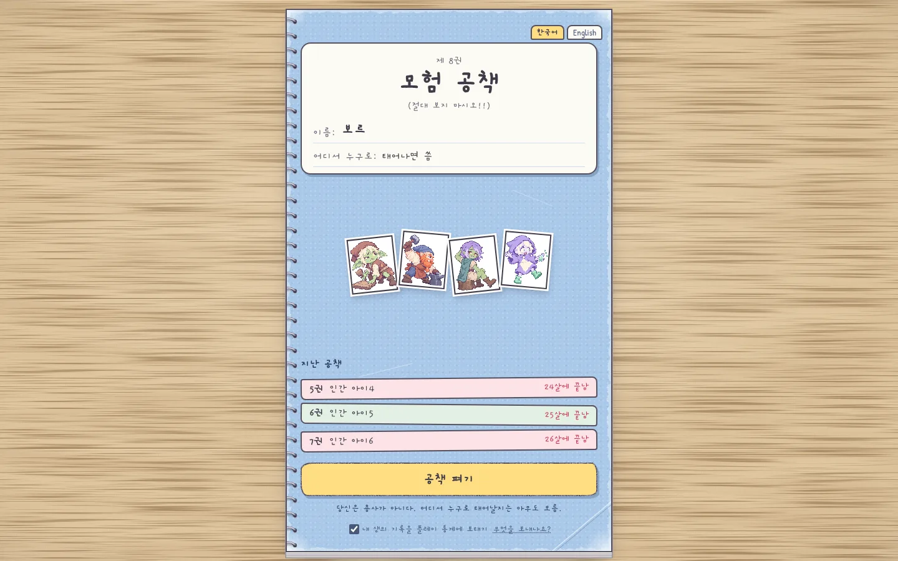
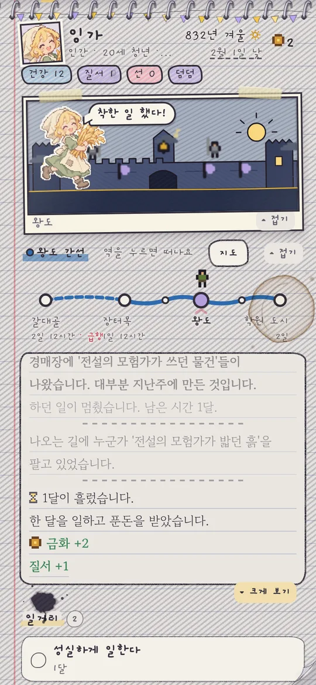
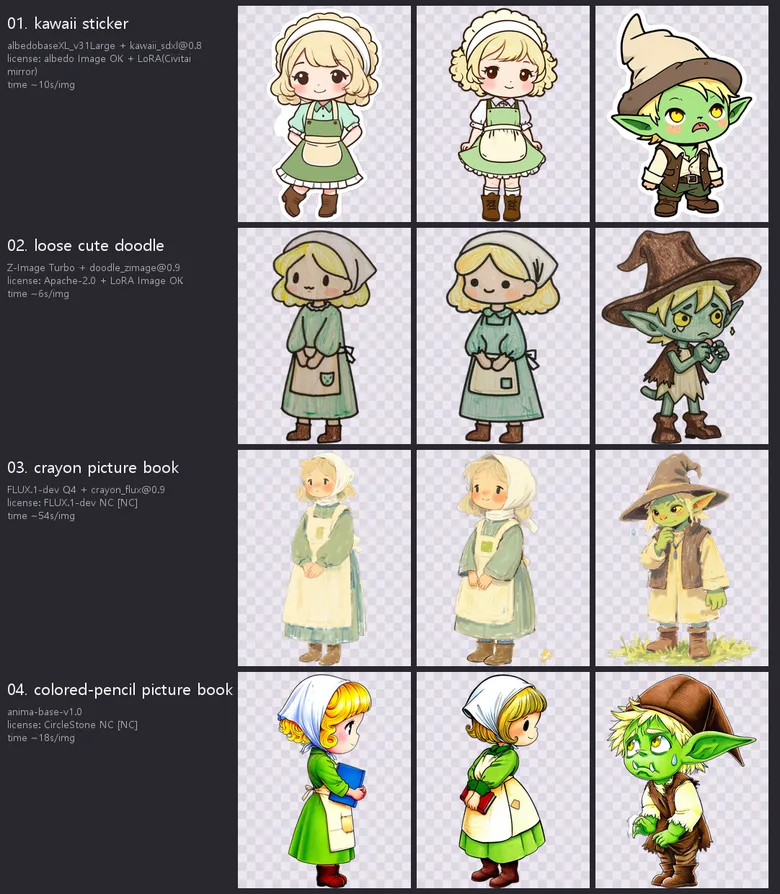
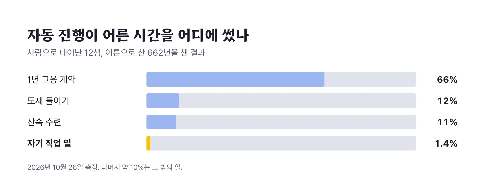

I started on October 20, which makes today exactly one week. Somehow a playable fantasy web game is already up and running—and I haven't written a single line of code myself.

My job boils down to three things: sketching the big picture, deciding whether what comes back actually feels right, and picking a lane at every fork in the road. The coding and documentation fall to Claude, who doubles as my entire engineering team.

I'm the director who only talks, and AI is the crew that builds. Here's what the two of us decided—and what a few wrong turns taught me—in week one.

## So what kind of game is this?

You reincarnate at random as an ordinary resident of a fantasy world. No chosen ones, no saving the realm—you're the farmer's daughter next door or the blacksmith's third son. Thoroughly average.

At each crossroads of life, you roll a 20-sided die, and an entire lifetime plays out in a few minutes. When you die, a gravestone and death notice get pasted onto the last page of your notebook, topped with a cheerful **"Great job!"** stamp. Getting a gold-star stamp for dying in a ditch feels slightly passive-aggressive, which is the point.

<figure><figcaption>The title screen. One notebook is one person's entire life; every death adds another finished notebook to the stack below.</figcaption></figure>

Once a life wraps up, the game retraces everywhere that character wandered on a map.

<figure><video src="/assets/img/posts/first-week/journey.mp4" poster="/assets/img/posts/first-week/journey-poster.jpg" controls muted playsinline preload="none"></video><figcaption>A recap replay tracing your footsteps across the map from your birthplace, stopping at the big moments.</figcaption></figure>

Visually, it's meant to look like an adventure RPG a kid secretly doodled in a spiral notebook during class—ruled paper, wobbly pencil handwriting, scrapbook stickers and all. What happens inside is far less gentle. **"Harmless and cute on the outside, blunt and ruthless in the outcomes."** That's the rule I set on day one.

<figure class="narrow"><figcaption>Living a life on a phone. The current scene sits at the top, a subway-style travel map runs through the middle, and every twist of fate piles up in the log below.</figcaption></figure>

## Developing with my voice instead of a keyboard

The division of labor is simple: I make the calls, and AI does the legwork.

Whenever a design decision comes up, Claude puts together a short "decision card" laying out two or three options alongside its own recommendation. All I have to do is read it and say, "Let's go with B." I signed off on dozens of calls that way in a single week. I wrote down how I get an AI to present choices like this in [how to make it let you choose](/en/2026/10/27/ai-decision-cards/).

Because I'm impatient, I often open multiple chat windows and run big tasks in parallel—polishing combat in one, hooking up login in another. It's fast, though now and then two sessions edit the same file and collide. Setting up an automated merge command that cleans up overlapping changes finally restored peace ([parallel work post](/en/2026/10/27/ai-parallel/)).

One catch: the second you close a chat window, the AI forgets everything you just talked through. Having it write down *why* we made each key decision inside a project notepad cured the next-day amnesia completely ([memory post](/en/2026/10/27/ai-memory/)).

## Tearing up the art style three times

The first character the AI generated came back with sculpted armor and serious Western fantasy muscles. Impressive, just completely wrong for this game. I wanted a big-headed, wide-eyed chibi character with Japanese indie-game charm.

From there I bounced to pixel art, then to smooth illustration, before circling all the way back to the very first sample I'd glanced at—a "pastel pixel sticker" style—and realizing it was the winner all along.

<figure class="narrow"><figcaption>The same three characters lined up in different art styles. Seeing them side by side was the only way my own taste clicked into focus.</figcaption></figure>

The takeaway was humbling: one reference image beats a hundred words of art direction. And until you see several mockups side by side, you probably don't know what you want either ([order for picking an art style](/en/2026/10/27/ai-art-style/)).

## Checking the numbers before trusting my gut

By October 24, playtesting had given me a growing list of gripes: *"Too many random events keep interrupting progress,"* *"Landing the job I want feels nearly impossible."*

Normally I would've jumped straight into tweaking drop rates. This time I measured first. I asked the AI to run an auto-play bot through over a hundred lives and break down where adult characters actually spent their time.

<figure><figcaption>Where adult characters actually spent their lives. The real culprit was hiding in plain sight.</figcaption></figure>

The numbers caught me completely off guard. Characters were spending a staggering **66% of their adult lives on one-year hire contracts**, and only **1.4% actually working their own job**. Digging in, short-term contracts paid better than entry-level careers—so our rational little characters ignored their professions and became full-time gig workers.

Job events weren't rare because we hadn't written enough of them. They were rare because nobody was showing up for work. Had I trusted my gut, I would've spent a whole night writing dozens of extra job events that still wouldn't have triggered.

"When something feels broken, measure it before you touch a single knob." Easily the best habit I picked up in week one.

## The login scare

While hooking up Kakao and Google login, I absent-mindedly pasted five brand-new secret keys straight into the chat window. Half a second later it hit me what I'd done, so I revoked and reissued every single one of them. I wrote the whole cautionary tale down in the [secret keys post](/en/2026/10/27/ai-secret-keys/) so I never repeat it.

## Up next

Right now I'm weaving cause and effect between events—a face you pass in childhood returning years later as a rival, or a careless choice in your twenties boomeranging back in old age. I'll be back with another report once that starts clicking together.

## Three-line summary

1. Splitting roles—human for direction and calls, AI for code and verification—got a working web game off the ground in a week without writing code.
2. For taste-driven decisions like art style, stop over-explaining and put multiple mockups side by side.
3. Before fixing a game on a hunch, pull the stats first. The real bottleneck is rarely where you expect it.
