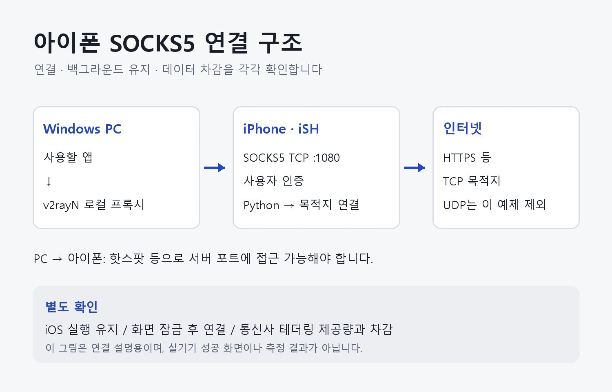
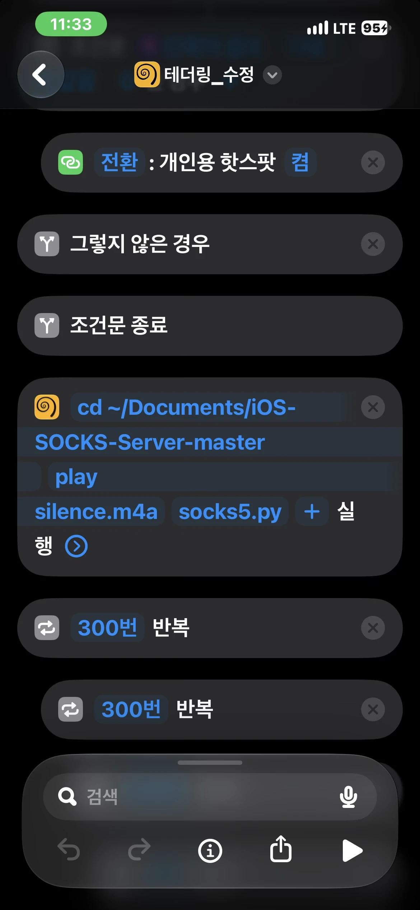

What started as idle curiosity about how tethering limits work on an iPhone MVNO (budget-carrier) plan quickly escalated into running an authenticated SOCKS5 proxy inside **a-Shell** and **iSH** on my phone. Once I was that far down the rabbit hole, I figured I might as well see how much of the daily command-typing could be automated away.

Most snippets floating around online leave out the parts you actually need: the server code itself is missing, there's no authentication, or a background process is left draining your battery after you quit. So here is the full, self-contained setup in order: **① server setup → ② PC connection → ③ background keep-alive and auto-start**.

Want to skip the backstory and get straight to installing on your iPhone? Jump straight to **[1. Prepare Python and a working folder in iSH](#ish-install)**. Every code block has a **"Copy code"** button underneath that grabs the full command, file-creation wrapper included.

<script src="/assets/js/iphone-ish-code-copy.js" defer></script>
<style>
.ish-copybar { display: flex; justify-content: flex-end; margin-top: 1rem; }
.ish-copybtn { min-height: 44px; padding: .5rem .9rem; border: 1px solid var(--line); border-radius: .4rem; color: var(--ink); background: var(--paper-2); font: inherit; font-size: .875rem; cursor: pointer; }
.ish-copybtn:focus-visible { outline: 2px solid var(--accent); outline-offset: 2px; }
</style>

## Before you start: a working proxy and tethering data billing are separate questions

What a carrier markets as "unlimited data" and what it counts against your "tethering (hotspot) allowance" vary wildly from plan to plan. (Even [Apple's official guidance](https://support.apple.com/ko-kr/111785) notes that Personal Hotspot behavior depends on carrier policy.)

Routing through a SOCKS5 proxy means your PC hands its internet requests to an app running on your iPhone, which forwards them onward. Still, digging that tunnel doesn't guarantee your carrier will bill the traffic as regular phone data. **"Does the proxy connect?"** and **"Does my tethering quota stay untouched?"** are two different checks—test with a tiny amount of traffic first before relying on it.

You also need a basic path open between the PC and the iPhone (such as Personal Hotspot). If hotspot itself is blocked on your plan, or your PC can't reach ports on the phone at all, a proxy won't fix that—check your plan's terms first.

<figure><figcaption>End-to-end flow. Getting traffic through the proxy is step one; iOS background survival and how your carrier meters the data each need their own check.</figcaption></figure>

## Why I gave up on a-Shell and switched to iSH

I started with **a-Shell**, an iOS terminal app that ships with Python built in. Its [official docs](https://github.com/holzschu/a-shell#shortcuts) make Shortcuts integration look invitingly clean.

At first I wired up the classic workaround: "loop a silent audio file + run `socks5.py` + repeat the shortcut forever." Below is the shortcut I built at the time—and the short verdict is **don't bother with this route.**

<figure class="narrow"><figcaption>My early a-Shell shortcut experiment. Even with silent audio and a loop, iOS put the background server right to sleep.</figcaption></figure>

Adding waits or loops inside a shortcut doesn't convince iOS to grant a terminal app indefinite background time. The silent-audio trick doesn't fool modern iOS for long either, and the server quietly dies. The [a-Shell GitHub issue tracker](https://github.com/holzschu/a-shell/issues/721) has plenty of similar reports of SOCKS proxies getting force-killed despite silent playback.

So I started over in **iSH**, which can stay alive in the background much more reliably via the location device (`/dev/location`). (Note that the `/root` path and `apk` commands below are iSH-specific and won't work in a-Shell—run all of these inside iSH.)

## What the "two-line iSH command" you see everywhere actually does

If you've searched around for iSH proxy tips, you've probably run across these two lines:

```sh
cat /dev/location > /dev/null &
cd /root/socks && python3 socks5.py
```

- **Line 1 (`cat /dev/location ...`)**: Continuously reads from the iPhone's GPS device so iOS assumes the app is actively navigating and holds off on killing it in the background. (This is the standard technique documented on the [iSH official wiki](https://github.com/ish-app/ish/wiki/Running-in-background).) The coordinate stream is discarded into `/dev/null`, and `&` sends it to the background.
- **Line 2 (`cd /root/socks ...`)**: Enters the working folder and starts the proxy server. Once running, the terminal prompt appears to hang—that's normal; the server is simply waiting for connections. Press `Ctrl+C` when you want to stop it.

What most quick posts skip are the two details that matter most: **what actually goes inside `socks5.py`**, and **how to cleanly stop that background location reader when you're done**. Below we'll build the full kit: an authenticated server plus a wrapper script that cleans up after itself.

<h2 id="ish-install">1. Prepare Python and a working folder in iSH</h2>

If you're reading this on your iPhone, tap **Copy code** under each block, paste it into iSH, and press Enter. Steps 1–4 are one-time setup; once they're done, starting the server takes a single line.

Our `socks5.py` wraps the well-tested open-source engine [pproxy](https://github.com/qwj/python-proxy) to serve a username/password-authenticated TCP SOCKS5 proxy. (UDP is not supported.)

Open iSH and, with an active internet connection so packages can download, paste the entire block below:

```sh
(
  set -eu
  apk update
  apk add python3 py3-pip curl
  mkdir -p /root/socks
  cd /root/socks
  if ! python3 -m venv .venv; then
    apk add py3-virtualenv
    python3 -m virtualenv .venv
  fi
  .venv/bin/python -m pip install 'pproxy==2.7.9'
  .venv/bin/python -c 'import pproxy; print("Python / pproxy OK")'
)
```

Wait for the packages to finish installing. If the final line prints **`Python / pproxy OK`**, step 1 is done. Because of `set -eu` inside the subshell, any failure stops immediately—check your connection and rerun if needed.

## 2. Create the socks5.py server file

Next, write the server script `socks5.py` into that folder. Paste the block below into iSH; if the cursor sits on the last line afterward, hit Enter once.

```sh
cat > /root/socks/socks5.py <<'PY'
#!/usr/bin/env python3
"""Authenticated TCP SOCKS5 example using pproxy 2.7.9. No UDP listener.

Local credentials stay beside this script in credentials.json. Do not publish it.
The SOCKS5 username/password exchange is NOT encrypted. Use a trusted network.
"""
import argparse
import asyncio
import getpass
import json
import os
from pathlib import Path
import re

CONFIG = Path(__file__).resolve().with_name("credentials.json")


def credentials():
    cfg = json.loads(CONFIG.read_text(encoding="utf-8"))
    user, password = cfg["username"], cfg["password"]
    if not isinstance(user, str) or not re.fullmatch(r"[A-Za-z0-9_-]{1,64}", user) or "__" in user:
        raise ValueError("Use 1-64 ASCII letters, digits, _ or - for username; do not use consecutive underscores")
    if not isinstance(password, str) or not re.fullmatch(r"[A-Za-z0-9_-]{16,128}", password) or "__" in password:
        raise ValueError("Use 16-128 ASCII letters, digits, _ or - for password; do not use consecutive underscores")
    return user, password


async def serve(host, port):
    import pproxy
    user, password = credentials()
    proxy = pproxy.Server(f"socks5://{host}:{port}#{user}:{password}")
    # Disable IP-based authentication reuse; authenticate every connection.
    server = await proxy.start_server(dict(rserver=[], authtime=-1))
    print(f"SOCKS5 TCP listening on {host}:{port}; authentication required", flush=True)
    async with server:
        await server.serve_forever()


def main():
    parser = argparse.ArgumentParser(description=__doc__)
    parser.add_argument("--configure", action="store_true")
    parser.add_argument("--host", default="127.0.0.1",
                        help="IPv4 bind address; use the phone LAN IP for PC access")
    parser.add_argument("--port", default=1080, type=int)
    args = parser.parse_args()
    if args.configure:
        if CONFIG.exists():
            raise SystemExit("credentials.json already exists; edit or remove it locally first")
        user = input("Username (ASCII letters/digits/_/-): ").strip()
        password = getpass.getpass("Password (16+ ASCII letters/digits/_/-): ")
        if password != getpass.getpass("Repeat password: "):
            raise SystemExit("Passwords do not match")
        # Validate before saving. The restrictive alphabet avoids URI delimiters.
        if not re.fullmatch(r"[A-Za-z0-9_-]{1,64}", user) or "__" in user:
            raise SystemExit("Invalid username (consecutive underscores are not allowed)")
        if not re.fullmatch(r"[A-Za-z0-9_-]{16,128}", password) or "__" in password:
            raise SystemExit("Invalid password (consecutive underscores are not allowed)")
        fd = os.open(CONFIG, os.O_WRONLY | os.O_CREAT | os.O_EXCL, 0o600)
        with os.fdopen(fd, "w", encoding="utf-8") as handle:
            json.dump(dict(username=user, password=password), handle)
        print("Saved local credentials.json. Keep it private.")
        return
    try:
        asyncio.run(serve(args.host, args.port))
    except KeyboardInterrupt:
        pass


if __name__ == "__main__":
    main()
PY
```

Run a quick syntax check to verify nothing got mangled during paste. Seeing **`socks5.py OK`** means you're good to go.

```sh
cd /root/socks && .venv/bin/python -m py_compile socks5.py && echo 'socks5.py OK'
```

*(If you'd rather skip pasting, you can grab [the exact same socks5.py as a direct download](/assets/downloads/iphone-socks5/socks5.py).)*

## 3. Set your own username and password

To keep anyone else from hitching a ride on your proxy, lock it down with a username and password. The command below prompts for them in order:

```sh
cd /root/socks && .venv/bin/python socks5.py --configure
```

One quirk to keep in mind: because of how pproxy parses its URI syntax, two underscores in a row (`__`) are deliberately disallowed.

1. **`Username`**: Any combination of ASCII letters, digits, `_`, and `-`.
2. **`Password`**: Same character set, **at least 16 characters** long. (Use a brand-new password, not one reused from another account. Nothing appears on screen as you type—that's normal.)
3. **`Repeat password`**: Enter the same password again.

When **`Saved local credentials.json. Keep it private.`** appears, your credentials are saved with `0600` permissions. You'll enter this same username and password in v2rayN on your PC shortly.

## 4. Test-run the server

Before adding any automation, verify that the bare server starts cleanly:

```sh
cd /root/socks && .venv/bin/python -u socks5.py --host 0.0.0.0 --port 1080
```

Seeing **`SOCKS5 TCP listening on 0.0.0.0:1080; authentication required`** means the proxy is up and listening inside your iPhone. (If iOS prompts for "Local Network" access, tap **Allow**.)

Here `--host 0.0.0.0` binds the server so your hotspot-connected PC can reach it. When you're ready to stop the test server, tap `Ctrl` on iSH's helper keyboard bar and then press `C`.

## Connecting from a Windows PC with v2rayN

Leave the server running on your iPhone and connect your Windows PC to the iPhone's Personal Hotspot.

Open PowerShell on Windows, run `ipconfig`, and note the **"Default Gateway"** IPv4 address for the hotspot adapter. It usually looks like `172.20.10.1`—that's your iPhone on the hotspot network.

First, check whether your PC can reach port 1080 on the phone at all:

```powershell
$phoneIp = Read-Host 'iPhone address'
Test-NetConnection -ComputerName $phoneIp -Port 1080
```

`TcpTestSucceeded : True` means the port is reachable. (If it comes back `False`, double-check your hotspot connection and iSH's Local Network permission.)

Next, test an actual web request using your credentials:

```powershell
$proxyUser = Read-Host 'SOCKS username you set'
curl.exe --connect-timeout 10 --max-time 30 `
  --proxy "socks5h://${phoneIp}:1080" `
  --proxy-user "$proxyUser" https://example.com/
```

Enter your 16+ character password when prompted. If the HTML for `Example Domain` streams across your terminal, it worked—that request just rode out through your iPhone's iSH proxy and back.

For everyday browsing, register the server in **[v2rayN](https://github.com/2dust/v2rayN)** on Windows:

| Item | Value to enter |
| --- | --- |
| Type | `SOCKS` (or `SOCKS5`) |
| Address | The iPhone gateway IP address you just found |
| Port | `1080` |
| Username / password | The username and password you set in step 3 on the iPhone |
| Set as active server | Right-click the entry you just added and choose it as the active server |

For your first run, skip TUN mode and use **"Set system proxy"** to confirm your browser loads pages smoothly.

> **💡 Don't forget!** Before quitting v2rayN, always click **"Clear system proxy"** at the bottom first. If you close the app while the system proxy is still active, Windows keeps pointing traffic at a dead local port, making your internet look completely broken.

## Bundling keep-alive and server launch into one script

With PC access confirmed, let's fold the tedious parts into a single script. Go back to iSH and stop the test server with `Ctrl+C`.

Paste the block below to create `start-socks.sh`, which handles **① starting the location keep-alive + ② a lock directory to prevent duplicate instances + ③ launching the proxy + ④ cleaning up on exit**:

```sh
cat > /root/socks/start-socks.sh <<'SH'
#!/bin/sh
set -eu
cd /root/socks

# A directory lock avoids starting multiple copies from different login shells.
if ! mkdir .run-lock 2>/dev/null; then
    echo 'Already running, or stale .run-lock. Check ps before removing the lock.'
    exit 1
fi
location_pid=''
cleanup() {
    if [ -n "$location_pid" ]; then
        kill "$location_pid" 2>/dev/null || :
        wait "$location_pid" 2>/dev/null || :
    fi
    rmdir .run-lock 2>/dev/null || :
}
trap cleanup EXIT
trap 'exit 130' INT
trap 'exit 143' TERM HUP

if [ ! -c /dev/location ]; then
    echo '/dev/location is unavailable; background keep-alive is not enabled.'
    exit 1
fi
cat /dev/location > /dev/null &
location_pid=$!

# Foreground server: Ctrl+C returns to the shell and stops this location reader.
# All IPv4 interfaces are reachable: only use a trusted private hotspot/network.
.venv/bin/python -u socks5.py --host 0.0.0.0 --port 1080
SH
chmod 700 /root/socks/start-socks.sh
```

*(Prefer a file download? Grab [the same start-socks.sh here](/assets/downloads/iphone-socks5/start-socks.sh).)*

From now on, **one command** brings up both the background keep-alive and the proxy server. (When iOS asks for location permission the first time, pick **"Allow While Using App" or "Always Allow"**.)

```sh
sh /root/socks/start-socks.sh
```

The real win here is the cleanup trap: when you hit `Ctrl+C` to stop the server, the script also terminates the background `cat /dev/location` reader so it doesn't sit there quietly sipping battery.

If iSH crashes or gets killed abnormally and the next run warns `Already running, or stale .run-lock`, run `ps` to confirm no server is still alive, clear the stale lock directory, and start again:

```sh
rmdir /root/socks/.run-lock
sh /root/socks/start-socks.sh
```

Even `/dev/location` isn't invincible—heavy memory pressure or an aggressive iOS cleanup can still drop the session. Test it with your screen locked for a bit to see how long it stays up under your own routine.

## Going one step further: auto-start when iSH opens (`.profile`)

If even typing that one line feels like one line too many, wire it into `/root/.profile` so the server launches the moment iSH opens. (Make sure any running server is stopped with `Ctrl+C` first.)

```sh
if ! grep -Fq '# BEGIN iSH SOCKS5 autostart' /root/.profile 2>/dev/null; then
  cat >> /root/.profile <<'PROFILE'

# BEGIN iSH SOCKS5 autostart
case $- in
  *i*)
    if [ ! -e /root/socks/disable-autostart ] &&
       [ -x /root/socks/start-socks.sh ]; then
      sh /root/socks/start-socks.sh
    fi
    ;;
esac
# END iSH SOCKS5 autostart
PROFILE
fi
```

From here on, every fresh interactive login shell in iSH starts the proxy automatically.

Need a normal terminal without auto-start getting in the way? Hit `Ctrl+C` to stop the server and drop a quick "do not disturb" marker file:

```sh
touch /root/socks/disable-autostart
```

Remove the marker file whenever you want auto-start back:

```sh
rm /root/socks/disable-autostart
```

## Pairing it with iOS Shortcuts

One last convenience layer: Apple's built-in **Shortcuts** app.

iSH doesn't support passing commands via a URL scheme like `ish://command` (the [official GitHub issue](https://github.com/ish-app/ish/issues/2063) was closed as unplanned). That means an "Open App" shortcut triggers `.profile` auto-start when iSH launches cold, but won't re-run it if iSH was already open at a shell prompt.

The cleanest workaround is a **two-step shortcut**:

1. **Copy text to clipboard**: `sh /root/socks/start-socks.sh`
2. **Open app**: choose `iSH`

Pin that shortcut to your Home Screen or map it to the iPhone Action Button. If iSH cold-starts, `.profile` brings the server up automatically; if it was already open and stopped, a single tap-and-paste gets you back online in a second.

## Final notes and security reminders

- **Never run this on public Wi-Fi**: SOCKS5 username/password authentication is sent in plain text ([RFC 1929](https://www.rfc-editor.org/rfc/rfc1929)). Never leave it running on a cafe or hotel network—stick strictly to your own iPhone Personal Hotspot with your own PC connected directly.
- **Layer one piece at a time**: Don't wire everything through `.profile` on the very first attempt, or debugging becomes guesswork. Verify each layer in order: **manual server start → PC connectivity test → wrapper script → auto-start**.

## Three-line summary

1. Skipping a-Shell's fragile silent-audio workaround in favor of iSH's `/dev/location` keep-alive and an authenticated `pproxy` SOCKS5 server is far more dependable.
2. Wrapping the location reader and exit cleanup inside `start-socks.sh` and hooking it into `.profile` lets the proxy start automatically whenever iSH launches.
3. Verify the PC (`v2rayN`) connection first, then test with a small transfer to see how your MVNO plan actually meters the traffic.
