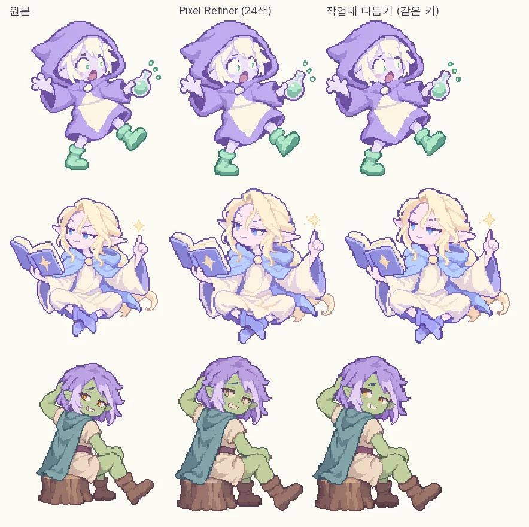

Whenever I find a great community tip or a nifty web tool while making the game, I first toss the link to Claude with **"hey, check this out."**

Quite a few sites paid off nicely that way, only for me to scramble a few days later going "what was that URL again?" So here's a pinned shelf of the sites that actually earned their keep.

<figure><figcaption>A bookmark list picked out by category.</figcaption></figure>

## Writing and polishing tone

**[Humanize KR](https://github.com/epoko77-ai/im-not-ai)** · A skill made for Claude that smooths the awkward translation-ese and robotic sentence lineups typical of AI-written Korean into natural human speech. It leaves facts and numbers alone and only evens out the texture of the sentences. We use it to polish drafts before publishing on this blog too.

## Claude settings and a token diet

**DCinside [AI Dev Gallery post](https://gall.dcinside.com/mgallery/board/view/?id=aidevelop&no=4369) and [AI Usage Gallery post](https://gall.dcinside.com/mgallery/board/view/?id=ai_utilize&no=137000)** · Posts where veteran Claude Code users generously spill their practical setups for saving tokens. They're packed with solid tips like running the automatic conversation summary early and not summoning helper agents carelessly. How I had Claude read these posts, fact-check them against the official manual, and apply them to our environment is written up in detail in the [saving tokens post](/en/2026/10/27/ai-tokens/).

## Pixel art and graphics tools

**[Pixel Refiner](https://pixel-refiner.app/)** · A handy free web tool that snaps "pixel-in-name-only" AI art onto a **real pixel grid**. Just open the site, drag your image in, and you're done. I compared it side by side with the touch-up feature of the asset workbench we built ourselves, and the results were neck and neck. For anyone without their own workbench, it's my number one recommendation.

<figure><figcaption>From the left: the AI original, the Pixel Refiner result, and our own workbench result. The messy pixel lines get cleaned up neatly.</figcaption></figure>

**[claude-pxl](https://github.com/augusto-scarvalho/claude-pxl)** · A tool that stamps out pixel art and frame animations from a short bit of code, designed from the ground up to be easy for an AI to drive. I handed it to Claude and asked for a fire magic effect, and at first the pastel flames washed out against the bright notebook background. Just adding an option for a dark outline instantly gave us game-worthy quality.

<figure><figcaption>Top is the fire magic with default settings, bottom is the version with an outline added to fit the notebook background.</figcaption></figure>

**[Pixel Shading Glossary](https://tuiella.github.io/pixel-glossary/)** · A Korean visual dictionary that explains the technical terms for light, shadow, and color in pixel art with cute before-and-after illustrations. If you just tell the AI "make the shadows look more natural," it brings back something off every time, but if you call out the exact terms from this dictionary (for example, no pillow shading, apply hue shifting), the results come out surprisingly consistent. I even had Claude memorize this dictionary whole and turn it into a checklist for reviewing art.

**[Names of Pixel Problems](https://tuiella.github.io/b3/dot/)** (Korean) · A new column from the glossary author. It takes fifteen pixel-art problems that usually live as vague complaints like "it's bubbling" or "it looks jittery," gives them names such as boiling, mixels and pivot jitter, and pairs each with its cause and fix. With art problems, you can't even search for them until you know the name. I had Claude walk through our game with this list, and the faint animation, which lays the character down at exactly 90 degrees, already met the "45 or 90 degree steps are fine" rule. The full-body sets we generated frame by frame with AI, though, are now homework under the very first entry, boiling.

**[You Need to Know Light](https://tuiella.github.io/b3/light/)** (Korean) · Part 1 of another B3 column by the same author. It follows one number in a texture through eight steps until it becomes light on your monitor, explaining gamma, linear math, HDR, tone mapping, LUTs and gamuts along the way. The five-line checklist at the end, "when someone says the colors look off, ask in this order," is especially handy. I had Claude check our game against it. The 307 places where the screen mixes colors do it the way Photoshop does, so leaving them alone is what keeps the notebook look. I tried blending the torch glow as "added light" instead of a "cover," and the wall just went hazy, so I put it back. Shrinking the character art in linear light did keep the white glint in the eyes a little sharper. Sometimes a theory article is useful simply for telling you there's nothing to fix.

**[Scenario Agent Skills](https://github.com/scenario-labs/skills)** · A pack of 175 skills (MIT) released by the game-art service Scenario. Most only run when hooked up to Scenario's paid server. Still, the skill texts alone teach a lot, from sprite-sheet frame math to keeping one character consistent across many actions. What caught my eye were the "expert tools" skills that drive Blender, Unity, and Godot directly—no Scenario account needed, just the app itself. I have Blender on my home PC, so next time I'm posing mannequins, I'm reaching for that set first.

## Game screen (UI) design

**[UI Glossary](https://tuiella.github.io/ui-glossary/)** · A Korean dictionary from the same author as the pixel shading glossary above, this time covering 140-odd game screen components with example pictures. Things like a delayed damage bar, a hit vignette, or collection silhouettes—the stuff you usually refer to as "you know, that thing"—all have proper names here, so I spend way less time struggling to describe them to Claude. I handed the whole list to Claude and had it check our game screen against it line by line. Once what we already had and what we were missing split apart at a glance, the idea meeting moved as fast as ticking off a checklist.

**[unslop](https://github.com/heydamir/unslop)** · A Claude skill that audits screens for that "AI-made" look (CC BY 4.0). It was built for company dashboards and landing pages, so rules like "remove emoji" and "use gray backgrounds" are the exact opposite of a notebook RPG. I had Claude read it first, drop the rules that didn't fit and audit with the rest. It flagged messy chip colors, tiny text, and a whopping twenty-seven different font sizes, and it led all the way to [turning the route board into a colored-pencil map](/en/2026/11/02/pencil-map/).

**[Game UI Database](https://www.gameuidatabase.com/)** · A free site collecting screenshots from 300-odd games, sorted by screen type like shops, inventories and HUDs. If the UI glossary taught you the names, this is where you see the real thing. It has a fair number of pixel games like Celeste and Rogue Legacy, plus card and turn-based games. Next time I rework a shop or bag screen, I plan to pick a few similar screens here and hand them to Claude along with the game names. Since the screenshots belong to the game studios, I'm only linking to the site here.

**[Impeccable](https://github.com/pbakaus/impeccable)** · A screen-design skill in the same family as unslop above (Apache-2.0). Its 24 commands, such as `bolder`, `quieter` and a scored `critique`, put names on vague requests. It also has 62 "AI tell" rules that run without any AI. It's tuned for company web pages too, so as with unslop I plan to have Claude read it first and filter out the rules that don't suit a notebook RPG. Its live mode, which edits right in the browser, has a setting that calls an agent without permission checks, so turn it on with care. I ran just the checker on our game: 26 hits, every one of them a notebook margin line, graph paper or sticker shine read as an "AI tell," so nothing to fix. It did say our contrast and text sizes were clean, which was nice to hear.

## Treasure chest of effect ideas

**[Opus 5.5 video collection](https://github.com/yihui-dev/awesome-opus5-5-videos)** · A repository gathering 703 videos of results from having AI write animations in code, along with the actual prompts. When it's frustrating to explain an effect that only exists in your head, you can find a video with a similar feel here and borrow the prompt wording, which is a huge shortcut. The analog effect in our game where pencil lines jitter slightly came from a hint found right here, and I applied it in the [video-making post](/en/2026/10/27/ai-clip/).

**DCInside [AI game dev gallery post](https://gall.dcinside.com/mgallery/board/view/?id=aidevelop&no=2572)** (Korean) · True to its title, "I asked an AI to make a game, so why does it feel so cheap?", it explains through game feel and juice why a game where every feature works can still feel flat. The key advice: "make it juicy" is not a magic spell, so diagnose the gaps first, rank them, then give each action a specific intensity. I had Claude measure our game in exactly that order, and it found that in fights the hero gets bitten on screen a full 1.1 seconds before the die stops rolling. I'd watched that dozens of times and never noticed.

**[Names of Game Feel](https://tuiella.github.io/b3/sonmat/)** (Korean) · Another column by the same author, this time turning "please make the hits feel better" into words that actually get things fixed. Each of its thirteen game-feel parts, hitstop, easing, count-up and so on, comes with a request that has the numbers baked in, like "pause for 0.06 seconds," so you just copy it and hand it to the AI. After reading it I had Claude compare our gold coins against the "collect to HUD" entry. We already had coins flying from the hero to the gold slot, but the number itself was changing all at once before the coins had even left. Funny how learning one name puts the fix right in front of you.

## Getting more out of AI requests

**[How to be more ambitious: a tutorial for humans with models](https://felixrieseberg.com/how-to-be-more-ambitious-a-tutorial-for-humans-with-models/)** · Felix Rieseberg's essay splits "asking AI for bigger work" into three directions: altitude, depth, and range. Aim at the outcome that should change instead of the artifact (altitude), make the model work from the raw material and methods a top expert would use and let an outside judge, not the model, grade the result (depth), and borrow the eyes of other professions (range). The "I want a deeper version of this task, not a bigger one" prompt template is ready to lift as is. I went one step further and had Claude read it and write a project instruction that rewrites each of my requests into an English prompt in this style before starting work. Blowing up a one-line question or a typo fix into a grand plan would be silly, so there's also a line saying to just do the simple stuff right away.

## Balance and play data

**DCInside [indie game dev gallery post](https://gall.dcinside.com/mgallery/board/view/?id=game_dev&no=233476)** (Korean) · The developer of the pachinko roguelite *High Roller Penny* shares how they tuned balance from 58,000 recorded runs. Instead of math models, they started with questions like "which stage kills the most players?" and designed their logging around answering them. I had Claude read it and map it onto our game, and out came an eight-row question sheet: life stages and causes of death instead of win rate, and "the choice you picked and the life that followed" instead of item win rate. That's when I noticed we'd been collecting records all along with no questions to ask them.

## Three-line summary

1. When you spot a promising tip or resource, hand it to the AI to cross-check against official docs first, then keep only what actually pays off.
2. For AI pixel art, snap to the grid with Pixel Refiner, generate effects with claude-pxl, and guard quality with glossary checklists. Run your UI against the UI Glossary line by line and the gaps jump right out.
3. Turn one great essay on prompting into a standing project instruction and you stop reinventing the wheel every request. I'll keep adding tools that earn their keep here.
