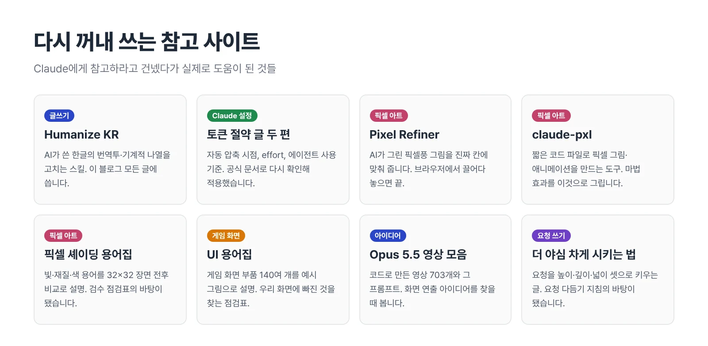
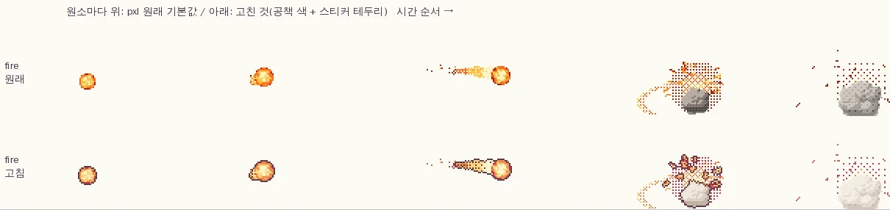
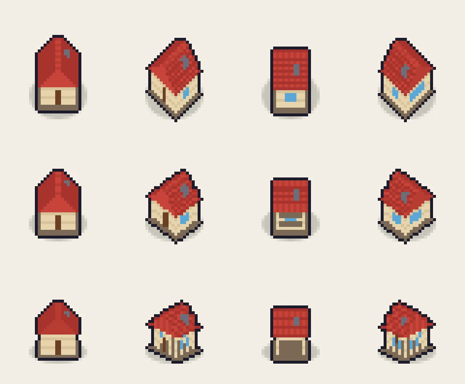

Whenever I stumble onto a sharp community post or a clever web tool while building the game, my first move is to toss the link to Claude with a quick **"read this and see what we can use."**

Quite a few links paid off handsomely—right up until I spent ten minutes digging through my browser history three days later trying to remember the URL. So here is a permanent shelf of the sites that genuinely pulled their weight.

<figure><figcaption>My go-to bookmarks, grouped by what they actually help with.</figcaption></figure>

## Writing and polishing tone

**[Humanize KR](https://github.com/epoko77-ai/im-not-ai)** · A Claude skill that sands off the stiff translation-ese and robotic rhythm typical of AI-generated Korean. It leaves facts and numbers untouched and only smooths out the phrasing. I use it as a sanity pass on drafts before publishing posts on this blog too.

## Claude settings and a token diet

**DCinside [AI Dev Gallery post](https://gall.dcinside.com/mgallery/board/view/?id=aidevelop&no=4369) and [AI Usage Gallery post](https://gall.dcinside.com/mgallery/board/view/?id=ai_utilize&no=137000)** · Two posts where veteran Claude Code users break down practical ways to stop burning through tokens—triggering auto-compact early, keeping subagent spawns on a leash, and more. How I had Claude cross-check both posts against its own official docs and apply the winners is written up in the [saving tokens post](/en/2026/10/27/ai-tokens/).

## Pixel art and graphics tools

**[Pixel Refiner](https://pixel-refiner.app/)** · A free web tool that snaps "pixel-ish" AI art onto a **real pixel grid**. Drag a file onto the page and you're done. I stacked its output side by side against our custom-built asset workbench, and the two went toe-to-toe. If you don't have your own pipeline, start here.

<figure><figcaption>Left to right: raw AI output, Pixel Refiner, and our own workbench cleanup. Fuzzy pixel edges snap neatly into place.</figcaption></figure>

**[claude-pxl](https://github.com/augusto-scarvalho/claude-pxl)** · Generates pixel sprites and frame animations from short code, designed from the start to be driven by an AI. I asked Claude for a fire-magic effect and the first pastel draft washed right out against our bright notebook paper. Adding a dark outline option turned it into something game-ready on the next try.

<figure><figcaption>Top: default fire magic. Bottom: tuned for notebook paper with a crisp dark outline.</figcaption></figure>

**[Pixel Shading Glossary](https://tuiella.github.io/pixel-glossary/)** · A Korean visual dictionary of pixel-art lighting, shading, and color terms, each illustrated with clear before-and-after examples. Telling an AI "make the shadows look more natural" is a coin flip; naming exact terms from this glossary—no pillow shading, use hue shifting—makes the output far more predictable. I had Claude read the entire site and turn it into our art-review checklist.

**[Names of Pixel Problems](https://tuiella.github.io/b3/dot/)** (Korean) · A newer column by the same author. It takes fifteen visual annoyances that usually stay stuck as "it looks bubbly" or "it feels jittery" and gives them proper names—boiling, mixels, pivot jitter—along with causes and fixes. With art bugs, you can't even search for a cure until you know the word. Running our game against this list confirmed our 90-degree faint animation already passed the "45° or 90° increments are fine" rule—while our frame-by-frame AI character sets earned a spot on the homework list under entry #1, boiling.

**[You Need to Know Light](https://tuiella.github.io/b3/light/)** (Korean) · Part 1 of another B3 column by the same author. It traces a single number in a texture through eight stages until it becomes light on your monitor, covering gamma, linear math, HDR, tone mapping, LUTs, and color gamuts along the way. The five-line checklist at the end—"when someone says the colors look off, ask in this order"—is worth bookmarking on its own. Checking our game against it showed that our 307 color-blending spots behave like Photoshop, so leaving them alone preserves the notebook palette. I tested switching torch light from "overlay" to "additive," watched the wall turn milky, and reverted it. Downscaling character sprites in linear light *did* keep the white glint in their eyes sharper. Even a theory piece that proves "nothing to fix here" earns its keep.

**[Dynamic Lights: How They Work and How to Use Them](https://tuiella.github.io/b3/light2/)** (Korean) · Part 2 of the same column, moving from painted versus computed light to placing a single torch, with an interactive tavern scene where you toggle each effect on and off. Checking our game against it revealed that our black-clad bandit practically vanished during night fights. Borrowing the article's rule on "things that must stay readable no matter how dark it gets," we gave night characters a 1-pixel warm rim on their front edge and a floor under their darkest tones. We also stepped the roadside lantern's smooth gradient down into three clean bands, straight from "pixel art keeps its palette when brightness is quantized." We skipped normal maps—drawing a second map for all 466 sprites was a bridge too far.

**[Sprite stacking](https://www.spritecook.ai/blog/sprite-stacking-pixel-art)** · Stack thin 2D slices one pixel apart and a sprite rotates like a 3D object with no 3D model in sight. SpriteCook's post walks through the whole technique using a race car. I asked Claude to file it away for a future project; instead of stopping at notes, it sliced a little house into 14 layers in code and spun it for me. Across three camera tilts, 0.75 hit the sweet spot, while 0.5 pulled the slices apart until the roof cracked open. Our side-view notebook RPG has no use for it yet, but the day boats or carts cross a top-down map, this comes straight off the shelf.

<figure><figcaption>Camera tilts of 1, 0.75, and 0.5 from top to bottom. At 0.5, the slices separate and split the roof.</figcaption></figure>

**[Scenario Agent Skills](https://github.com/scenario-labs/skills)** · A collection of 175 skills (MIT) published by the game-art platform Scenario. Most require hooking up to Scenario's paid server, yet the written skills alone are packed with practical guidance on sprite-sheet grid math and keeping a character consistent across animations. The real surprise was the "expert tools" group that drives Blender, Unity, and Godot directly—no Scenario account required, just the local app. Since Blender is already on my home PC, I plan to try that bundle the next time I'm posing mannequins.

## Game screen (UI) design

**[UI Glossary](https://tuiella.github.io/ui-glossary/)** · Another Korean visual dictionary from the same author, naming 140-odd game UI parts with illustrations. Delayed damage bars, hit vignettes, collection silhouettes—having real names for every "you know, that thing" saves endless back-and-forth with Claude. I handed the entire glossary to Claude for a line-by-line audit of our game, and separating what we already had from what we were missing turned a vague brainstorm into a crisp checklist.

**[unslop](https://github.com/heydamir/unslop)** · A Claude audit skill built to catch that generic "AI-generated UI" look (CC BY 4.0). Because it targets SaaS dashboards and marketing pages, rules like "strip emoji" and "use neutral gray backgrounds" are the exact opposite of a hand-drawn notebook RPG. I had Claude read it first, drop every mismatched rule, and audit our screens with the rest. It caught messy chip colors, tiny labels, and an astonishing twenty-seven different font sizes—and kicked off the redesign that [turned our route board into a colored-pencil map](/en/2026/11/02/pencil-map/).

**[Game UI Database](https://www.gameuidatabase.com/)** · A free archive of screenshots from 300-odd games sorted by screen type—shops, inventories, HUDs, and more. If the UI Glossary gives you the vocabulary, this is where you see real shipped examples, including pixel games like *Celeste* and *Rogue Legacy* plus plenty of card and turn-based titles. Next time I rework a shop or bag screen, I plan to pull a few references here and pass the game titles to Claude. Since the screenshots belong to their respective studios, I'm only linking out.

**[Impeccable](https://github.com/pbakaus/impeccable)** · A design skill in the same family as unslop (Apache-2.0). Twenty-four named commands—`bolder`, `quieter`, a scored `critique`—give fuzzy art direction concrete handles, alongside 62 deterministic "AI tell" checks that run without an LLM. Like unslop, it assumes corporate web apps, so I'll filter out mismatched rules before leaning on it. (A heads-up: its browser live mode can invoke an agent without permission prompts, so use it cautiously.) Running just the rule checker on our game flagged 26 items—every single one a false positive mistaking notebook margin lines, graph paper, and sticker shine for "AI slop." Hearing that our contrast and text sizes came back spotless was a nice bonus.

## Effects and game feel

**[Opus 5.5 video collection](https://github.com/yihui-dev/awesome-opus5-5-videos)** · A repository of 703 code-generated AI animations paired with the exact prompts that produced them. Whenever an effect lives clearly in your head but refuses to translate into words, finding a close match here and borrowing the phrasing is a huge shortcut. Our jittering analog pencil-line effect started from a prompt I spotted here and wrote about in the [video-making post](/en/2026/10/27/ai-clip/).

**DCInside [AI game dev gallery post](https://gall.dcinside.com/mgallery/board/view/?id=aidevelop&no=2572)** (Korean) · Carrying the blunt title *"I asked an AI to make a game, so why does it feel so cheap?"*, it breaks down through game feel and juice why a feature-complete game can still feel lifeless. Its core takeaway: "make it juicy" isn't a magic spell—diagnose the weak spots, rank them, and give every action a concrete intensity. Having Claude measure our game in that exact order uncovered a 1.1-second desync in combat where the hero was visibly getting bitten before the die even finished rolling. I'd watched that animation dozens of times and missed it completely.

**[Names of Game Feel](https://tuiella.github.io/b3/sonmat/)** (Korean) · Another column by the same author, turning vague requests like "make the hits feel punchier" into actionable specs. Each of its thirteen mechanics—hitstop, easing, number count-ups, and more—comes with a copy-ready prompt with numbers baked in ("pause for 0.06 seconds"). Comparing our gold coins against the "collect to HUD" entry revealed that while coins did fly from the hero to the gold counter, the number jumped to the new total before the coins had even left. Learning one name immediately exposed the bug.

## Asking AI for better work

**[How to be more ambitious: a tutorial for humans with models](https://felixrieseberg.com/how-to-be-more-ambitious-a-tutorial-for-humans-with-models/)** · Felix Rieseberg's essay frames ambitious AI collaboration along three axes: altitude (aim for the outcome that should change, not just the artifact), depth (work from the raw materials and methods a top expert uses, graded by an external check rather than the model itself), and range (borrow perspectives from adjacent disciplines). Its *"I want a deeper version of this task, not a bigger one"* prompt template is ready to lift verbatim. I had Claude turn the essay into a standing project instruction that rewrites my bigger requests into English prompts in this style before starting—with a sensible escape hatch so quick questions and typo fixes don't get inflated into grand campaigns.

## Balance and play data

**DCInside [indie game dev gallery post](https://gall.dcinside.com/mgallery/board/view/?id=game_dev&no=233476)** (Korean) · The developer of the pachinko roguelite *High Roller Penny* walks through balancing the game using 58,000 recorded runs. Rather than starting from spreadsheets of formulas, they started with concrete questions—*"which stage kills the most players?"*—and designed their telemetry to answer them. Mapping that approach onto our game produced an eight-row question sheet: life stages and causes of death instead of win rate, and *"the choice picked and the life that followed"* instead of item win rate. That's when it hit me: we'd been logging runs for weeks without a single real question to ask them.

## Three-line summary

1. When you find a promising article or tool, have the AI audit your project against it first—what fits and what to skip separate themselves fast.
2. Snap AI pixel art to a grid with Pixel Refiner, generate effects with claude-pxl, and use visual glossaries as checklists for both sprites and UI.
3. Bake strong prompting habits into a standing project instruction so you don't repeat yourself on every task. I'll keep adding sites here as they earn a spot.
