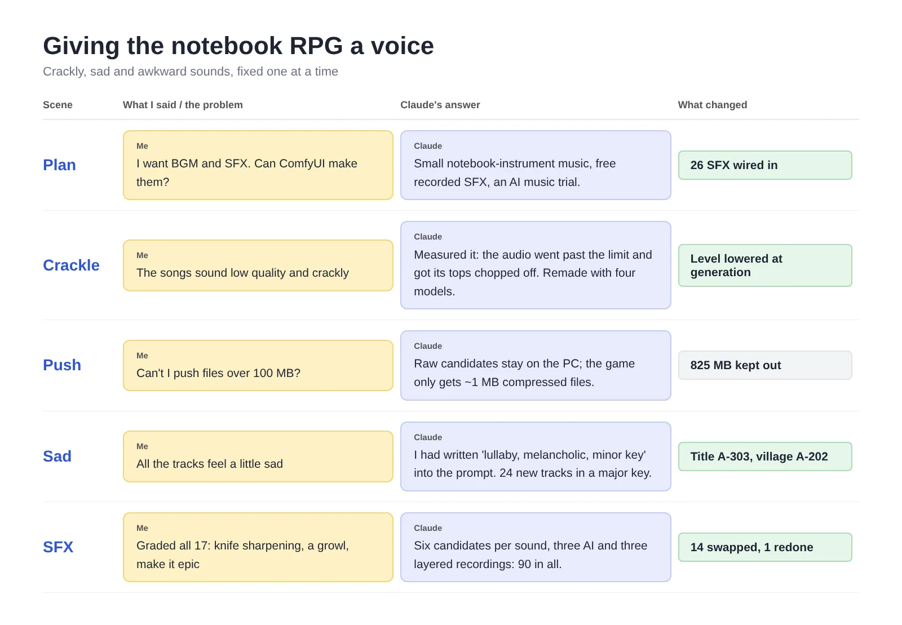
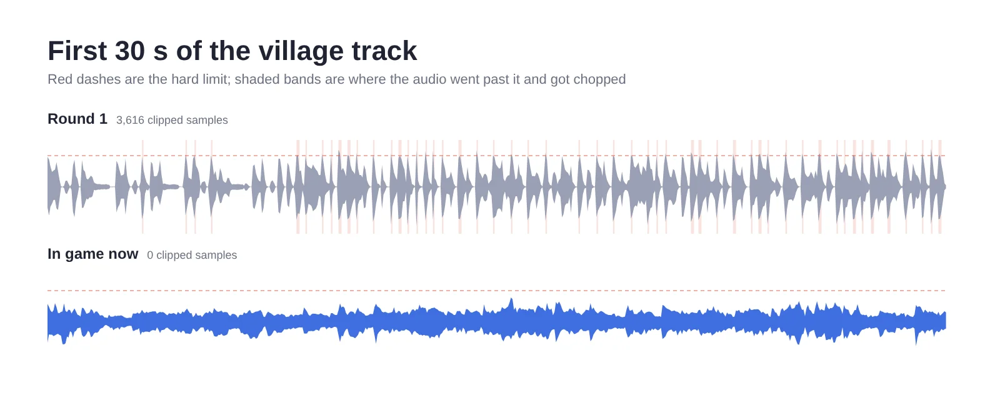
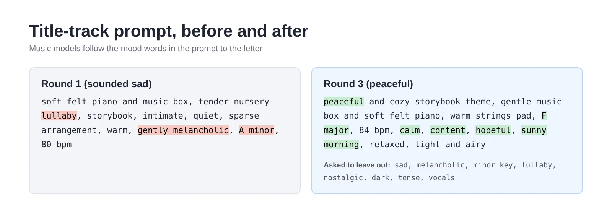
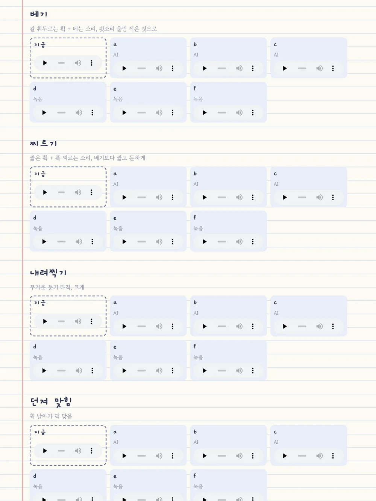

Once the art finally settled down, the silence hit me. Here was a notebook RPG drawn in pencil, without a single pencil scratch to its name—playing it felt like watching a silent film. So I asked Claude to wire up background music and sound effects, and fired up ComfyUI on my home PC to generate the tracks ourselves. Predictably, every sound we added arrived with its own small disaster.

<figure><figcaption>From the initial plan to the SFX retakes: five scenes from the audio work.</figcaption></figure>

## Mishap #1: the music came out crackling

The plan started modestly: small, gentle "notebook" instruments like music boxes and recorders for the BGM, and free CC0 recordings for the sound effects. Claude wired 26 sound effects to pencils, dice, and stamps, and generated ten title and village tracks using an open model called ACE-Step.

Then I hit play. Every track had what I described as "bad audio quality, like it's breaking up." Unsure whether my ears were tired or the model was broken, I asked Claude to inspect the files. A quick measurement nailed the culprit: running the model on fast settings pushed the volume past the ceiling, slicing the tops off the waveforms like a kitchen knife. It is the same harsh distortion you get when someone shouts straight into a karaoke mic—audio engineers call it **clipping**.

<figure><figcaption>Top: the first generated track. Bottom: the one now in the game. The red zones show where the signal slammed into the ceiling and crackled.</figcaption></figure>

Once peaks are sheared off, no amount of post-processing brings them back. Lowering the gain at generation time—giving the audio headroom before polishing—fixed it immediately and saved hours of pointless cleanup.

## Mishap #2: a 100MB suitcase blocked the Git push

Generating piles of candidate tracks had an unexpected side effect: pushing to the repository stopped dead. GitHub rejects any single file over 100MB. My bundled candidate originals weighed 369MB on their own, and the full candidate folder had ballooned to 825MB.

Claude's fix felt a lot like packing for a move. Heavy originals stay in local storage on my PC, while the game ships only compressed copies at a little over 1MB per track. We also blocked the candidate folders from ever being committed again, closing the door on a repeat incident.

## "All the background music sounds a little sad"

With the crackling gone, a weirder problem surfaced: every track sounded heartbreaking. Instead of a cozy starting town, it felt like waving goodbye at a train station in the rain. Before blaming the model, we checked the prompt—and found the smoking gun. Claude had written "lullaby", "gently melancholic", and "A minor" into the title track's description. The AI hadn't failed at all; it had delivered heartbreak with admirable obedience.

<figure><figcaption>Red words made the track weep; green words swapped in to cheer it up.</figcaption></figure>

We pivoted to a major key with "peaceful, cozy, content", and banished sadness, minor keys, and lullabies to the negative prompt. While we were at it, I asked Claude how indie devs actually work with AI audio. The common workflow turned out to be **generating 8–12 candidates, picking the strongest one, and spending about 30 minutes polishing it**. Following that playbook, we generated 24 fresh tracks across three models and picked one for the title screen and one for the village. On the October leaderboard, the top instrumental model was a paid service and my free model sat a rung below—but with proper curation and a light polish, it held its own.

<figure><audio src="/assets/img/posts/ai-sound/title.m4a" controls preload="none"></audio><figcaption>The track now playing on the title screen. The tail overlaps the intro so it loops cleanly.</figcaption></figure>

## You can't sword-fight with knife-sharpening sounds

Once the music sounded decent, the rough edges on the sound effects stuck out twice as much. I listened to all 17 one by one and sent Claude a blunt set of notes: slash "sounds like sharpening a kitchen knife", bite "doesn't feel like a bite, more like a growl", meteor "needs to be more epic", and critical success "a plain thud would probably do." In hindsight, it read like a grumpy report card.

Claude introduced a basic trick from sound design: instead of relying on a single raw clip, **layer two or three elements**—a *whoosh* for the attack, a *slice* for the body, a *ring* for the tail—and trim the whole thing to match the on-screen animation. Then it spun up a quick web listening page with 90 candidates: three AI-generated options and three layered CC0 recordings for every sound.

<figure><figcaption>Dashed box: the current clip. a–c are AI, d–f are layered recordings. Picking them felt like taking a multiple-choice quiz.</figcaption></figure>

Final tally: 14 replaced, 1 sent back for a retake. Only the hero-getting-hit sound still felt too soft, which we fixed in one extra round by layering a punch with half a blunt-weapon thud. Looking back at the winners, my picks split roughly fifty-fifty between AI and real recordings. Neither side swept the board; each sound simply favored a different source.

Now the notebook RPG has scratching pencils, tumbling dice, and a meteor that lands with an honest-to-goodness boom. Next up: night, dungeon, and battle tracks using the same loop.

## Three-line summary

1. If AI music crackles, turn the volume down at generation time instead of trying to rescue it later. Clipped peaks never come back.
2. When a track's mood feels wrong, read your prompt before blaming the model. One stray "lullaby" can turn an entire village mournful.
3. For SFX, auditioning a batch of candidates by ear beats tweaking blind—and blunt feedback like "sounds like sharpening a kitchen knife" gets you there faster.
