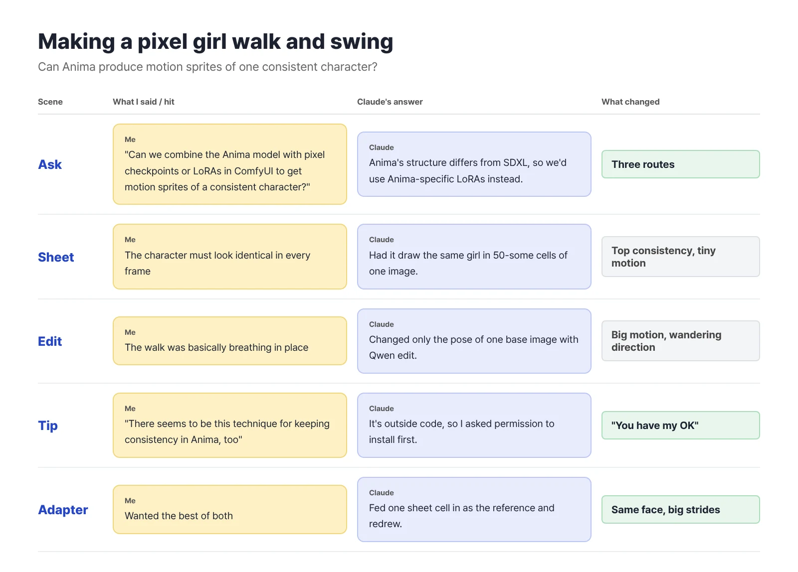
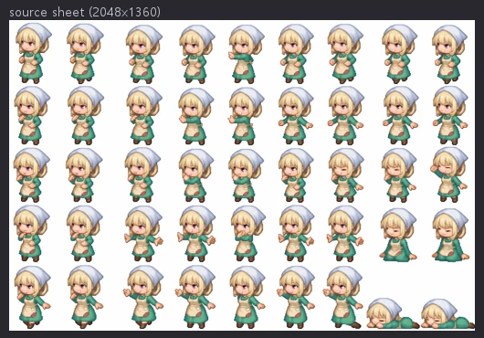
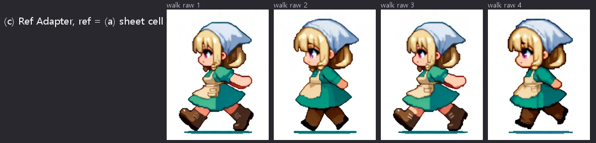

The fastest way to lose your mind making AI game sprites is watching your character get plastic surgery between frames. In frame 1 she has a bob; in frame 2 she suddenly has bangs; by frame 3 her apron is a different color. This test wasn't even for the current game—pure curiosity. I just wanted to see if consistent AI pixel motion actually works, so I pitched the question to Claude.

<figure><figcaption>An experiment that kicked off with one curious question and flipped on a single link.</figcaption></figure>

## "Wait—is Anima the checkpoint?"

Here was my opening pitch: **"Can we combine the Anima model with pixel checkpoints or LoRAs in ComfyUI to get motion sprites of a consistent character?"**

Claude shot down the mix-and-match plan immediately. Anima excels at anime styles, but its underlying architecture is completely different from the SDXL pixel models I had used earlier, so you can't swap parts between them. Confused, I asked: "So we don't use a checkpoint? Is Anima the checkpoint...?" Exactly. If a checkpoint is the base artist and a LoRA is a style textbook, Anima *was* the base artist. Fortunately, Civitai already had a handful of Anima-specific pixel and sprite LoRAs, giving Claude three routes to pit against each other.

## Route 1: draw them all on one canvas and you get twins

Route 1 stacked an RPG battle-sheet LoRA with a pixel style LoRA, asking the model to draw the same girl across 50-some cells of a single image. Because every cell is generated inside one shared canvas, the model has no chance to drift into a different person. The consistency was uncanny: face, kerchief, apron patch, palette, and pixel scale stayed dead-on twins from cell to cell. At 55 seconds per sheet—roughly 1 second per frame—it was blazingly fast, too.

<figure><figcaption>Fifty girls on one sheet, and every single one is the same person.</figcaption></figure>

The catch was animation range. Trained on classic RPG battle screens, "walk" barely amounted to breathing in place, and "attack" was a polite little arm nudge. She wouldn't touch a weapon like a pitchfork at all.

## Route 2: bold poses, zero sense of direction

Route 2 went back to my favorite tool from earlier tests: generate one reference frame and let an edit model (Qwen-Image-Edit) change only the pose per frame. This time the motion popped. Legs crossed into real strides, and hoisting the pitchfork overhead before slamming it down read clearly at a glance.

The trade-off? She spun around like a weathervane—facing right in one frame, staring straight at the camera in the next, then turning her back. Because the pitchfork stretched the bounding box differently each time, her height bounced up and down too. It felt like being forced to choose between consistency and actual movement.

## One link flipped the whole test

That's when I dropped a link into the chat: "By the way, there seems to be this technique for keeping consistency in Anima, too." It was **Anima Ref Adapter**, a tool that locks a character's identity to one reference image while letting the text prompt drive the pose.

Claude didn't rush to install it; it paused to ask permission first, since we were putting third-party code onto my PC. Once I gave the green light, it installed the node, checked the source to verify there were no hidden network calls or external commands, and fed a single cell from Route 1's sheet in as the reference.

<figure><figcaption>The girl from the battle sheet finally breaks into real strides.</figcaption></figure>

Out came the best of both worlds. All four frames kept the same face, kerchief, apron, profile, and height—while her legs actually swung back and forth. Watching the three routes side by side makes the jump unmistakable.

<figure><video src="/assets/img/posts/anima-motion/walk.mp4" controls muted playsinline preload="none" poster="/assets/img/posts/anima-motion/walk.jpg"></video><figcaption>Left to right: single sheet, edit model, reference adapter. Only the right one actually walks.</figcaption></figure>

It wasn't magic without quirks. Even told to "face right," she stubbornly faced left most of the time (nothing a horizontal flip couldn't fix), and she insisted on sketching an uninvited ground line under her boots. In the attack cycle, handing her a fresh pitchfork each frame made the tool's shape drift slightly, and feeding Route 2's image as reference mysteriously turned her apron patch into a floral print. At roughly 55 seconds per frame, it was also the slowest option.

<figure><video src="/assets/img/posts/anima-motion/attack.mp4" controls muted playsinline preload="none" poster="/assets/img/posts/anima-motion/attack.jpg"></video><figcaption>Attack comparison. The girl on the right hoists the pitchfork clear over her head.</figcaption></figure>

We also caught a sneaky pipeline bug worth flagging: our pixel-cleanup step measured the native grid size independently on every frame, causing the girl to shrink randomly on certain frames. **Measuring the grid once on frame 1 and locking that size across the whole animation** kept her height rock-steady.

## How to actually use this

Lined up side by side, the three routes split cleanly:

1. **Single sheet**: unbeatable consistency, tiny motion, fastest at ~1 second per frame.
2. **Base image + edit model**: bold motion, wobbling direction and scale, ~31 seconds per frame.
3. **Base image + reference adapter**: consistency *and* bold motion, ~55 seconds per frame.

The winning combo was **locking in a character design on a single sheet first, then feeding one clean cell into the reference adapter to generate big action frames**. Both Anima and the adapter carry non-commercial model licenses while explicitly permitting commercial use of the generated images. Some of the sprite LoRAs I used forbid selling outputs, though, so this pipeline stays in the drawer for now—proven and ready the moment a commercially clean LoRA arrives.

## Three-line summary

1. Need the same character across dozens of frames? Generate them together on a single sheet first.
2. Need bold poses too? Feed one clean cell from that sheet into a reference adapter as step two.
3. Lock your pixel-grid measurement to frame 1 so sprites don't shrink mid-cycle—and always require permission plus a quick code check before installing third-party nodes.
