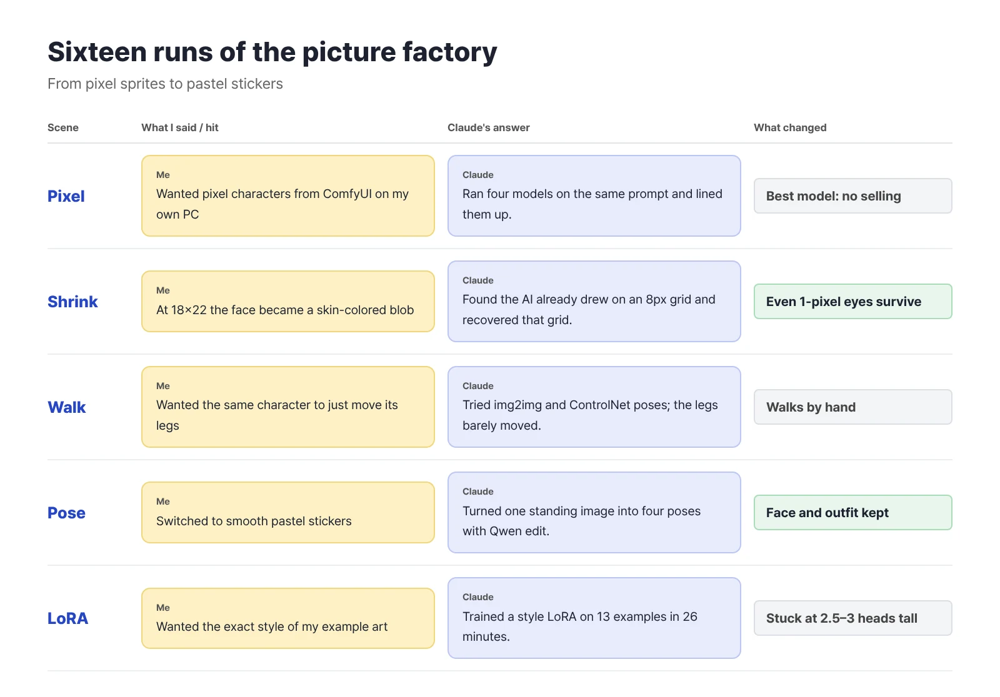
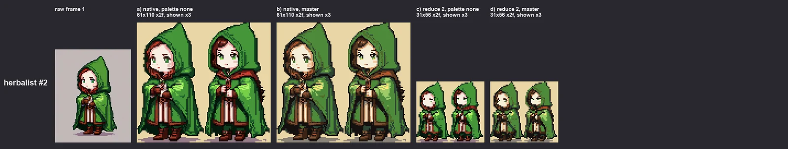
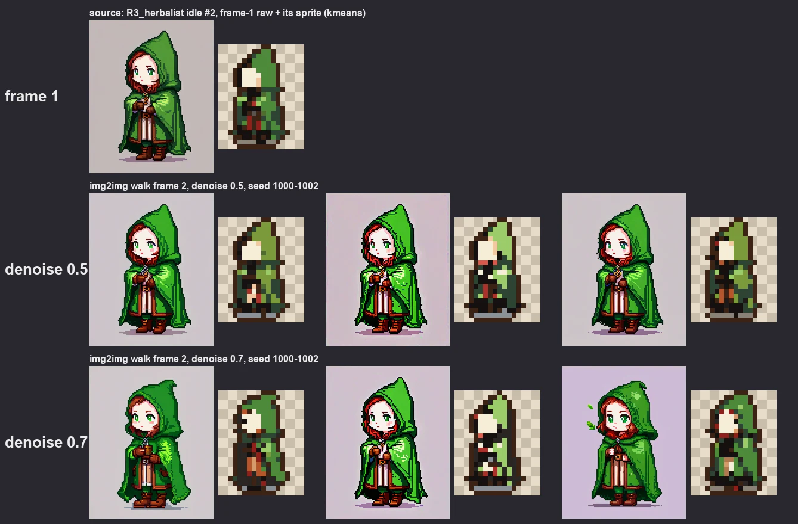
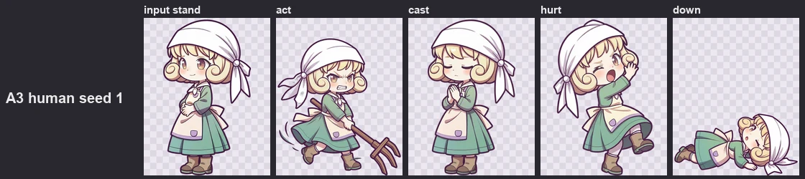
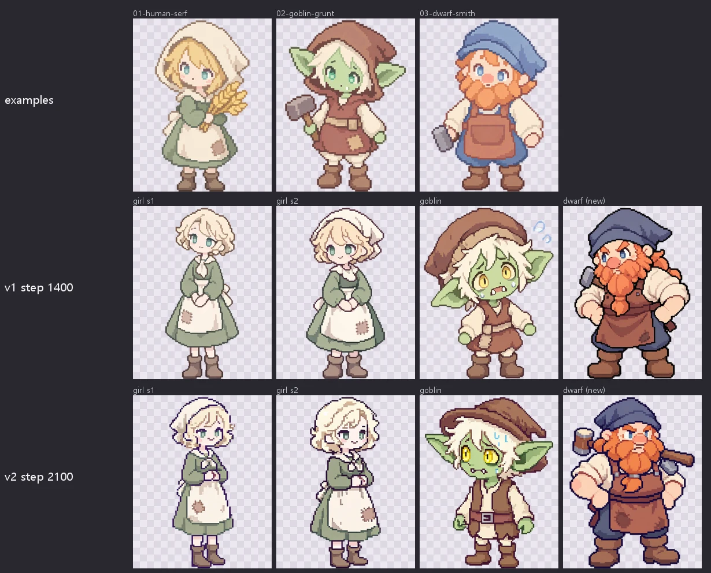

I installed ComfyUI on my PC—basically a local AI art factory—and handed Claude the remote controls so I could generate my own game characters. For two days my RTX 4070 Ti (12GB) ran hot through sixteen test runs. Full disclosure up front: I ended up making the current game's art with a different tool. Still, none of those runs were wasted. Here are the lab notes so my next project doesn't walk straight back into the same walls.

<figure><figcaption>Sixteen runs boiled down to five scenes. Grey boxes are dead ends; green ones are keepers.</figcaption></figure>

## Run 1: of course the winning model couldn't be sold

The opening brief was simple: generate pixel-art characters. Claude fed the exact same prompt to four SDXL pixel models and lined up an herbalist, a goblin, and a cave from each. Laid out like a tasting flight, picking a winner took five seconds. One model nailed flat color blocks and crisp outlines by a mile.

Then we opened its license. You couldn't sell images from it without the creator's permission. From that moment on, every comparison table got a permanent license column at the far right. Pretty art still makes my eyes light up—only now, the prettier it looks, the faster I read the fine print.

One quick bonus tip: write "sprite sheet" in the prompt and models get overexcited, cramming ten or twenty tiny people onto one canvas. One character per image became the default rule right after.

## Shrinking to 18×22 erased the face

To fit the game, the sprite had to shrink to fingernail size. The catch was that scaling down to 18×22 cells melted the character's face into a flesh-colored smudge. The hood and tunic still read fine, but with both eyes gone, my herbalist looked less like an adventurer and more like a faceless ghost.

Zooming in on the raw output, Claude caught something clever: what looked like a large image was already pixel art drawn on a hidden grid of roughly 8px cells. Instead of crushing it with a normal resize, you detect that native grid and sample one representative color per cell.

There was a sneaky order-of-operations trap here, too. On our first try, we quantized the palette down to 16 colors *before* reading the grid—and lost the eyes and pink cheeks all over again. **Flipping the order (recover the grid first, reduce colors second)** kept even single-cell eyes crisp and alive.

<figure><figcaption>Far left: the AI original. Next to it: the recovered native grid. The tiny pair on the right checks whether the face survives at half size.</figcaption></figure>

## Is "just move the legs" really that hard?

A walk cycle only changes the legs, so I assumed it would be easy. We ran img2img—redrawing on top of frame one—and pushed the denoise strength (how much creative leeway the model gets) up to 0.5 and 0.7. As you can see below, the cloak pattern wiggled a bit while her legs stayed firmly planted at attention.

<figure><figcaption>Asked to "walk" three times; stood strictly at attention all three times.</figcaption></figure>

Next we brought in ControlNet pose, which tries to enforce posture using a stick-figure skeleton. Problem: the pose detector didn't even recognize a chibi character whose head is half her body as human. Even after we hand-drew a chibi-proportioned skeleton, the legs refused to budge. We called it right there. For a walk cycle that shifts a pixel or two, doing it by hand beats arguing with a neural net.

## A new art style, and the edit model stole the show

Meanwhile, the game's visual direction pivoted to smooth pastel stickers (that whole detour lives in [Picking the Game's Art Style]()). Suddenly the problem changed: I needed the *same* character to swing, pray, wince in pain, and collapse on the floor.

Enter **Qwen-Image-Edit**, an image-editing model. Instead of generating from scratch, you hand it one standing portrait and tell it to change only the pose. In 20–25 seconds per image, **the posture shifted while the face, clothes, palette, and art style stayed remarkably locked in.** Easily the biggest win out of all sixteen runs.

<figure><figcaption>Only the leftmost image was supplied; the other four are pure edits. Please forgive the kerchief that defies gravity even when she's down.</figcaption></figure>

## Baking a custom style LoRA in 26 minutes—almost

Finally, I got ambitious. What if we taught the model my favorite style directly? I trained a style LoRA—a lightweight add-on patch that steers a base model toward a specific look—on 13 reference images. It finished baking in 26 minutes, and testing checkpoints up to 2,100 steps showed the sweet spot around 1,400 steps. For v2, we tossed in 10 more images from the edit model and carefully tagged "two heads tall" and "three-quarter view".

<figure><figcaption>Top row: the reference examples. Bottom two rows: LoRA output. Great colors, stubbornly tall proportions.</figcaption></figure>

It nailed the colors and patched-fabric details, yet the characters kept stretching to 2.5–3 heads tall with noticeably heavier outlines than the references. Thirteen examples simply weren't enough to drill the "giant chibi head" rule into the weights.

## The playbook for next time

Right around then I moved image production to another tool and shut down the ComfyUI lab. If I fire up the factory again for the next game, here is the checklist I'll follow from day one:

1. Put every candidate model's license in a table before admiring the samples.
2. Never blind-resize pixel art; detect and recover its native grid first.
3. For multiple poses of one character, edit a single base image rather than rolling from scratch.
4. Don't bake a style LoRA until you have dozens of clean examples in hand.

Next up: I turned ComfyUI back on this week to see whether it can finally pull off a pixel sprite of one character walking and swinging with the same face.

## Three-line summary

1. Pixel models already draw on a hidden grid—recover that grid first, then reduce colors, instead of crushing the image down.
2. For consistent poses of one character, an image-editing model beats generating fresh frames by a wide margin.
3. Always put a license column in your comparison sheet. The prettiest model in the lineup might be the one you can't sell.
