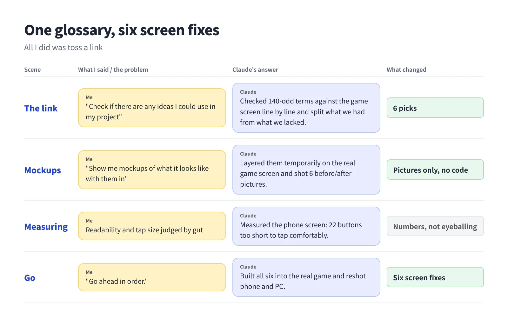
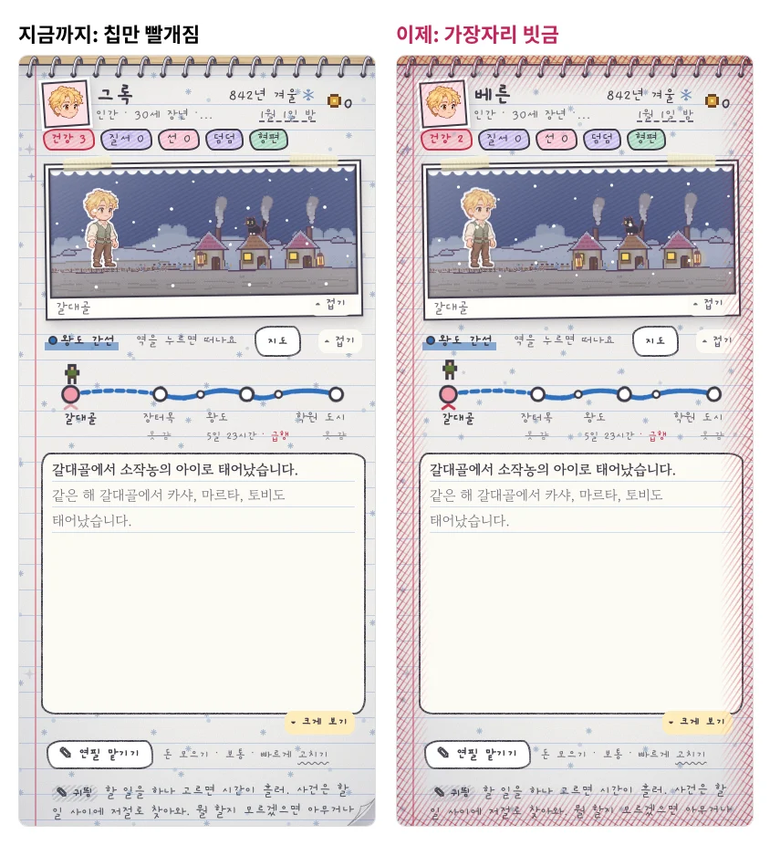
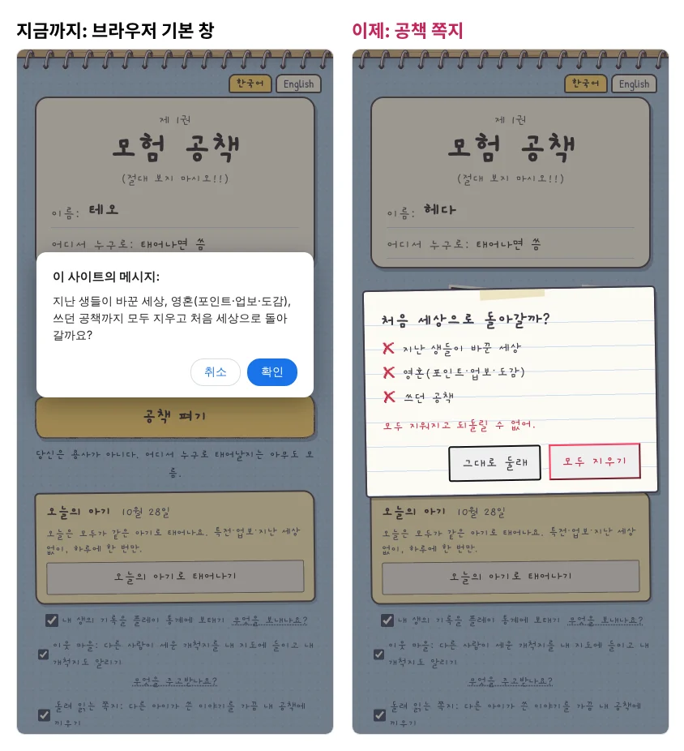
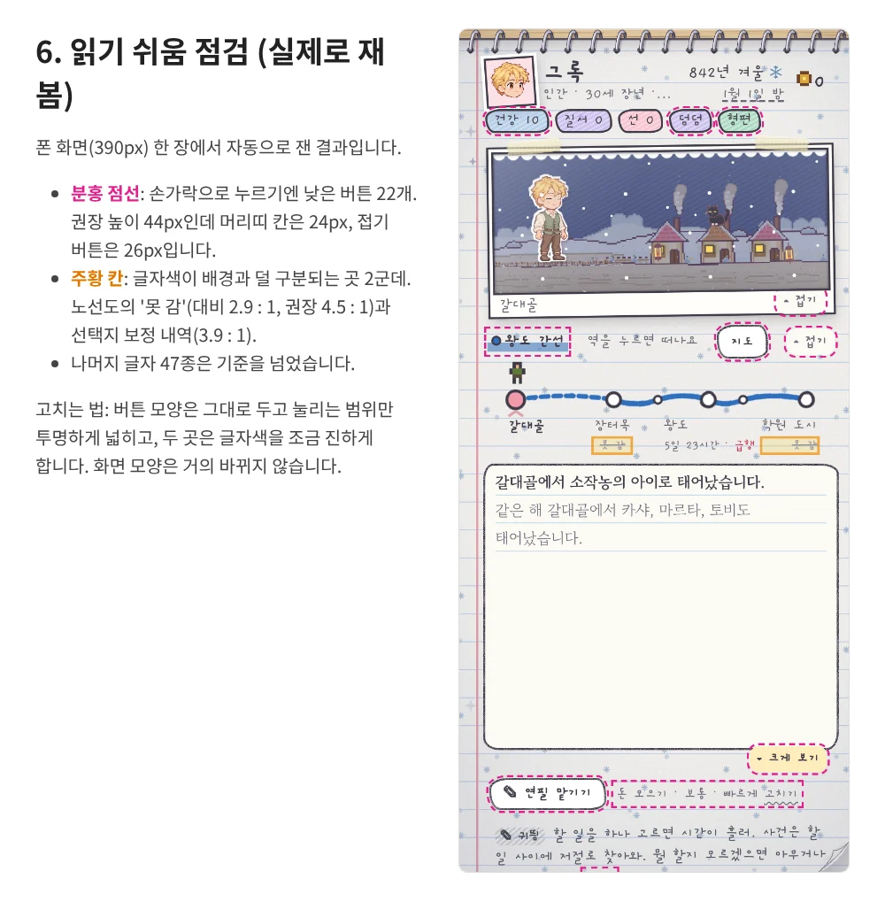
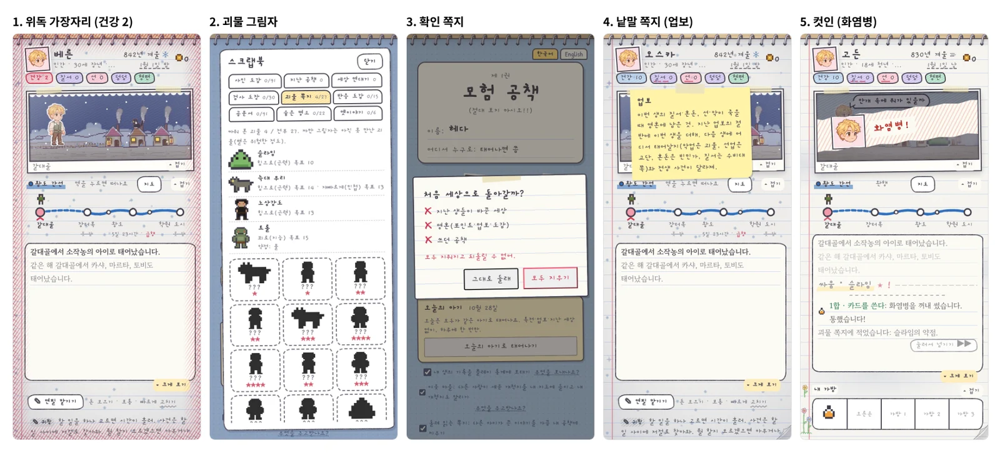

When you design game screens without formal UI vocabulary, you end up saying things like "you know, that thing where the edges turn red when you take a hit." Without the right name, your explanation drags on—and the longer you ramble, the further off-target the AI drifts.

Then I came across a Korean [UI glossary](https://tuiella.github.io/ui-glossary/) that names roughly 140 game UI components. I dropped the URL into Claude with a single line: **"Check if there are any ideas I could use in my project."**

<figure><figcaption>Four prompts that turned one link into six live UI upgrades.</figcaption></figure>

## Turning a glossary into a live audit

Claude read the glossary front to back and checked every term against our codebase. Its report came back neatly sorted into three piles: **what we already have, what doesn't belong in this game, and what's genuinely missing.**

Typewriter-style choices and a success-chance preview were already built. Crosshairs, battle passes, and gacha animations got cut—wrong genre entirely. Closed captions for sound effects clashed with my earlier "no onomatopoeia" rule, and Claude dropped that one on its own. Watching it remember a decision from weeks ago was oddly satisfying.

Six items made the cut: a low-health notebook border, silhouettes for undiscovered monsters, a proper confirmation dialog, inline glossary notes, a cut-in for big attacks, and easier-to-tap buttons.

<figure><figcaption>The glossary's "damage vignette," translated to notebook paper. Low health brings red colored-pencil hatching in from the margins.</figcaption></figure>

## Choose from real-screen mockups, not bullet lists

Reading a six-item text list didn't tell me how any of it would actually feel inside the game. So I asked: **"Show me mockups of what it looks like with them in."**

Without touching a single source file, Claude launched the real game, temporarily overlaid each mockup, and brought back side-by-side before-and-after screenshots. Left was today's screen; right was the proposed change. Seeing each idea sitting inside our actual game made decisions instant—all I had to do was flip through the images and nod.

<figure><figcaption>The jarring gray browser dialog became a torn notebook slip. Buttons name the real action ("Erase all") instead of a vague "OK."</figcaption></figure>

## Pull out a ruler where your eyes lie

The sixth item—readability—couldn't be judged from a mockup. It needed measurements. Claude inspected every button size and text-contrast ratio on the mobile layout and came back with hard numbers.

Twenty-two buttons were too short for a thumb. The recommended tap target height is 44px; our header chips were sitting at 24px, barely past half. **The screen had looked completely fine to my eyes—without those numbers, I would have shipped it as-is.** The fix was neat, too: keep the visual chips the exact same size, and expand only their invisible hit area.

<figure><figcaption>Pink dashes mark undersized tap targets; orange boxes flag low-contrast text.</figcaption></figure>

## "Go ahead, in order."

After reviewing the mockups and measurements, those four words were all it took. Claude built items 1 through 6 into the real game and came back with fresh phone and desktop captures. Drop to low health and the margins now breathe in and out; lob a firebomb and a torn paper strip bearing the hero's face slices across the screen.

<figure><figcaption>Five of the six changes running in-game. The sixth (expanded tap targets) is working properly precisely because you can't see it.</figcaption></figure>

<figure class="narrow"><video src="/assets/img/posts/ui-glossary/pulse.mp4" poster="/assets/img/posts/ui-glossary/pulse.jpg" controls muted playsinline preload="none"></video><figcaption>The border at 1 health—the lower it drops, the wider and faster the pulse.</figcaption></figure>

## Three-line summary

1. When you find a strong reference glossary, have the AI audit your project against it line by line—what you have, what doesn't fit, and what's missing sort themselves out.
2. Ask for temporary mockups overlaid on the real app before editing code; you'll decide in seconds instead of guessing from a list.
3. For ergonomics and legibility, ask for measurements instead of opinions—screens that look fine to the naked eye still hide plenty of 24px buttons.
