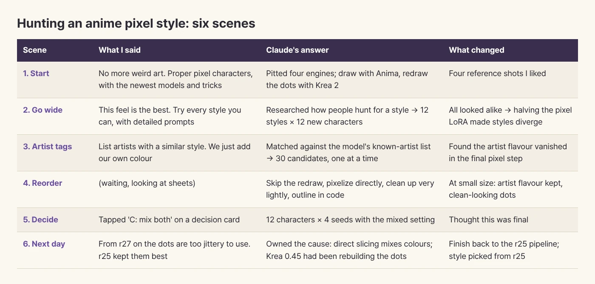
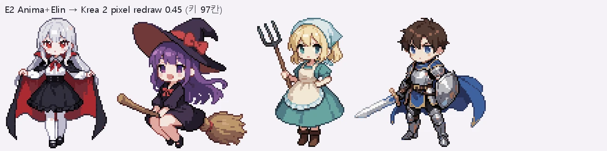
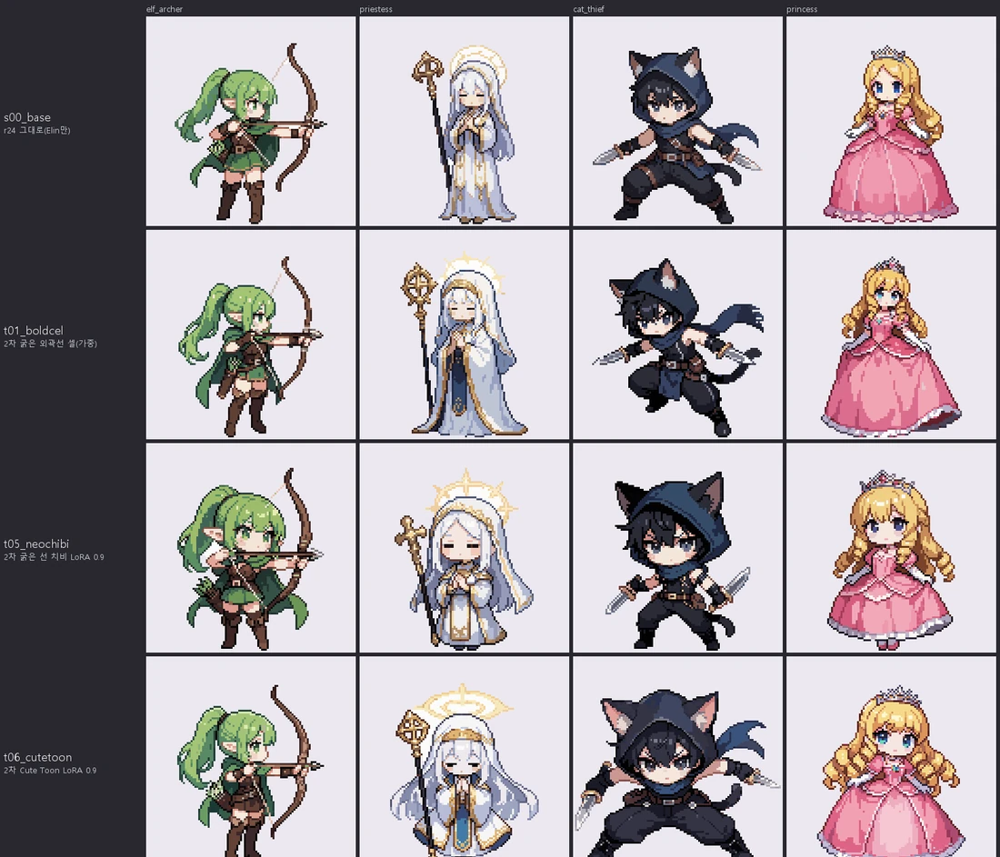
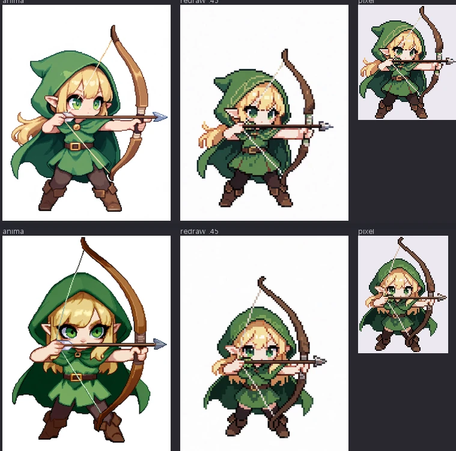
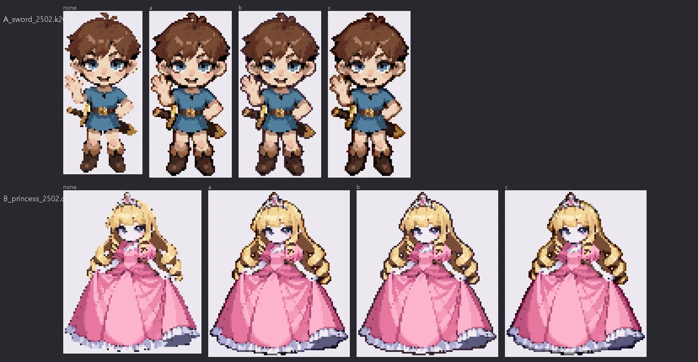
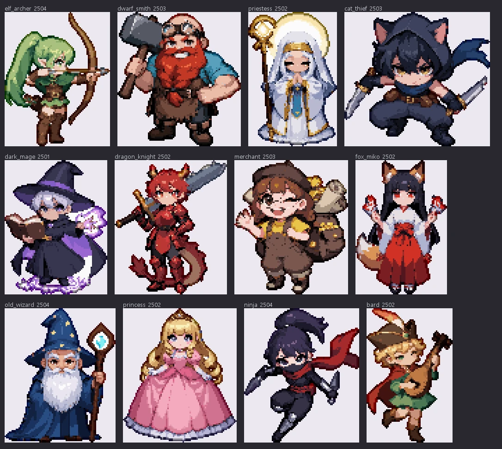
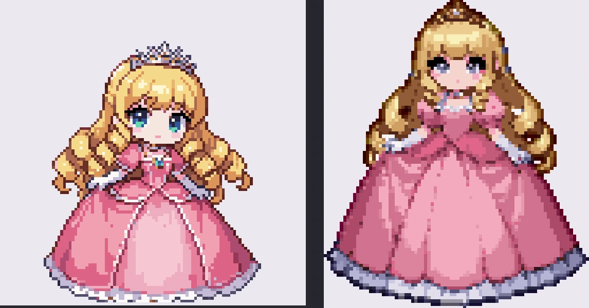

Ask an AI for pixel characters and the first few look promising. Scroll past a dozen more, though, and the weirdness creeps in: glassy eyes, mushy dots, and an awkwardly Western-RPG face popping up out of nowhere. Setting the current game aside for a day, I decided to go hunting from scratch for an anime pixel style I genuinely loved.

<figure><figcaption>Two days of back-and-forth compressed into six scenes.</figcaption></figure>

## "Not these weird pictures"

It started with a blunt complaint: I wanted proper pixel characters instead of "these weird pictures," adding that we should use the newest models and techniques available.

Claude surveyed how the ComfyUI crowd builds pixel sprites and ran four engines head-to-head. Anima paired with a pixel LoRA had the best character art; the newly released Krea 2 with a pixel LoRA produced the cleanest pixels. So Claude chained them together—draw with Anima first, then let Krea 2 redraw just the pixels cleanly. One look at the four test pieces and I was hooked: "I like this look best."

<figure><figcaption>The starting point—and the exact moment I wondered if something even better was hiding one tweak away.</figcaption></figure>

## Twelve styles, twelve identical twins

Naturally, I got ambitious. I asked Claude to explore as many style branches as possible in this direction with rich, varied prompts, and to look up how pros actually engineer prompts when hunting for a personal style.

Digging through the official model card and community guides, Claude came back with three ground rules:

1. Change exactly one variable at a time.
2. Compare at least four seeds side by side for every tweak.
3. Skip bare tag soup—write at least two full sentences of description.

Using that playbook, we ran 12 style branches across 12 fresh characters: an elf archer, a dwarf smith, a cat thief, a fox shrine maiden, a bard, and more. The full-sentence descriptions paid off immediately—drawing a bow, praying, crouching, curtsying with a skirt in hand all landed right on cue.

The styles, however, came out as **twelve identical twins**. No matter what we typed, they refused to budge. The culprit was the pixel LoRA: cranked up so high that it steamrolled every style keyword we threw at it, from "thick outlines" to "pastel" to "90s retro." Cutting its weight in half and turning up the style finally let the twelve branches split apart.

<figure><figcaption>Top row: the baseline style. Bottom two rows: style LoRAs mixed in—bigger heads, softer faces.</figcaption></figure>

## "Even the official docs say it's weak without them"

Here Claude and I clashed. Claude refused to put specific artist names into the prompt, arguing that mimicking someone else wouldn't give us our own style and could become a legal headache if the game ever goes on sale. I pushed back: **list artists close to the look we want so we can blend in our own flavor—after all, even the official docs say the model's styling is weak without artist tags.**

Faced with the docs, Claude pivoted right away. It pulled the 400 artists most frequently tagged alongside pixel and chibi art on an image board, cross-referenced them against the 59,000 artists the model actually knew, and narrowed the list to 243. After filtering out accounts heavy on adult art, it tested 30 artists one by one—same seed, same character, changing nothing but the name.

That's when we uncovered a painful plot twist. The artist tags worked wonders in the Anima step—sharper eyes, bigger chibi heads, bolder linework. Then the image passed through Krea 2's pixel-redraw step at the end, and almost every trace of the artist vanished. We had spent hours seasoning a dish only to rinse it under the kitchen faucet right before serving.

<figure><figcaption>Top: no artist tag. Bottom: one artist added. Worlds apart on the left; practically twins on the right.</figcaption></figure>

## The fix was the pipeline order, not the prompt

Claude suggested reordering the finish. Dropping the redraw and pixelizing Anima's output directly preserved the artist's flavor, though the sprite came out oversized and noisy. A few rounds of tuning gave us a new recipe:

1. Shrink the character to target height (97 cells) first, then pixelize directly.
2. Let Krea 2 do only a whisper-light cleanup. At 0.45 denoise the artist vibe vanishes; at 0.25 and up, mouths and eye highlights start to smear. **0.20** hit the sweet spot.
3. Scrub stray pixels and wrap a dark 1-cell outline around the sprite. Because that runs in plain code instead of AI, it takes 0.003 seconds per image.

<figure><figcaption>Far left: no outline. Moving right, the edges sharpen so the sprite pops even against white.</figcaption></figure>

The final call came down to a decision card (the side-by-side summary Claude writes whenever I have to pick a path): the sharp-eyed artist, the round-faced artist, or a blend of both. Claude recommended the blend and I agreed—mixing two styles kept us away from copying any single artist. Below is the full cast of 12 characters, generated four times each.

<figure><figcaption>Twelve characters from the shiny new pipeline. That night, I genuinely thought we were done.</figcaption></figure>

## "The dots got way too jittery"

The next morning, I opened the sprites one by one and zoomed in. My enthusiasm evaporated on the spot. I messaged Claude: **everything from r27 onward has dots so jittery they're unusable; r25 held the pixels together best.** Even the artist-tag run only held up through r25—everything from r26 on wasn't worth keeping.

Claude diagnosed it immediately. Anima doesn't actually draw native pixel art, so slicing it straight into cells mixes multiple colors inside each square and creates visual static. That heavy 0.45 Krea redraw we had hated for washing out the artist tags was also the step rebuilding clean, intentional pixel structure. **In chasing artist flavor, we had traded away the actual pixel quality.** At thumbnail scale it fooled me completely; blown up to in-game size, the noise screamed off the screen.

<figure><figcaption>Left: the r25 pipeline. Right: the new one. Zoom in and the hair and skirt on the right turn into static.</figcaption></figure>

So we locked the finishing pass right back to r25 (Krea 2 redraw at 0.45) and agreed to pick our style from the r25 branches. The artist tests and the reordered pipeline went straight into the "do not repeat" drawer.

One quick licensing check before wrapping up: Anima's model weights carry a non-commercial license, but its terms explicitly allow using generated images for any purpose, commercial included—the restriction is against hosting the model itself inside a paid service. Krea 2 allows commercial use as long as annual revenue stays under $1M. Next up: pick one r25 style, feed a character in as a reference, and see if we can pull off multiple poses.

## Three-line summary

1. When style keywords seem broken, stop writing longer prompts and check if another LoRA's weight is drowning them out.
2. In a multi-stage pipeline, inspect each stage—and never sign off on pixel art without zooming to real in-game size.
3. When an AI refuses a request for reasons that don't hold up, push back with concrete evidence like the official docs. One clear line is enough to pivot.
