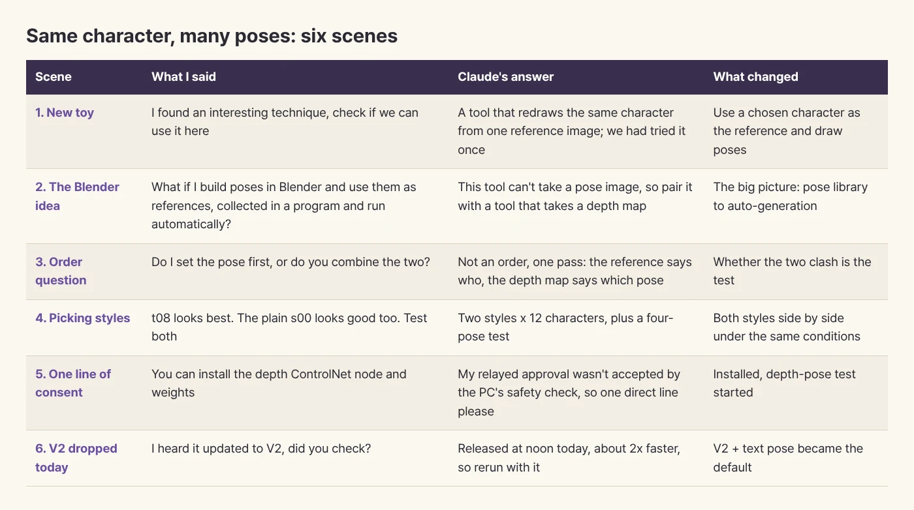
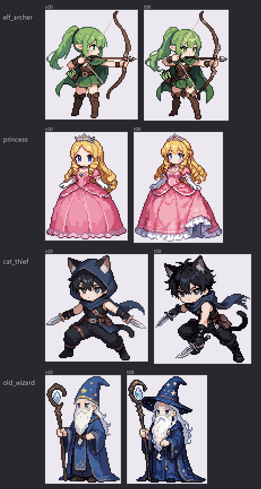
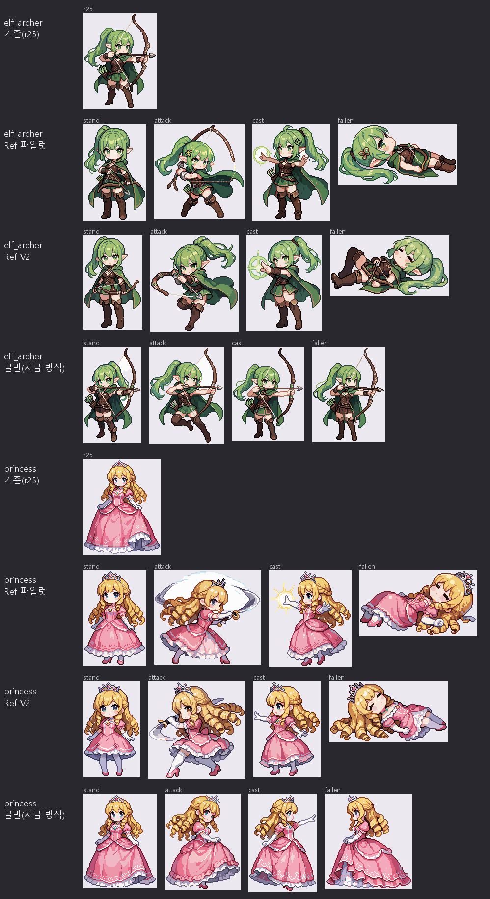
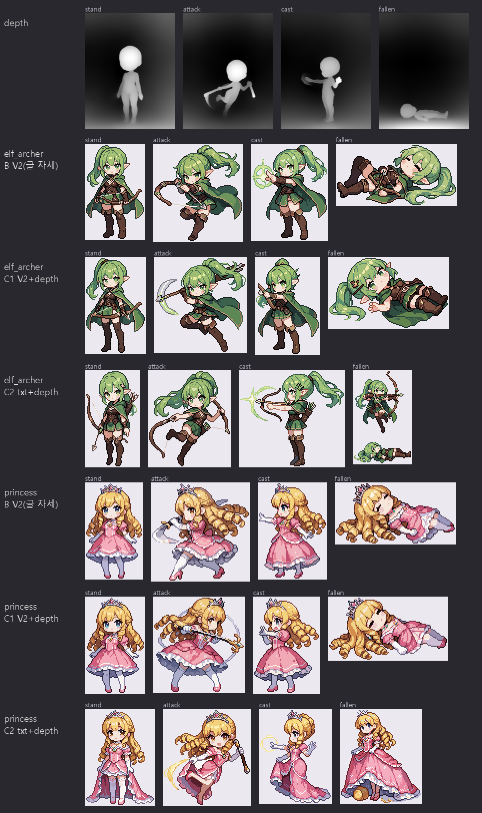

The moment I finally narrowed down the art style, the next boss fight walked right in. Game characters don't get to stand still like passport photos. They have to swing weapons, cast spells, and occasionally eat dirt on the dungeon floor—and the instant you ask an AI for a new pose, it usually swaps out the face and wardrobe along with it. Time to tackle **keeping one character locked in while changing only the pose**.

<figure><figcaption>A full day of back-and-forth squeezed into six scenes.</figcaption></figure>

## "Check if we can use it here"

It started with a toy I spotted online: a reference adapter for Anima that takes one portrait and redraws the same character in fresh scenes. As Claude reminded me, we had actually tried it once in the [earlier motion test](), so it was already sitting on my PC.

My imagination, however, had already sprinted three steps ahead. Why not pose a bunch of 3D rigs in Blender, feed them in as references, and churn out sprites automatically? **The grand vision was a full pose-library app: click a pose, out pops your character.**

Claude's verdict was half yes, half no. The reference adapter is explicitly designed to read *who* is in the picture (face, hair, outfit) and ignore their posture. To drive the pose with an image, we would need to bolt on a separate ControlNet node that reads a depth map—a grayscale picture where closer objects are bright and farther ones are dark.

## "Do I set the pose first, or do you combine them?"

Here I got tripped up on the order of operations: do we lock the pose first and apply the adapter second, or the reverse? Turns out it's **neither—both fire in a single pass**. The reference image says "draw this person," the depth map says "stand in this shape," and the model reads both simultaneously, like handing an animator a headshot and a storyboard panel at the same time. The catch was that nobody had publicly verified whether these two tools even play nice together, which gave our experiment its centerpiece.

While setting up, I also narrowed down the art style. Re-examining our earlier grid, I remarked: "t08 looks best, though the plain base s00 looks great too." Claude ran both under identical settings so I could compare cleanly: t08 had glossy eyes, shiny hair, and ornate patterns, while s00 stayed flat, clean, and super legible at small sizes.

<figure><figcaption>Left: s00. Right: t08. Both keep crisp pixels; the right turns up the shine.</figcaption></figure>

## Consent, typed with my own hands

Midway through, a funny security hiccup stopped us cold. I had already told Claude to go ahead and install the depth tool, yet the install got blocked anyway. Because my approval had been relayed through Claude to the PC, the local safety check refused to accept secondhand permission. I had to type one direct line into the chat myself: "You can install the depth ControlNet node and weights."

Slightly inconvenient in the moment, genuinely comforting in hindsight. **Installing third-party code on my machine shouldn't be settled by AIs whispering "the boss said it's fine" to each other.** On top of that, Claude audited the source code before installing to confirm there were no surprise network calls or sketchy install scripts.

## "I heard V2 just dropped—did you check?"

Right in the middle of testing, word popped up about a V2 release for the adapter. Checking the repo, it had literally launched at noon that very day. Training data had jumped from 300 characters to 2,300, and inference was nearly twice as fast. We upgraded on the spot, and per-image time on my PC dropped from 55 seconds to 33. Sadly, the creator noted that development had paused for lack of funding.

The comparison sheet couldn't have been clearer. Without the adapter—just appending a pose to the original text prompt—the elf archer **kept aiming her bow in all four panels**, whether asked to attack, cast a spell, or lie knocked out on the ground. The phrase "aiming a bow" baked into her original character description simply overpowered every new pose instruction. Handing her identity to the reference adapter and writing only the pose in text fixed it overnight: attack, spellcast, and flat-on-the-floor all landed while keeping her face, hair, and outfit intact.

<figure><figcaption>The bottom row for each character is text-only, no adapter. Tell the elf to collapse and she still refuses to drop that bow.</figcaption></figure>

## No need to haul out Blender after all

What about those depth maps I had been so excited about? Good news first: the reference adapter and depth ControlNet didn't clash at all. Together they kept the character recognizable while following the standing silhouette, forward lean, and fallen posture.

The bad news? Depth maps generated from a basic mannequin were too blunt to steer arms and weapons accurately. **In practice, they barely outperformed a single line of plain text.** Worse, running the depth map *without* the adapter sometimes hallucinated two people into one frame.

<figure><figcaption>Top row: the mannequin depth maps. The overall silhouette carries over, but arms and weapons get lost.</figcaption></figure>

So the winning default is refreshingly simple: **"reference adapter V2 + pose in plain text."** The Blender pose factory stays on the shelf until we genuinely need razor-sharp depth maps for exact arm and weapon placement. Two loose ends remain: a mysterious glowing orb that spawns in the hand during every casting pose, and a weapon that morphs freely between scythe, staff, and sword. Next time, I'll lock in one style and generate a full pose set with the weapon nailed down.

## Three-line summary

1. Don't cram character identity and new poses into one text prompt—split the job into one reference portrait for *who* and one line of text for *what they're doing*.
2. Before bolting on Blender rigs or extra ControlNets, test how far plain text takes you. Simpler gear wins surprisingly often.
3. When you hear an open-source tool just shipped a new version, check right away. One question cut our render time from 55 seconds down to 33.
