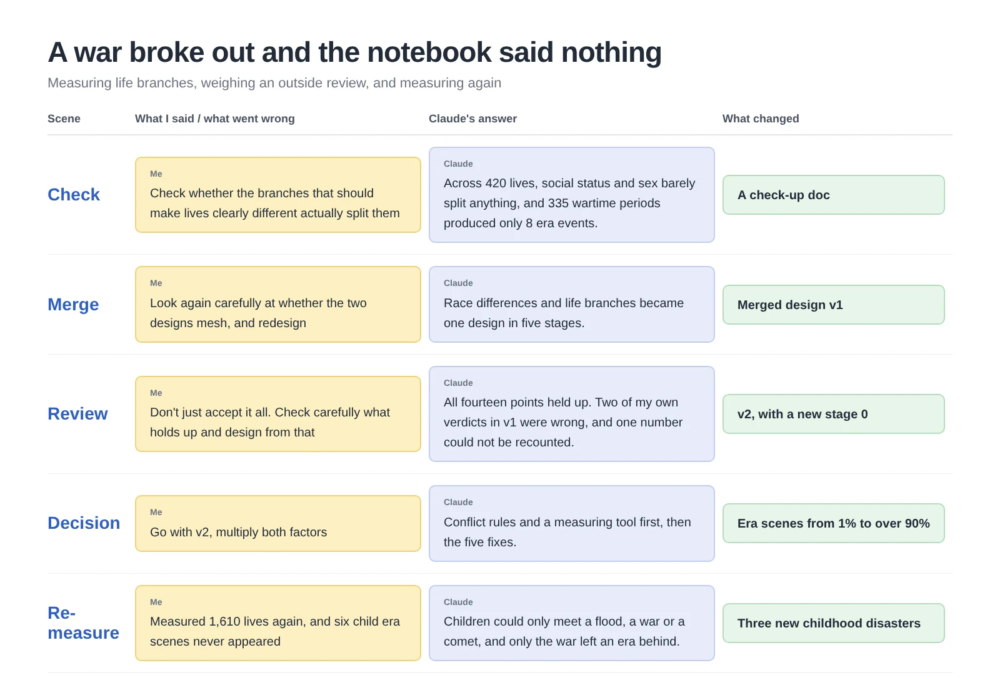
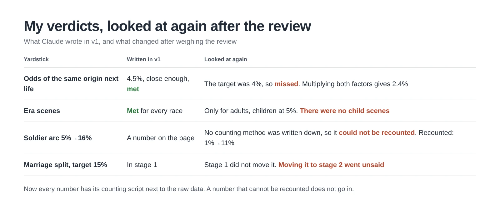
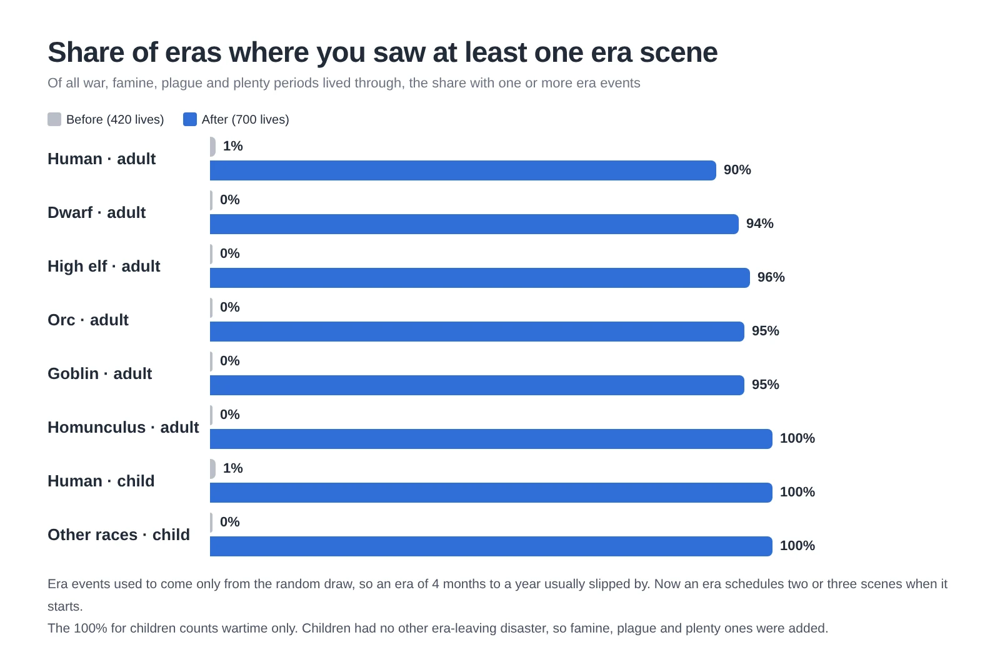
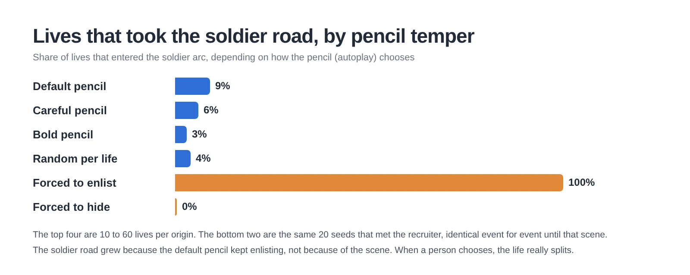

If a war breaks out across the kingdom and your diary only talks about quiet village chores, something has gone sideways. In the Notebook RPG I'm building, when your character dies you flip to a fresh notebook for the next life—so each run really ought to branch into a different story. One day I stopped assuming it did and asked Claude to actually measure it. Does a noble's life read differently from a serf's? Does growing up in wartime read differently from a year of plenty? The numbers came back a little humbling.

<figure><figcaption>Five scenes, from asking for a check, to handing over an outside review, to tapping one decision card.</figcaption></figure>

## 335 wars, 8 lines in the notebook

Claude auto-played 420 lives across twenty-one origins and returned with a report. Born a serf's kid or a temple novice in the same reed village, you ended up living nearly the same adult life. Run the same seed as a man and as a woman across 84 pairs, and **not a single pair experienced a different event.** The real gut punch came last: across 335 periods of war, famine, and other major upheavals, era-specific scenes showed up exactly 8 times. The country was on fire, and the notebook kept doodling like it was a sunny Tuesday.

Meanwhile, another thread was reworking racial differences. Both jobs touched the same event pool, so running them in parallel was asking for a head-on collision. I merged the two and asked Claude: "Look again, carefully, at whether the two designs mesh with each other, and whether the directions I gave are actually covered by that design, and redesign it." Out came merged design v1, laid out in five stages.

## "Don't just accept it all"

I sent v1 out for a second opinion elsewhere, and it came back with fourteen critiques. Pasting all fourteen straight in would have been easy, sure, but swallowing outside feedback whole is the fastest way to turn a design into Frankenstein's monster. So I handed the list to Claude with a caveat: "This isn't something to accept unconditionally. Look at it, and carefully check which parts hold up or need more work, then design from there."

Claude weighed all fourteen points one by one and decided every single one held water. Even better, auditing someone else's notes made it **confess its own mistakes first**. Two items it had marked "met" in v1 had actually missed their targets, and one figure couldn't be reproduced at all because the counting method was never saved.

<figure><figcaption>The target was 4%, and it had casually stamped "met" beside 4.5%. Now every metric keeps its counting script right next to the raw data.</figcaption></figure>

Version 2 folded in the review and added a brand-new stage 0: before writing a single extra scene, establish traffic rules for when scenes collide, and build the measuring tool to verify them. On the decision card, I clicked "Go with v2, multiply both factors."

## Rules first, then 1,610 lives

The moment we added more scenes, the collisions showed up right on cue. Elves live for centuries, so a wedding, a newborn, and a war could easily pile into the same calendar year. Three traffic rules went in first:

1. **Priority order**: birth, losing someone, major era events, growing up, then marriage and children.
2. **Half a year apart**: scheduled scenes keep six months between them. At first we tried scaling that spacing by each race's lifespan pace—which stretched it to ten years for elves and quietly dropped almost every scene.
3. **Same-meaning bundles**: the wartime recruiter, the origin-based levy, and the human-village recruiter all tell the same "army comes calling" story, so only one can trigger within ten years.

With the new tool, we simulated 1,610 lives. The share of eras where a character saw at least one era scene leaped from 1% to 90% for human adults, and from 0% to 94–100% for adults of other races.

<figure><figcaption>The grey bars you have to squint to see are the before. Child bars count wartime only.</figcaption></figure>

The measuring tool also exposed a sneaky blind spot. We had written eight new childhood era scenes, yet six of them never triggered once across 700 lives. Turned out children could only experience three major events—a flood, a war, and a comet—and only war actually spawned an era. **We had written the famine scenes and forgotten to build a road for famine to arrive.** We added a childhood lean year, plague, and great harvest right away.

## The surge of soldiers was the pencil's fault

One number still rubbed me the wrong way. After adding war scenes, lives entering the soldier arc jumped from 1% to 11%, while lives with children dipped slightly. Were the new scenes railroading players into the barracks?

To find out, we swapped out our "pencil"—the autoplay bot that picks choices for you—and tested careful, bold, and per-life random personalities. We also lined up the same twenty seeds in front of the recruiter and forced one group to enlist and the other to hide.

<figure><figcaption>All twenty who enlisted became soldiers. None of the twenty who hid did.</figcaption></figure>

The culprit was the default pencil, which had a reflex for signing up whenever a recruiter walked by. Flip that around and it was actually good news: when a real human makes the choice, lives genuinely branch apart. We caught a bonus quirk about personality, too. Even with a completely random pencil, 72% of lives ended up hot-headed—meaning that skew lives inside the events and choices themselves, not the bot. We parked that for the upcoming personality stage.

That's what shipped in this update. The small dip in lives with children, along with married and single runs still overlapping a bit too much, gets re-measured next when each race gets its own family structure. First, though, I want to untangle five core states—including legal status, affiliation, and livelihood—plus how a neighborhood calculates your reputation.

## Three-line summary

1. Don't judge "do lives actually branch?" by gut feel. Have the AI simulate it—numbers like 335 wars and 8 diary lines never surface in conversation.
2. Hand over outside feedback with "weigh it, don't blindly adopt it." Checking someone else's critique often prompts the AI to catch its own earlier slips.
3. Keep the counting script right next to every metric. A number you can't reproduce can't support your next decision.
