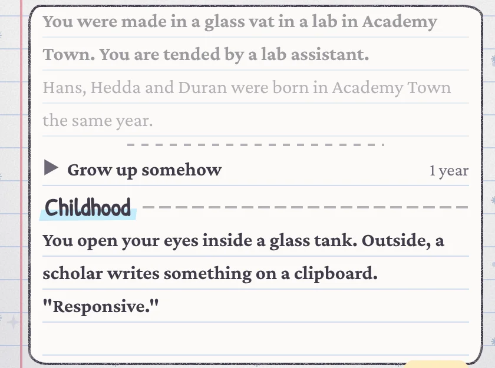
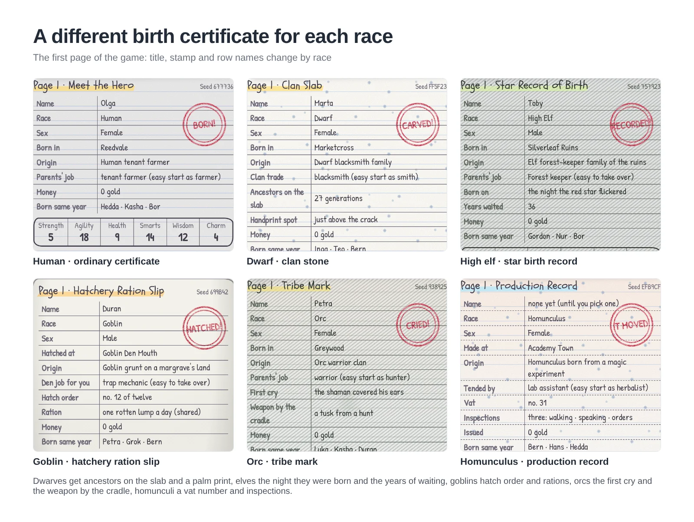
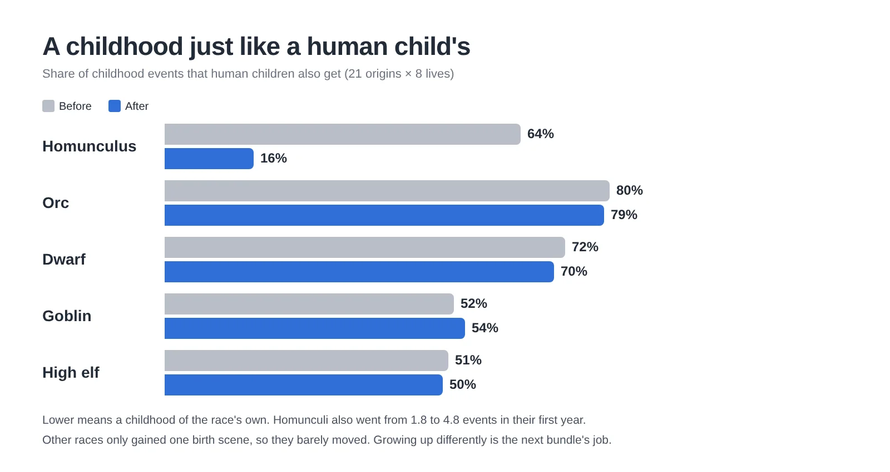

An artificial human grown in a magic lab's glass vat was crawling across the floor and playing peekaboo. In the previous post I nudged adult dwarves toward the anvil and elves toward the library—which only made childhood stick out worse. Once characters grew up they finally had some flavor, while as kids all six races were still the same generic village toddler. Time to go back to page one of the notebook.

<figure><figcaption>Five scenes, from asking for an audit to tapping one decision card.</figcaption></figure>

## The homunculus that crawled

I opened with a loose prompt: figure out how to make racial differences hit harder for players. Rather than poking around the code on a hunch, Claude ran the numbers first—eight lives from each of 21 origins, childhood only, 168 lives in all.

The printout got an immediate laugh out of me. A homunculus grown in a glass vat was **learning to crawl and playing peekaboo.** It saw only 1.8 events in its first year, and 64% of its childhood overlapped with a human kid's. Forest elf babies and mine-born dwarf babies were both getting the "adventurers trample the village field" event. Deep in an ancient forest. Which field, exactly?

## "Elves would normally be born in a forest, right?"

While the simulation ran, a second thought tagged along. Birthplace is only half the picture—how you're raised, and the values and prejudices that rub off on you, shouldn't match across races either. I added a quick note: a homunculus isn't born like an ordinary creature at all, so its background and culture need real teeth right from the moment it opens its eyes.

Back came a table laying out birth, upbringing, values, and prejudice for every race, along with fresh lore for homunculi. They wake inside a vat, pass three inspections—walking, speaking, following orders—and on the day they leave the academy **they choose their own name.** Claude split the work into four bundles on a decision card, and I tapped "Start with bundle 1, birth." Rewrite everything at once and you'll never know what actually moved the needle.

<figure class="narrow"><figcaption>A homunculus's opening scene. You aren't "born," you're "made"—and instead of crawling, you get to ask why.</figcaption></figure>

## A scene you always see in your first three days

Whoever you roll, within your first one to three days you now hit a scene written specifically for your race and origin. There are twelve in total:

1. **Dwarf**: clan elders blacken the newborn's palm with charcoal and press it onto the ancestor slab. Beneath centuries of handprints, the bottom corner is yours.
2. **Ruin elf**: you're the first baby born in the forest in forty years. The keepers hold their breath watching which star you reach for, though grabbing a firefly instead is fine.
3. **Goblin and orc**: goblins start in a pen packed with eleven siblings; orcs get dunked straight into an icy river by tribal custom.
4. **Human**: in a fort you arrive the night the alarm drum sounds, on the coast at the dawn the tide turns, and in a gravekeeper's hut the exact moment every crow lifts off at once.

Homunculi get two extra beats. A few months in comes inspection day, and flunking even one item sends you back to the vat—the one beside yours quietly emptied last week. Right before release day, a vat sibling whispers to ask if you've picked a name. Keeping your serial number, or copying a missing sibling's number onto the back of your hand, is up to the player.

## Different paperwork from page one

The very first screen you see when starting a life is your birth certificate. To set the tone right away, every race got its own paperwork—ink stamp included.

<figure><figcaption>The homunculus name row reads "none yet (until you pick one)," and the stamp says "IT MOVED!"</figcaption></figure>

Humans get "BORN!", dwarves "CARVED!", goblins "HATCHED!", orcs "CRIED!". The goblin form is straight-up a hatchery ration slip: hatch order reads "no. 12 of twelve," and daily ration says "one rotten lump a day (shared)." One glance at the sheet tells you exactly what kind of welcome this kid is getting.

## Measured again: only the homunculus really moved

With everything wired in, we ran the 168 lives again. Every single run opened with its proper birth scene, and homunculi no longer crawl around playing peekaboo.

<figure><figcaption>Lower means a childhood of the race's own. Only the homunculus bar dropped sharply.</figcaption></figure>

The chart kept me honest, though. Homunculi dropped from 64% to 16% overlap with human kids, while every other race barely budged. Vivid as a birth scene is, it's still just one event. An orc kid still spends eight out of ten afternoons living through the same events as a human kid. So next up is bundle 2: growing up differently, and the words you hear as a child hardening into values.

## Three-line summary

1. When you only have a hunch that races "should feel different," ask the AI to measure the current overlap first. A peekaboo-playing homunculus jumps right off a data table.
2. Break big overhauls into bundles and ship one at a time. Change one layer and re-measure, or you'll never know what worked.
3. When the chart moves less than you hoped, resist the urge to spin it. That gap is your roadmap for the next bundle.
