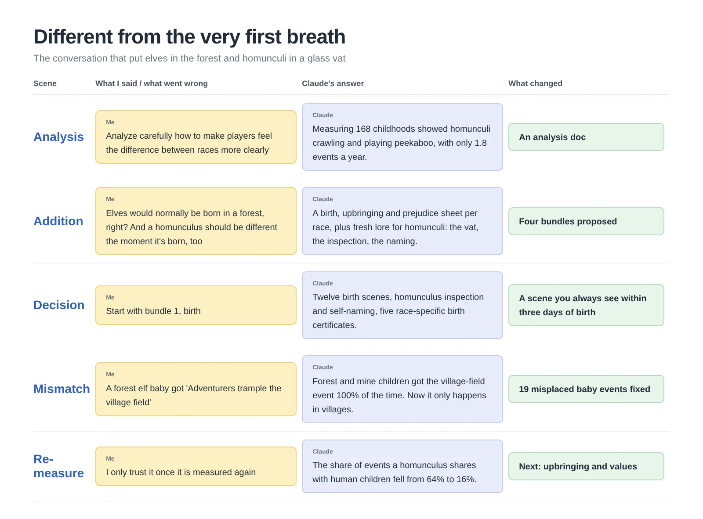

In the last post I nudged dwarves toward the anvil and elves toward the library. Fixing adulthood only made childhood stick out worse, though—once they were grown they had some flavor, while as kids everyone was still the same generic village toddler. So I went all the way back to day one.

<figure><figcaption>Five scenes, from asking for an analysis to tapping one decision card.</figcaption></figure>

## The homunculus that crawled

I started with a broad ask: dig into how to make the race differences land harder for players. Rather than guessing, Claude ran the numbers first—eight lives from each of 21 origins, childhood only, 168 lives in all.

The printout made me laugh out loud. A homunculus grown in a glass vat in a magic lab was **learning to crawl and playing peekaboo.** It got just 1.8 events in its first year, and 64% of its childhood matched a human kid's. Forest elf babies and mine-born dwarf babies were both getting the "adventurers trample the village field" event. In a forest. Which field, exactly?

## "Elves would normally be born in a forest, right?"

While that simulation ran, another thought crept in. Where you're born is only half of it—the way you're raised, and the values and prejudices you pick up along the way, shouldn't match either. I added a note that a homunculus was made completely differently from any ordinary creature, so its background and culture needed real teeth, right down to the moment it wakes up.

Back came a table laying out birth, upbringing, values, and prejudice for every race, plus brand-new lore for homunculi. They wake in a vat, pass three inspections—walking, speaking, following orders—and on the day they leave the academy **they name themselves.** The work came split into four bundles, and on the decision card I tapped "Start with bundle 1, birth." Change everything at once and you never know what actually moved the needle.

<figure class="narrow"><figcaption>A homunculus's first scene. It isn't "born," it's "made," and instead of crawling you get to ask why.</figcaption></figure>

## A scene you always see in your first three days

Whoever you roll, within your first one to three days you now get a scene that belongs to your race and origin. There are twelve in total:

1. **Dwarf**: clan elders blacken the newborn's palm with charcoal and press it onto the ancestor slab. Beneath centuries of handprints, the bottom corner is yours.
2. **Ruin elf**: you're the first baby born in the forest in forty years. The keepers watch which star you reach for, though grabbing a firefly instead is fine.
3. **Goblin and orc**: goblins start in a pen with eleven siblings; orcs get dipped straight into an icy river by tribal custom.
4. **Human**: in a fort you're born the night the alarm drum sounds, on the coast at the dawn the tide turns, and in a gravekeeper's hut the moment every crow lifts off at once.

Homunculi get two extra beats. A few months in comes inspection day, and flunking even one item sends you back into the vat—the one next to yours went empty last week. Right before release day, a vat sibling quietly asks if you've picked a name yet. Keeping your serial number or copying a sibling's number onto the back of your hand is up to the player.

## The paperwork is different from page one

The very first screen in the game is your birth certificate, so every race got its own paperwork—right down to the ink stamp.

<figure><figcaption>The homunculus name row says "none yet (until you pick one)," and the stamp says "IT MOVED!"</figcaption></figure>

Humans get "BORN!", dwarves "CARVED!", goblins "HATCHED!", orcs "CRIED!". The goblin form is literally a hatchery ration slip: hatch order reads "no. 12 of twelve," and daily ration says "one rotten lump a day (shared)." One glance at the paper tells you how this kid is going to be treated.

## Measured again, only the homunculus really moved

With everything wired in, I ran the 168 lives again. Every single run opened with its proper birth scene, and homunculi no longer crawl around playing peekaboo.

<figure><figcaption>Lower means a childhood of the race's own. Only the homunculus bar dropped sharply.</figcaption></figure>

The chart keeps me honest, though. Homunculi dropped from 64% to 16% overlap with human kids, while everyone else barely budged. Vivid as a birth scene is, it's still one event. An orc kid still lives through the same afternoon as a human kid eight times out of ten. So the next post tackles bundle 2: growing up differently, and the things you hear as a child hardening into values.

## Three-line summary

1. When you feel something "should clearly be different," ask the AI to measure it first. Mismatches like a crawling homunculus show up in numbers long before anyone puts them into words.
2. Split big work into bundles and do one at a time. Change one thing and measure again, and you'll see what actually worked.
3. If the result moved less than you hoped, take it as it is. That gap tells you what to do next.
