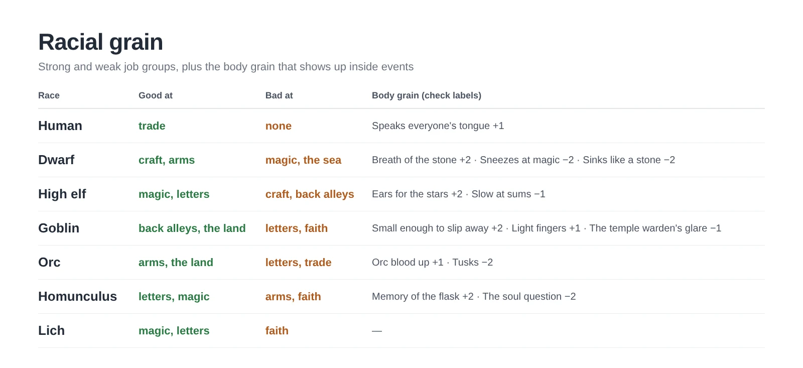

The Notebook RPG I'm building is a fantasy life-sim web game styled like a grade-schooler's scrawled notebook—and it packs six playable races: humans, dwarves, high elves, goblins, orcs, and homunculi. One day a nagging question popped into my head. In any self-respecting fantasy world, dwarves swing hammers and elves crack open spellbooks. Was ours actually doing that? I tossed the question to Claude, and the report card came back a little embarrassing.

<figure><figcaption>Five scenes, from one casual question to one lasting rule.</figcaption></figure>

## "Shouldn't there be something like that?"

My question was simple enough: dwarves are usually terrible at magic and elves are naturals, so shouldn't each race lean toward different jobs and run into different events?

Before guessing at an answer, Claude let the game play itself 210 times. The verdict was blunt: the moment characters grow up, race practically evaporates. Dwarves were drifting into tanning, gravedigging, and pickpocketing at random, while seven out of twenty high elves spent their centuries as hermits or idlers. The entire racial difference boiled down to a +2 stat bump—roughly 5 percentage points on a check. Elf-only events popped up 0.2 times across an 820-year lifespan. **Eight centuries of elf life, and it read like a copy-pasted human one.**

## What "design it slowly" changed

The first proposal landed almost immediately: an aptitude table per race with numbers bolted on. Nothing technically wrong with it, except it smelled less like fantasy and more like an HR spreadsheet. So I tapped the brakes—"Analyze it carefully and design it slowly." Make it fit the events and mechanics we already have, and make it actually fun to play.

Draft two came back with a completely different feel, starting with its name: **"racial grain."** One clean principle: ban nothing. Going with the grain is smooth; going against it fights you. A dwarf can still become a wizard, sure—it just feels like planing wood against the grain. Stiff, slow, and prone to splinters.

<figure><figcaption>At magic events a dwarf "Sneezes at magic," and at sea they "Sink like a stone."</figcaption></figure>

The grain runs three layers deep:

1. **Hands**: strong-fit jobs get +2 on the apprenticeship check and level up 1.3x faster; weak-fit jobs take −2 and crawl at 0.7x. Our autoplay bot—the "pencil" that picks choices for you—also reaches for good-fit work twice as often.
2. **Body**: thirteen check labels let your race peek through inside events even if you have no trade at all. An orc trying to sweet-talk nobles takes −2 for "Tusks."
3. **Life**: each race gets tuned event weights, plus six brand-new racial story arcs. A high elf befriends a human, and between the friend going grey and a grandchild tugging at the elf's sleeve at the funeral, only a few seasons pass on the elf's clock.

## One question before breaking ground

Reading the spec, a familiar worry crept in. Jobs and events will keep growing; if we have to patch this table every time a new one lands, the whole thing will turn into a duct-tape quilt in two weeks. So before a single line of code went in, I asked: "Will it still be easy to extend when I add jobs or events later?"

Thankfully, the plumbing held up. The grain checks **job groups and event tags, not individual jobs.** Tag a new job as "craft" and dwarves automatically take to it. Better yet, we paired it with a validator that raises a red flag the second anyone forgets a tag. Asking that one question before construction saved us from knocking down walls later.

From there, approval took one click on Claude's decision card—"Go with the recommendation, steps 1 to 7"—and the seven steps rolled in one by one.

## Dwarves to the anvil, elves to the library

Now the exact same "Learn a trade" menu wears a different face for every race. A dwarf sees "Born to it +2" gleaming beside the family anvil and the guard; a high elf eyeing a smithy's bellows gets "Against the grain −2."

<figure><figcaption>20% odds and a twenty-year bellows apprenticeship for an elf. Still, nobody says you can't.</figcaption></figure>

Anyone stubborn enough to fight the grain to the end doesn't walk away empty-handed. Master a weak-fit trade and a clan elder shows up to watch with folded arms; later, a kid of your own kind knocks on your door asking to apprentice under you. Your notebook earns an "Against the Grain" stamp, and if you roll the same race in your next life, that trade isn't clumsy anymore. Stubbornness sticks to the soul.

Testing also handed us a funny little accident. A human farmer was supposed to get caught lying to the guild inspector and lose his job, except he kept smoothly talking his way out of it. Turns out the "Speaks everyone's tongue" +1 I'd given humans for market haggling was helping his lies glide right past too. We left the game untouched and fixed the test. That felt way too human to nerf.

## Measured again: about halfway there

With all seven steps wired up, we let the game run 210 lives again.

<figure><figcaption>Grey is before, blue is after. Elf-only events jumped fourfold too.</figcaption></figure>

Dwarves now gravitate toward guard duty and captaincy, while elves line up as scribes and song keepers alongside hermits. To be honest, though, the broader event-type mix still only shifts by 1 to 4 percentage points between races. Right now you feel the difference in check labels and racial stories more than in the macro stats. Once real play logs start piling up, I'll tighten the event weights a notch further.

## Three-line summary

1. When something feels like it "should work differently," have the AI measure the current state first. Numbers like 0.2 events in 820 years cut straight through guesswork.
2. When the first proposal reads like a spreadsheet, a simple "design it slowly" gives the AI room to weave the idea into your existing mechanics.
3. Always ask "will this hold up as it grows?" before writing code. That single check got us a tag validator along for the ride.
