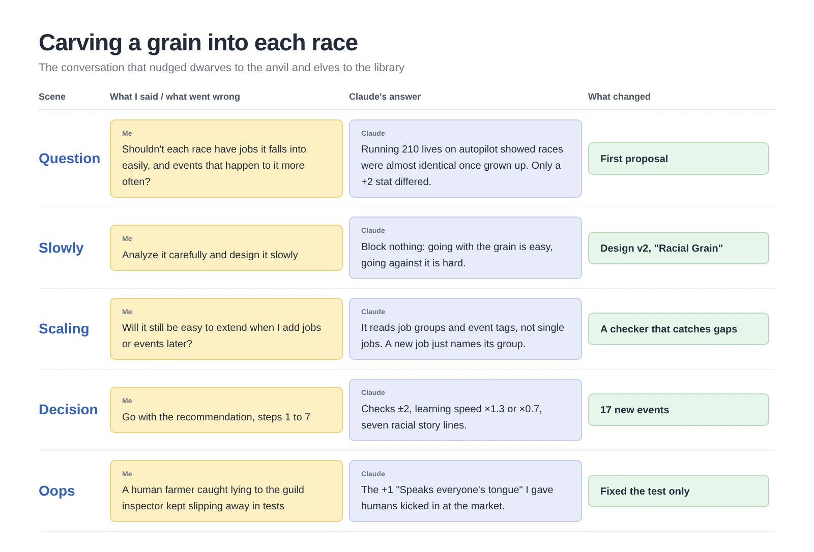
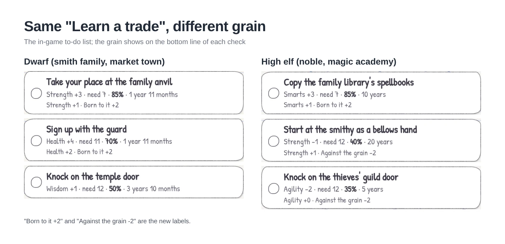
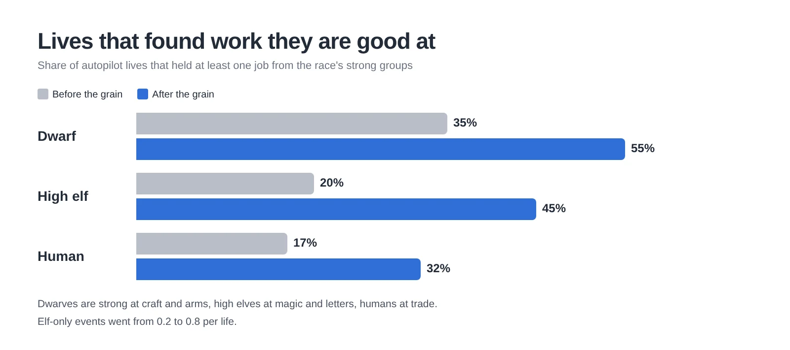

The notebook RPG has six races: humans, dwarves, high elves, goblins, orcs, and homunculi. Somewhere along the way I got curious. In any self-respecting fantasy, dwarves swing hammers and elves crack open spellbooks. Was ours actually doing that? I tossed the question to Claude, and the report card came back a little embarrassing.

<figure><figcaption>Five scenes, from one question to one rule.</figcaption></figure>

## "Shouldn't there be something like that?"

My question was straightforward: dwarves are usually bad at magic and elves are good at it, so shouldn't each race gravitate toward certain jobs and run into different events?

Before answering, Claude let the game play itself 210 times. Verdict: the moment characters grow up, race practically evaporates. Dwarves were wandering into tanning, gravedigging, and thieving at random, while seven out of twenty high elves spent their lives as hermits or idlers. The entire racial difference boiled down to a +2 stat bump—about 5 percentage points on a check. Elf-only events popped up 0.2 times across an 820-year lifespan. Eight centuries of elf life, and it read pretty much like a human's.

## What "design it slowly" changed

The first draft landed almost immediately: an aptitude table per race with numbers bolted on. Not wrong, exactly, just reeking faintly of spreadsheet. So I tapped the brakes—"Analyze it carefully and design it slowly." Make it fit the events and mechanics we already have, and make it fun to play.

Draft two felt completely different, starting with its name: **"racial grain."** One simple rule: block nothing. Going with the grain is smooth; going against it fights you. A dwarf can still become a wizard, sure. It's just like planing wood against the grain—stiff, slow, and prone to splinters.

<figure><figcaption>At magic events a dwarf "Sneezes at magic," and at sea they "Sink like a stone."</figcaption></figure>

The grain runs three layers deep:

1. **Hands**: strong-fit jobs get +2 on the apprenticeship check and level up 1.3x faster; weak-fit jobs take −2 and crawl at 0.7x. The autopilot pencil also picks good-fit work twice as often.
2. **Body**: thirteen new check labels let your race peek through inside events even if you have no job. An orc sweet-talking nobles takes −2 for "Tusks."
3. **Life**: each race now draws different event weights, plus six new racial story arcs. A high elf befriends a human, and between the friend going grey and a grandchild tugging at the elf's sleeve at the funeral, only a few seasons pass on the elf's clock.

## One question before building

Reading the spec, one worry nagged at me. Jobs and events will keep growing, and if we have to patch this table every single time, it'll turn into a quilt of duct tape. So before a single line of code went in, I asked: "Will it still be easy to extend when I add jobs or events later?"

Thankfully, yes. The grain checks **job groups and event tags, not individual jobs.** Tag a new job as "craft" and dwarves automatically take to it. Better yet, we paired it with a validator that throws a red flag the second anyone forgets a tag. Asking that one question up front saved us from knocking down walls later.

From there, I just clicked "Go with the recommendation, steps 1 to 7" on the card and let Claude march through them.

## Dwarves to the anvil, elves to the library

Now the exact same "Learn a trade" menu wears a different face for each race. A dwarf sees "Born to it +2" next to the family anvil and the guard; a high elf eyeing a smithy's bellows sees "Against the grain −2."

<figure><figcaption>A twenty-year bellows apprenticeship for an elf. Nobody says you can't.</figcaption></figure>

Anyone stubborn enough to fight the grain all the way still gets rewarded. Master a weak-fit trade and a clan elder shows up to watch with folded arms; later, a kid of your own kind comes knocking to apprentice under you. Your notebook earns an "Against the Grain" stamp, and if you roll the same race next life, that trade isn't clumsy anymore. Stubbornness sticks to the soul.

We hit one funny snag in testing. A human farmer was supposed to get caught lying to the guild inspector and lose his job, except he kept getting away with it. Turns out the "Speaks everyone's tongue" +1 I'd given humans for market haggling was letting his lies glide right past too. We left the game alone and fixed the test. That felt way too human to nerf.

## Measured again: about halfway there

With everything wired up, we ran 210 lives again.

<figure><figcaption>Grey is before, blue is after. Elf-only events went up fourfold too.</figcaption></figure>

Dwarves now settle into guard duty and captaincy, while elves split between hermits, scribes, and song keepers. Still, to be honest, the overall event-type mix only shifts by 1 to 4 percentage points between races right now. For the moment, you feel the difference in check labels and racial stories more than in raw stats. Once real play logs start piling up, I'll tighten the event weights a bit harder.

## Three-line summary

1. If something feels like it "should be there," ask the AI to measure the current state first. Starting from numbers instead of hunches keeps the design steady.
2. A single "design it slowly" turned a one-table proposal into a rule that meshes with the game's mechanics.
3. Before building, always ask, "Will this still hold up as it grows?" That single question earned us a validator that catches missing tags.
