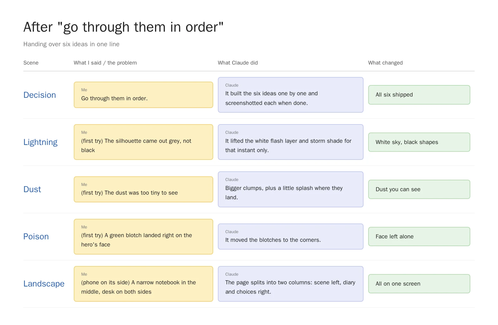
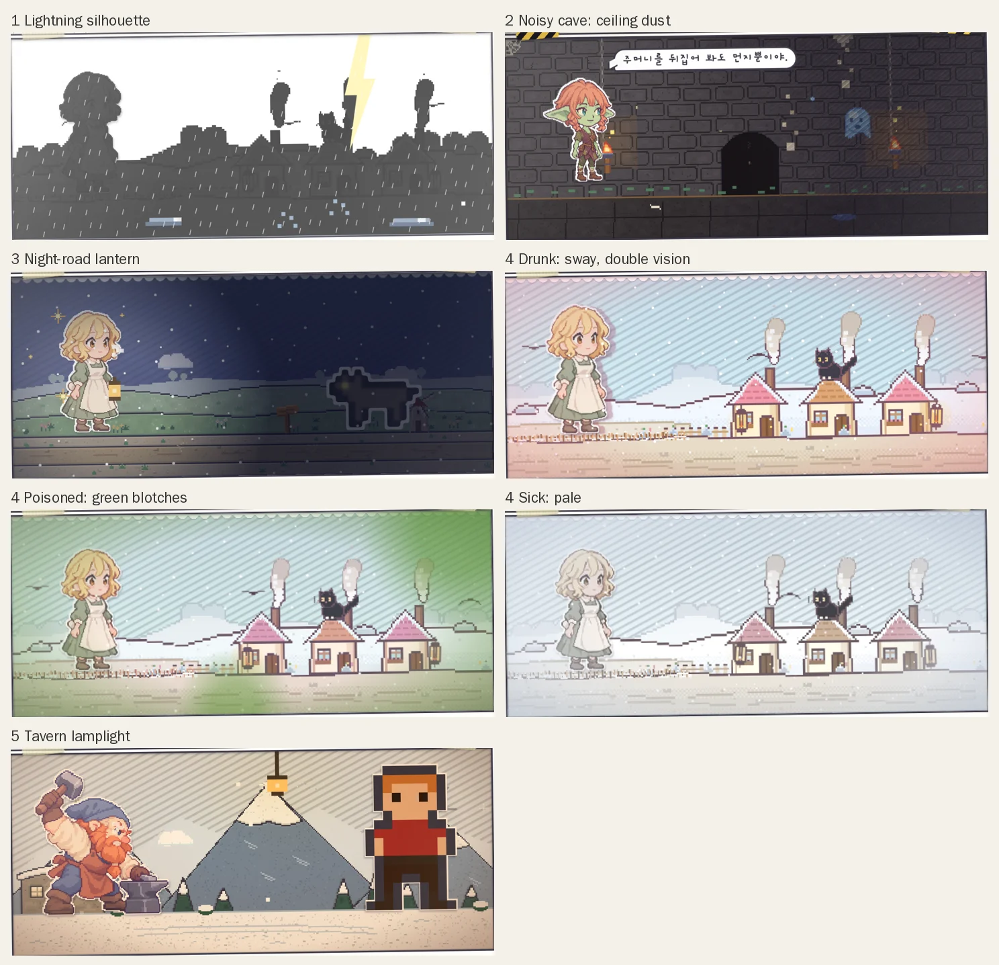
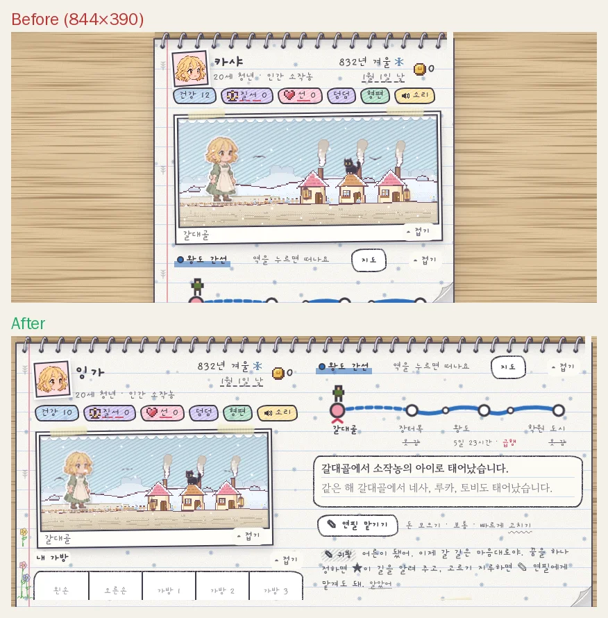

All I did was rubber-stamp one line—and by the time I looked back, lightning was flashing across the notebook and amber lamplight was flickering inside taverns. At the end of [the last post](/en/2026/11/01/screen-check/), Claude had left me a neat numbered shortlist of six mood effects to add next: lightning, cave dust, a night-road lantern, a drunk screen, indoor lighting, and a landscape layout for phones. Every single one sounded good, and ranking them felt like more effort than just shipping them all. So I sent back five words: "Go through them in order."

<figure><figcaption>After a one-line sign-off, the moments where Claude checked its own screenshots and fixed slips on the spot.</figcaption></figure>

## One stamp on the paperwork

Because the proposals had already arrived as a clean numbered list, there wasn't much left for me to do except stamp the top corner. **When your shortlist is well-structured, "in order" turns straight into a work order.** After finishing each effect, Claude screenshotted the live scene and tweaked anything that looked off without waiting for me. Meanwhile, I drank my coffee and worked on something else.

## When lightning strikes, the world turns into shadow theater

First out of the gate was the lightning silhouette. During an outdoor storm, for the split second of a flash, the sky blows out stark white while the ground, houses, and people collapse into ink-black silhouettes.

<figure><video src="/assets/img/posts/mood-effects/bolt.mp4" poster="/assets/img/posts/mood-effects/bolt.jpg" controls muted playsinline preload="none"></video><figcaption>Once every eight seconds, for just a flash, the notebook becomes a shadow play.</figcaption></figure>

The first attempt was the funny part: the silhouettes came out washed-out grey instead of black. Inspecting its own screenshot, Claude spotted the culprit right away. The white flash overlay blanketing the screen was sitting *on top* of the silhouettes too, bleaching them out along with everything else. Lifting the white layer and storm tint for that brief instant gave us crisp **ink-black shapes against a blinding white sky**.

## A noisy cave feels like the ceiling is coming down

The rest marched in right behind it.

<figure><figcaption>Lightning, cave dust, lantern, drunk, poisoned, sick, and tavern lamplight on one sheet.</figcaption></figure>

1. **Noisy cave**: when noise inside a cave climbs right to the edge of a monster ambush, dust tumbles from the ceiling and the scene trembles. The first dust specks practically required a magnifying glass, so the clumps doubled in size and picked up a tiny bounce where they land.
2. **Night-road lantern**: walk a road after dark and your hero carries a lantern, casting a single warm halo around them. Watching wolf eyes step out of the pitch black beyond it is genuinely creepy.
3. **Drunk, poisoned, sick**: drunk, the world tilts and characters double up. Poisoned, greenish blotches creep in from the margins. Sick, the color drains away into a pale wash. On the first try, the poison blotch bloomed dead-center on the hero's face, so it got banished to the edges.
4. **Tavern lamplight**: trigger a tavern or inn event and an overhead lamp sways with flickering amber light. Since you're under a roof now, the outdoor rain politely stops.

## Turn the phone sideways and the notebook opens wide

Last up was the landscape phone layout. Previously, rotating a phone sideways left the notebook floating narrow in the center with acres of bare desk on either side, forcing you to scroll forever just to read your diary and choices.

<figure><figcaption>Scene and bag on the left, route board, diary, and choices on the right—no scrolling required.</figcaption></figure>

Now the notebook opens cleanly into a two-column spread. There was a sneaky snag where an overflowing left column spawned a rogue third column, fixed by making **the scene shrink automatically to fit the screen height**. Running [last time's checker](/en/2026/11/01/screen-check/) over the new layout also caught station names elbowing each other on crowded travel routes—a nice freebie bug fix.

## Three-line summary

1. Get the AI to hand you a numbered shortlist of next steps, and "go through them in order" is all the approval you need.
2. Have it screenshot every piece as soon as it lands—it'll spot washed-out shadows and misplaced poison blotches on its own.
3. Re-run the automated checker you built earlier whenever you ship something new. It almost always pays for itself with a bonus catch.
