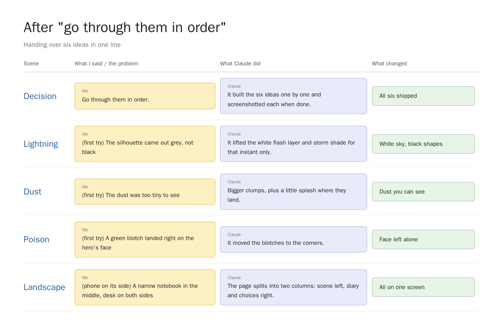
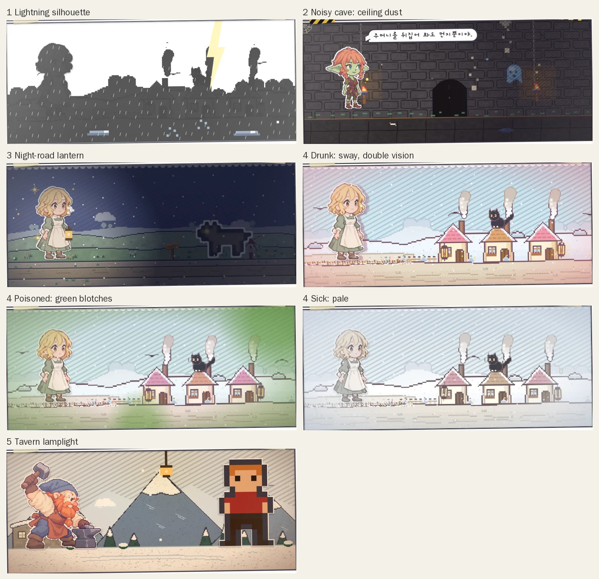
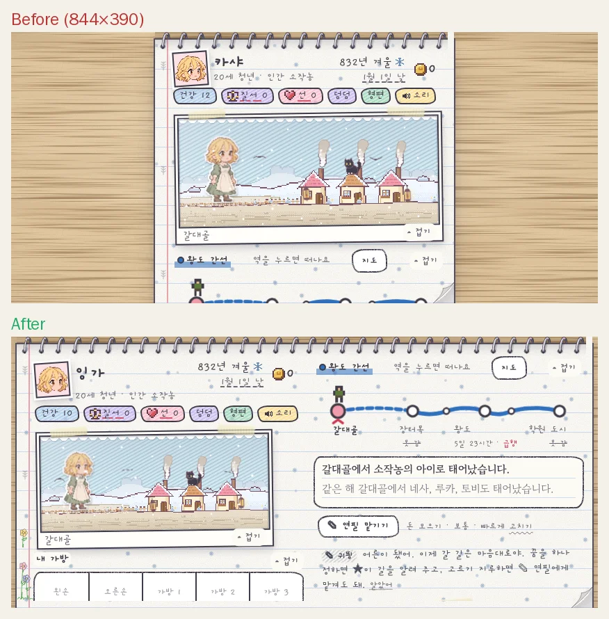

At the end of [the last post](/en/2026/11/01/screen-check/) Claude listed six effects worth adding next: lightning, cave dust, a lantern for night roads, a screen for when you're drunk, indoor lighting, and a layout for phones turned sideways. They all sounded good, and picking between them felt like more work than just doing them. So I sent one line: "Go through them in order."

<figure><figcaption>After one line of sign-off, the moments where Claude fixed its own work.</figcaption></figure>

## One stamp on the paperwork

The ideas had already arrived as a numbered list, so all I really had to do was stamp it. **When the list is tidy, "in order" turns straight into a work order.** Claude screenshotted each effect as it finished it and redid anything that looked off, right there. I was off doing something else the whole time.

## When lightning strikes, the world turns into a paper cut-out

First up was the lightning silhouette. In an outdoor storm, at the instant of the flash the sky blows out to white and the ground, houses and people stay behind as black shadows.

<figure><video src="/assets/img/posts/mood-effects/bolt.mp4" poster="/assets/img/posts/mood-effects/bolt.jpg" controls muted playsinline preload="none"></video><figcaption>Once every eight seconds, just for that flash, it becomes a shadow play.</figcaption></figure>

The first try was the fun part. The silhouettes came out grey instead of black. Looking at its own screenshot, Claude tracked it down to the white layer that covers the whole screen during a flash, which was washing the shadows out too. Lifting that layer and the storm shade for that one instant gave a proper **white sky with black shapes**.

## A noisy cave feels like the ceiling is coming down

The rest followed one at a time.

<figure><figcaption>Lightning, dust, lantern, drunk, poisoned, sick and lamplight on one sheet.</figcaption></figure>

1. **Noisy cave**: when the noise in a cave builds up to just before the monsters come swarming, dust falls from the ceiling and the scene shakes. At first the dust was so tiny you could barely see it, so the clumps doubled in size and got a little splash where they land.
2. **Night-road lantern**: walk a road at night and the hero carries a lantern, and only the area around it stays warm and bright. When a wolf steps out of the dark beyond, it's properly creepy.
3. **Drunk, poisoned, sick**: drunk, the scene sways and people show up twice. Poisoned, green blotches creep in from the edges. Sick, the colour drains out and everything goes pale. The poison blotch first landed right on the hero's face, so it got moved to the corners.
4. **Tavern lamplight**: in a tavern or inn event a lamp hangs down and amber light flickers. You're indoors, so the rain outside doesn't show.

## Turn the phone sideways and the notebook opens into two columns

Last was the landscape phone layout. With the phone on its side, the notebook kept its portrait width and floated narrow in the middle with a lot of desk on either side, and you had to scroll a long way to reach the diary and the choices.

<figure><figcaption>Scene on the left, diary and choices on the right, all visible without scrolling.</figcaption></figure>

Now the page splits into two columns. There was a trap where an overflowing left column spawns a third one, so **the scene now shrinks automatically to fit the screen height**. Running last time's checker over it again also caught station names elbowing each other on lines with lots of stops.

## Three-line summary

1. Get ideas from the AI as a numbered list and "go through them in order" is all you need to say.
2. Have it screenshot each piece as it finishes, and it will catch its own slips like grey shadows or a blotch on someone's face.
3. Re-run the checker you built last time whenever you add something new. It throws in a free bug.
