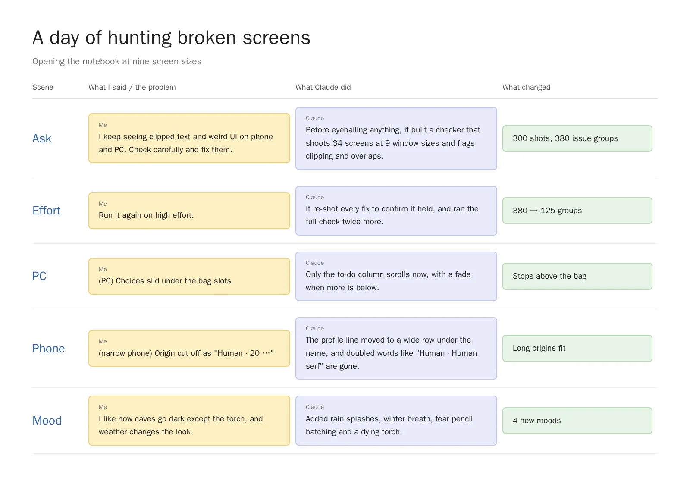
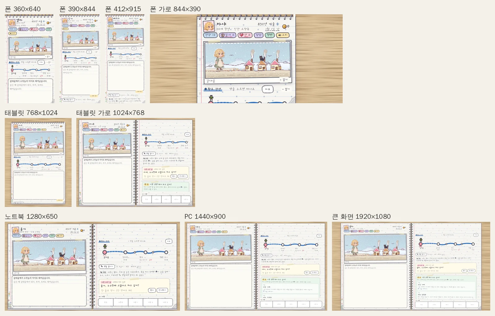
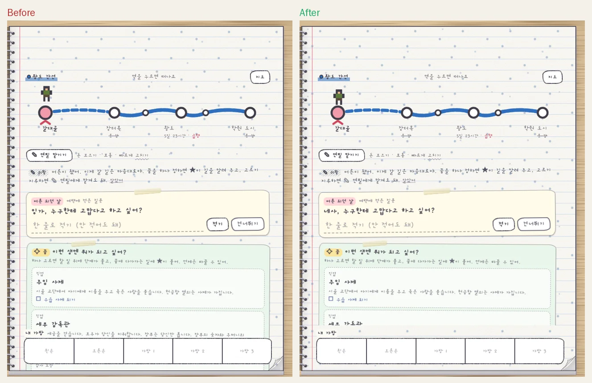
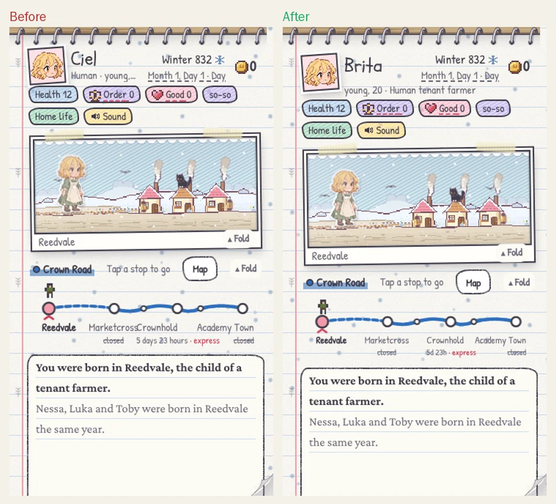
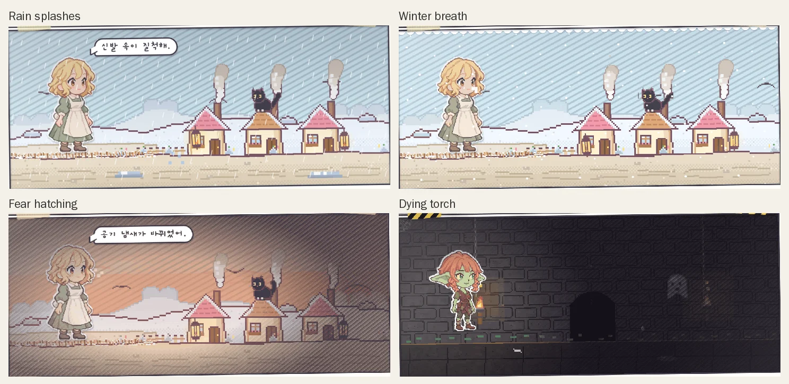
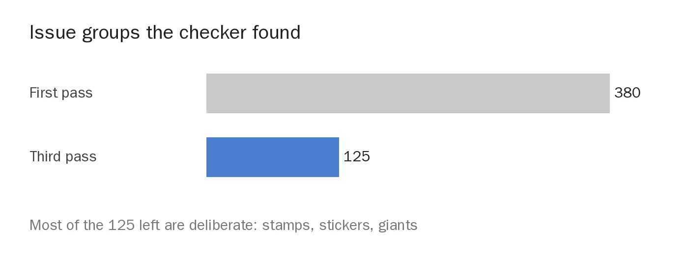

Every time I opened the game on my phone, some tiny glitch would poke me in the eye. An origin chopped off with a "…" next to the hero's name, or a PC button that had quietly slipped off into the void. Individually they're minor, but once you start spotting them, playing stops feeling like a fantasy adventure and starts feeling like proofreading an exam sheet. So I handed the whole UI over to Claude—and casually mentioned I'd love more mood effects like the dark cave torchlight I've been enjoying.

<figure><figcaption>From one cleanup request to four new mood effects, in five scenes.</figcaption></figure>

## Build a checker before squinting

My prompt was plain enough: I keep spotting clipped text and weird UI layouts on mobile and desktop, so check thoroughly and fix them.

Claude didn't jump straight into CSS. First, it built **an automated screen checker to replace a pair of human eyeballs**. It opens 34 screens—cover, birth, battles, caves, the map, the final page—across nine sizes from a small phone to a large monitor, screenshots every one, and flags text spilling out of boxes or piling onto neighbors. Basically buying nine phones, lining them up on a desk, and squinting at each one—except a script does the squinting.

<figure><figcaption>Spread the same scene across nine screen sizes and the hidden glitches come straight out of hiding.</figcaption></figure>

The first sweep flagged 380 issue groups. Not all of them were real bugs, of course. Crooked notebook stamps and giant monsters deliberately bursting out of their panels also look like "overlaps" to a machine. After weeding out those innocent decorations screenshot by screenshot, only the real troublemakers remained.

## The choices were hiding under the bag

The sneakiest PC bug lived on the right-hand page of the notebook. Whenever a question note, dream picker, and hint stacked up together, the to-do column grew tall and slid right underneath the "My bag" slots at the bottom. The exact buttons you needed to move the story forward were buried under your own luggage.

<figure><figcaption>Now the to-do column stops cleanly above the bag, fading gently at the edge when there's more below.</figcaption></figure>

We gave the to-do column its own scroll with a soft bottom fade to hint when more choices sit below. On laptop screens (1280×650), the checker also caught the "Write the next one" button—the one that starts your next life on the final page—shoved off into an invisible third column. Splitting that page evenly into two fixed it. Living an entire lifetime only for the button to start the next notebook to vanish would have been a rough finale.

## "Human · Human serf"?

On phones, the culprit was the profile line beneath the character's name. On a narrow 360px screen it rendered as "Human · 20 …" and lopped the origin straight off. Staring at the clipped line turned up a funny bonus bug: because the origin name already included the race, the header was **repeating the same word twice**, like "Human · Human serf." Introducing yourself by saying your last name twice.

<figure><figcaption>In English, even the station names on the travel route board were elbowing each other.</figcaption></figure>

On narrow phones, the profile line now drops onto its own wide row below the name and date, minus the doubled race name. On the English route board, "5 days 23 hours" went on a diet to "5d 23h", and holding a tablet upright no longer squeezes the whole notebook down to phone width.

## Dark caves, and a pencil that shakes when you're scared

Now for the fun half. All I offered was a vague hint—that I liked how caves go dark outside the torch circle and how weather shifts the mood. Claude reviewed our existing effects and came back with **four quiet moments that were begging for atmosphere**.

<figure><figcaption>Rain splashes, winter breath, fear hatching, and a dying torch.</figcaption></figure>

1. **Rainy days**: outdoors, raindrops splash on the ground and puddles glint. Butterflies cheerfully fluttering through a downpour got evicted at the same time.
2. **Cold days**: in snow or winter, a pale puff of breath drifts from the hero's mouth.
3. **When you're scared**: as the fear gauge climbs, dark pencil hatching creeps in around the edges and tightens like a heartbeat.
4. **Down to the last torch**: the bright circle inside the cave shrinks, and the flame wavers like it's seconds from going out.

As a bonus, the chicken that used to sprint across clear night skies is now a shooting star. Even in fantasy, a midnight sky-chicken felt a little hard to justify.

## When the torch is down to its last use

My favorite of the four is the dying torch. The first draft was so polite you could barely tell the light had shrunk—so Claude watched its own recording, decided it wasn't dramatic enough, and darkened the cave further before I even spoke up.

<figure><video src="/assets/img/posts/screen-check/torch.mp4" poster="/assets/img/posts/screen-check/torch.jpg" controls muted playsinline preload="none"></video><figcaption>With one torch use left, the light circle shrinks to 70% and the flame flickers. A polite hint to find the exit.</figcaption></figure>

## "Run it again on high effort"

Right after sending the initial prompt, I tacked on one extra line: "Run it again on high effort." Claude has a dial for how deeply it thinks, and cranking it up changed the workflow immediately. From that point on, Claude **re-shot the exact screen after every single fix to prove it actually held**, and ran the full audit twice more.

<figure><figcaption>Down from 380 to 125. Most of what remains is decoration overlapping on purpose.</figcaption></figure>

Taking an AI's "all fixed!" at face value is a reliable way to end up with half-fixed screens. **Making it re-shoot each fix and show receipts** was easily the best habit I walked away with. Better yet, the checker now lives in the repo, ready to run whenever the layout changes.

Next up are the mood effects that only made the shortlist this round: lightning silhouettes flashing in a storm, dust tumbling from a noisy cave ceiling, a lantern glow on night roads, and hazy visuals when you're drunk or poisoned.

## Three-line summary

1. Before hunting layout bugs by eye, have the AI build a checker that screenshots every screen across multiple viewport sizes.
2. Don't take "fixed it" on faith—make the AI re-shoot the screen after every change to prove it.
3. For atmospheric polish, even a casual "I like this kind of vibe" is enough for the AI to spot empty moments and bring them to life.
