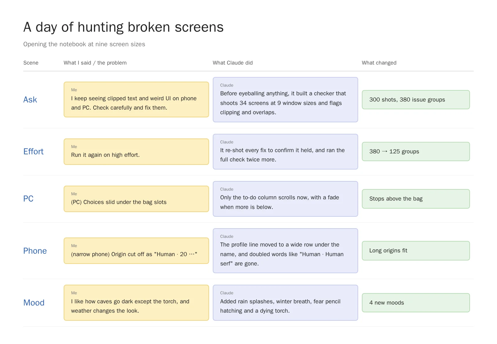
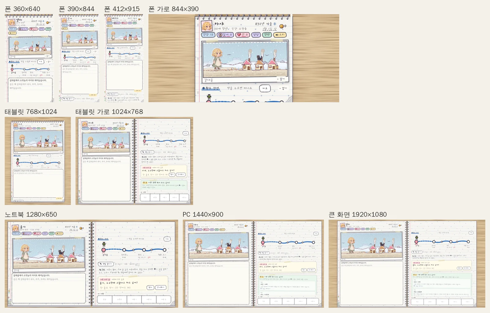
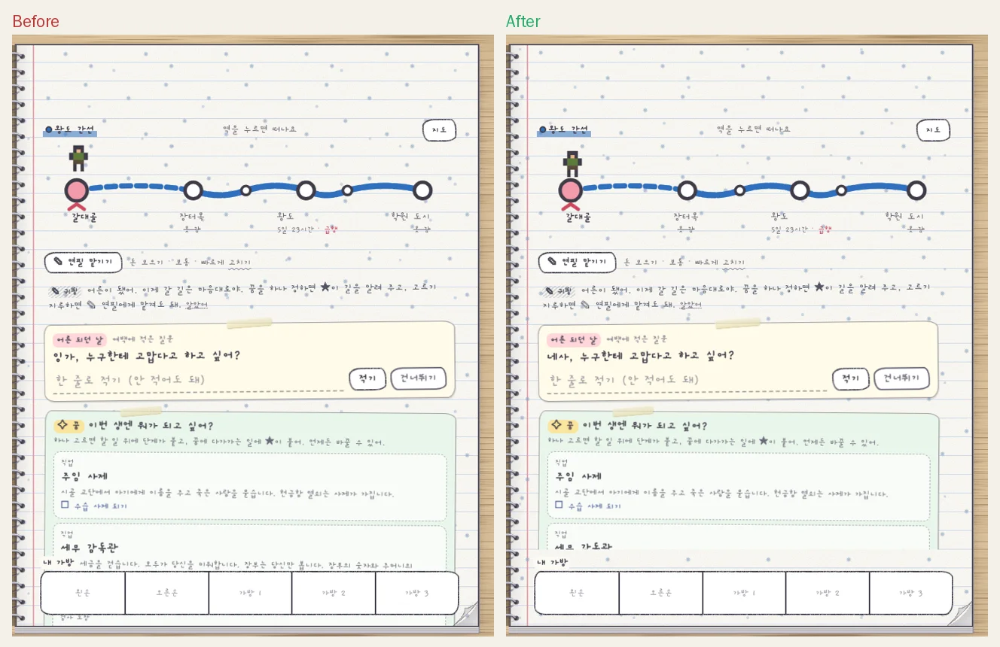
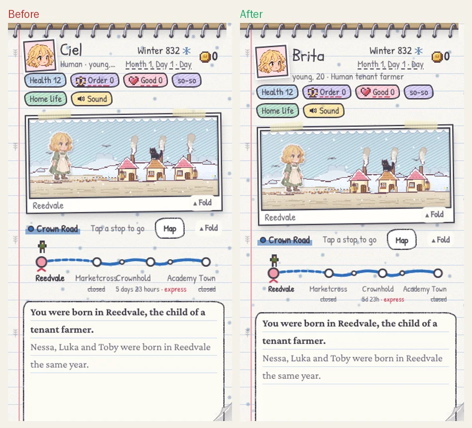
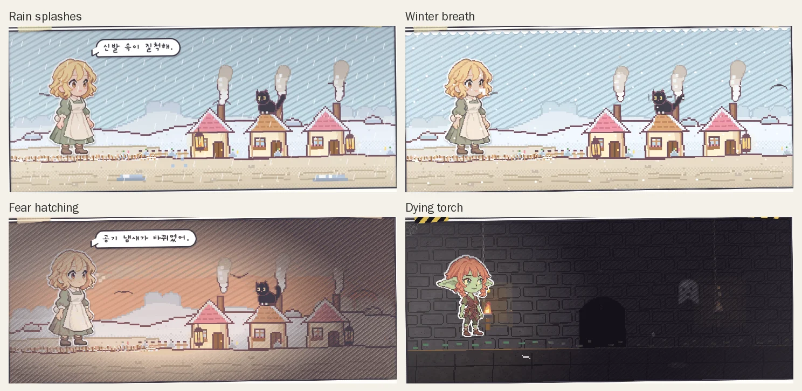
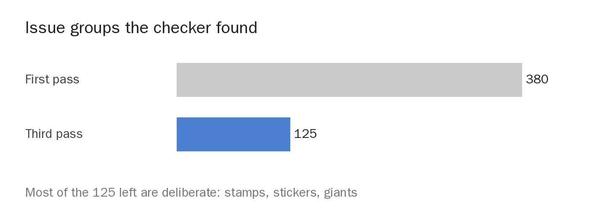

Every now and then the game looked a little off on my phone. An origin cut short with a "…" next to the hero's name, or a button on PC that had quietly wandered off somewhere. Each one was tiny, but once you notice them, playing starts to feel less like an adventure and more like proofreading a test paper. So I handed the whole thing to Claude, and while I was at it I mentioned I'd love more mood effects like the cave darkness I've grown fond of.

<figure><figcaption>From one request to four new mood effects, in five scenes.</figcaption></figure>

## A checker before the eyeballs

My request was simple: when I look at the mobile or desktop UI I keep seeing clipped text and weird layouts, so check carefully and fix them.

Claude didn't dive straight into fixing. First it built **a checker to scan screens instead of a pair of human eyes**. It opens 34 screens—the cover, birth, fights, caves, the map, the last page—at nine sizes from a small phone to a big monitor, takes a shot of each, and flags any text spilling out of its box or sitting on top of another. It's like buying nine phones, lining them up on the desk and squinting at each one, except a machine does the squinting.

<figure><figcaption>Lay the same scene out at nine sizes and the hidden problems show up.</figcaption></figure>

The first pass came back with 380 issue groups. Not all of them were real bugs, of course. Stamps stuck on at a jaunty angle and giant monsters bursting out of the notebook also look like "overlaps" to a machine. After weeding out those false alarms screenshot by screenshot, the real fixes were left.

## The choices were hiding under the bag

The sneakiest bug on PC was on the right-hand page. When a question note, the dream picker and a hint all showed up at once, the to-do column grew long and its bottom slid right under the "My bag" slots. The exact buttons you needed were buried under your own luggage, leaving players rummaging around wondering where the story went.

<figure><figcaption>The to-do column now stops above the bag and fades out a little when there's more below.</figcaption></figure>

Now only the to-do column scrolls, with a soft fade at the bottom to hint there's more below. At laptop size (1280×650), the "Write the next one" button on the last page had been shoved into an invisible third column, so that page now splits evenly into two. Finishing an entire life only for the "next notebook" button to vanish would have been a pretty awkward ending.

## "Human · Human serf"?

On phones the trouble was the profile line under the name. On a 360px phone it showed "Human · 20 …" and chopped the origin right off. While staring at the clipped text, Claude caught an embarrassing bonus: the origin name already contained the race, so the line was **saying the same word twice**, like "Human · Human serf." Basically introducing yourself by repeating your last name twice.

<figure><figcaption>In English even the station names on the route board were elbowing each other.</figcaption></figure>

On narrow phones the profile line now drops to a wide row under the name and date, and the doubled race name is gone. The English route board puts "5 days 23 hours" on a diet to "5d 23h", and standing a tablet upright no longer squeezes the notebook down to phone width.

## Dark caves, and a pencil that shakes when you're scared

Now for the fun part. All I did was drop a hint—that I liked how caves go dark except for the torchlight and how weather changes the mood. Claude looked over our existing effects and came back with **four quiet moments that were begging for something extra**.

<figure><figcaption>Rain splashes, winter breath, fear hatching and a dying torch.</figcaption></figure>

1. **Rainy days**: outdoors, raindrops splash on the ground and puddles glint. Butterflies happily fluttering through a downpour got evicted while we were at it.
2. **Cold days**: in snow or winter, a white puff of breath drifts out of the hero's mouth.
3. **When you're scared**: as the fear gauge climbs, the screen edges darken with pencil hatching that tightens like a heartbeat.
4. **Down to the last torch**: the bright circle in the cave shrinks and the flame wavers like it's about to give up.

As a bonus, the chicken that used to sprint across clear night skies is now a shooting star. Even in fantasy, a midnight sky-chicken felt a bit much.

## When the torch is down to its last use

My favorite of the four is the dying torch. The first version was so polite you could barely tell anything had changed, so Claude watched its own recording and made the cave darker on its own.

<figure><video src="/assets/img/posts/screen-check/torch.mp4" poster="/assets/img/posts/screen-check/torch.jpg" controls muted playsinline preload="none"></video><figcaption>With one torch use left, the light circle shrinks to 70% and the flame wavers. A subtle nudge to start heading for the exit.</figcaption></figure>

## "Run it again on high effort"

After sending the request I tacked on one more line: run it again on high effort. Claude has a dial for how hard it thinks, and I turned it up. From then on Claude **re-shot the screen after every single fix to prove it actually held**, and ran the full check twice more.

<figure><figcaption>From 380 to 125. Most of what's left is decoration that overlaps on purpose.</figcaption></figure>

If you take an AI's "fixed it" at face value, things tend to stay half fixed. **Asking it to re-shoot the screen after each fix** was the best trick I picked up this time. The checker stays in the repo, ready to run whenever the screens change.

Next I'll pick from the ideas that only made the shortlist this time: a silhouette flashing when lightning strikes, dust falling from a noisy cave ceiling, a lantern circle on night roads, and a blurry screen when you're drunk or poisoned.

## Three-line summary

1. Before hunting broken screens by eye, have the AI build a checker that shoots every screen at several sizes.
2. When the AI says "fixed," don't just nod—ask it to re-shoot the screen and show you.
3. For mood effects, even a casual "I like this kind of vibe" is enough for it to spot the empty moments and fill them.
