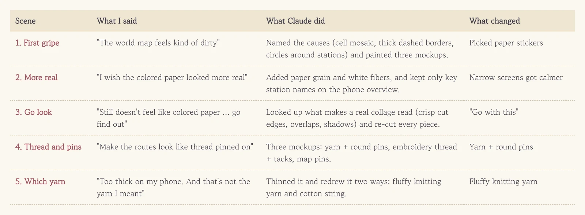
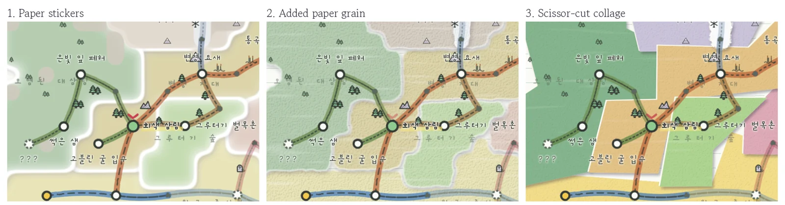
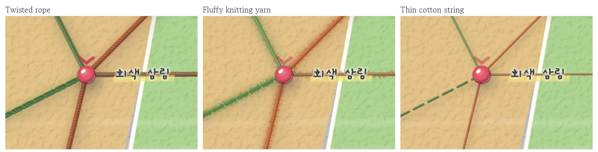
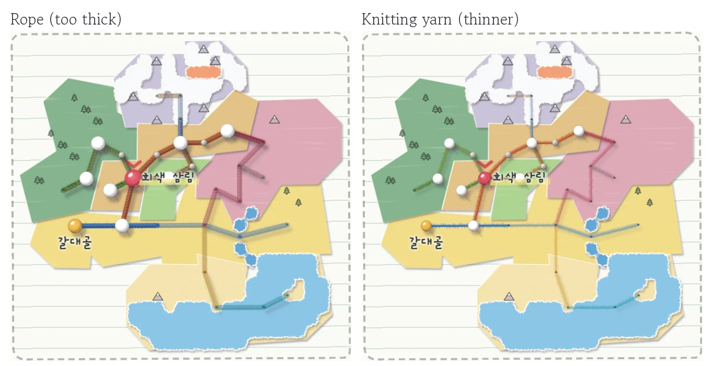
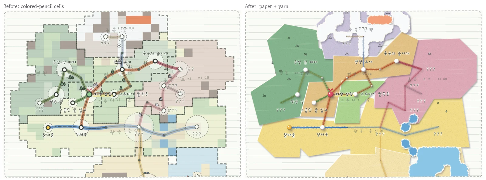

Once [the route board turned into a colored-pencil map](/en/2026/11/02/pencil-map/), the world map suddenly looked shabby by comparison. Cell-by-cell colored tiles, chunky dashed borders, and a circle around every station all piled on top of each other—instead of a notebook page, it looked like stained graph paper. I didn't have the vocabulary to pinpoint what was wrong, so I just went with my gut: "The world map feels kind of dirty … show me a few mockups."

<figure><figcaption>One vague "feels dirty" turned into five rounds of back and forth.</figcaption></figure>

## A vague gripe comes back as a list of causes

Claude first diagnosed three reasons the map looked cluttered: the land was painted as a grid mosaic, every region had a thick dashed fence around it, and every station wore an extra circle showing its land size. **Once my vague "it's dirty" got translated into three fixable items, all I had to do was pick.** The mockups were colored-pencil land, clean paper, and colored-paper stickers, and I went with the paper.

## "Still doesn't feel like colored paper"

Up close, though, it looked more like blurry paint blobs than paper. I asked for "more realism," and it gained paper grain and white fibers, yet still didn't feel like paper glued onto a page. So this time I didn't ask for another drawing. I asked Claude to go study what actually makes a colored-paper collage look real.

<figure><figcaption>First mockup, then added grain, then the scissor-cut collage. Only the third one got a "go with this."</figcaption></figure>

The clues it came back with were surprisingly crisp. Real collages don't have fuzzy edges—they have sharp scissor cuts, pieces overlap slightly, and every overlap casts a thin shadow. Torn paper, by contrast, shows white fibers along the rip. So the land became simple scissor-cut shapes, each tilted slightly and glued over its neighbor, leaving only the sea and snowfields as torn paper. **When "more realistic" misses twice in a row, it's faster to stop guessing and have the AI research why the real thing looks real.** As a bonus, the phone overview now only labels where you are and where you've been this life, untangling the crowded text.

## Let's string the routes with thread and pins

With pencil dashes crossing a paper collage, the routes started feeling out of place. I pictured a travel map with pins stuck in it and thread strung between stops, so I asked: "It'd be better if the routes looked like thread pinned onto the map. Do you get what I mean?"

Claude painted three options onto the real map: yarn with round pins, thin embroidery thread with thumbtacks, and side-view map pins. The 3D map pins looked great, except their big heads covered the station names, so I picked yarn and round pins. One more round of "more realistic" added a glossy highlight and cast shadow to the pins, plus a two-ply twist to the yarn.

<figure><figcaption>Three strands that all came from the word "yarn." The one I had in mind was the middle one.</figcaption></figure>

## One word, three pictures

On my phone, though, the thread looked like a ship's mooring rope draped across the continent. "Too thick on my phone. And that's not the yarn I meant." I was picturing cozy scarf yarn, not dockyard rigging. Claude admitted the heavy twist had turned it into rope, thinned it down, and drew two fresh options: fluffy knitting yarn with stray fibers, and smooth thin cotton string. Claude voted for cotton, but the knitting yarn was exactly what I'd been picturing. **Even one everyday word paints a different picture in everyone's head, so lining up candidates side by side beats ten sentences of explanation.**

<figure><figcaption>On phones the yarn and pins are drawn thinner than on PC so station names don't get buried.</figcaption></figure>

Now the world map looks like a craft project of scissor-cut colored paper, bead pins, and knitting yarn. Where you stand gets a red pin, places you've visited this life get yellow pins, and places you haven't discovered yet are just a tiny pinhole. The legend underneath uses the exact same pins.

<figure><figcaption>Left is the old map, right is the one re-glued with paper and yarn.</figcaption></figure>

## Three-line summary

1. Even a vague gripe like "it feels dirty" works—the AI translates it into a list of causes you can fix.
2. When "more realistic" misses twice, have the AI research what makes the real thing look real.
3. Even a common word like "yarn" means different pictures to different people, so line up candidates and point.
