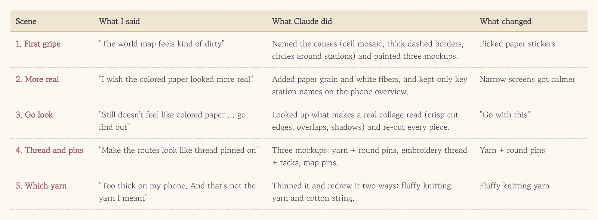
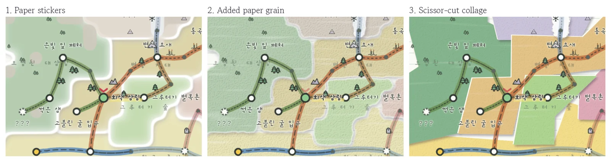
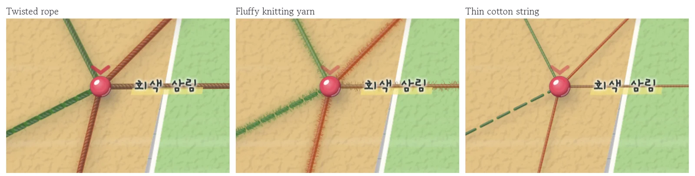
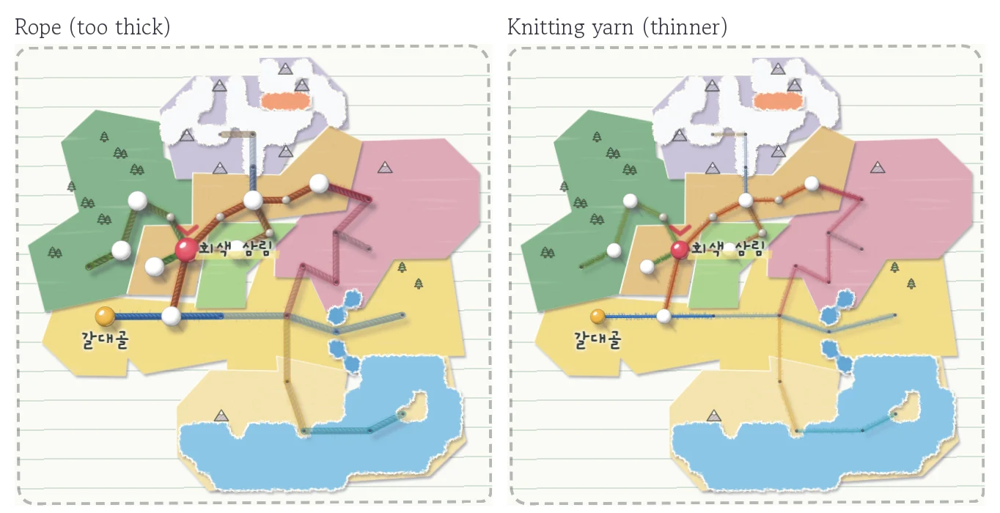
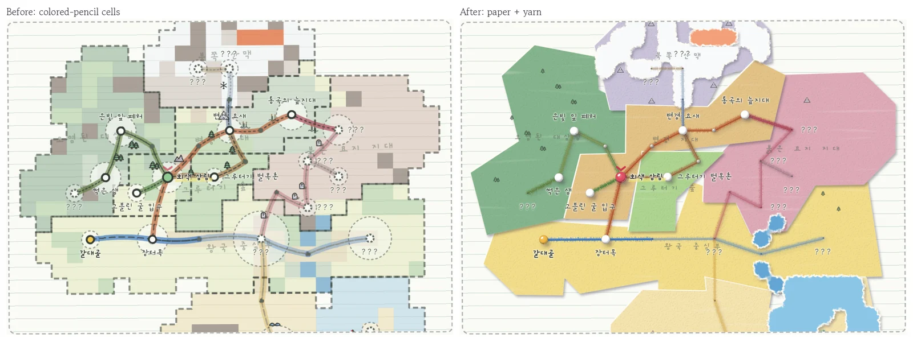

Right after [the travel board turned into a colored-pencil map](/en/2026/11/02/pencil-map/), the world map sitting next to it suddenly looked awful. Square-by-square land tiles, heavy dashed borders, and an extra circle around every town piled on top of each other until it looked less like a notebook page and more like stained graph paper. I didn't have design vocabulary to explain why it bothered me, so I just blurted out the feeling: "The world map feels kind of dirty … show me a few mockups."

<figure><figcaption>One vague "feels dirty" kicked off five rounds of back and forth.</figcaption></figure>

## A vague complaint comes back as a fix list

Instead of randomly repainting, Claude diagnosed three reasons the map looked noisy: land painted as a grid mosaic, thick dashed fences around every region, and circles around every station showing territory size. **Once my fuzzy "it's dirty" got translated into three concrete culprits, all I had to do was choose.** Out of colored-pencil land, clean paper, and colored-paper stickers, I picked colored paper.

## "Still doesn't feel like colored paper"

Zoomed in, though, it read more like blurry watercolor smudges than paper. Asking for "more realism" added paper grain and stray white fibers, yet it still didn't feel cut out and glued onto a notebook. So I stopped asking for another redraw and changed the assignment: go figure out what actually makes a paper collage look real.

<figure><figcaption>First pass, added grain, and scissor-cut collage. Round three finally got a "let's go with this."</figcaption></figure>

The answer was refreshingly concrete. Real collages don't have soft, airbrushed edges—they have crisp scissor cuts, pieces slightly overlap, and every overlap casts a hairline shadow. Torn paper, meanwhile, leaves fuzzy white pulp along the edge. So the land became bold scissor-cut shapes tilted slightly over one another, leaving only the sea and snowfields as hand-torn paper. **When "more realistic" misses twice in a row, stop guessing and ask the AI why the real thing looks real.** As a bonus, the phone overview now only labels where you are and where you've been this life, clearing the knot of colliding text.

## What if the roads were pins and string?

With colored paper in place, pencil dashes for roads suddenly felt out of place. I pictured a travel map on a wall with pins and string connecting stops, so I asked: "It'd be better if the routes looked like thread pinned onto the map. Do you get what I mean?"

Claude dropped three candidates onto the live map: yarn with round pins, thin embroidery thread with thumbtacks, and side-view map pins. The 3D map pins looked charming until their chunky heads covered half the station names, so yarn and round bead pins won. One more round of "more realistic" gave the pins a glossy highlight and shadow, and gave the yarn a two-ply twist.

<figure><figcaption>Three strands all born from the single word "yarn." The middle one was what lived in my head.</figcaption></figure>

## One word, three very different pictures

Opening it on my phone made me laugh out loud. The "yarn" looked like mooring rope for a cargo ship draped across the continent. "Too thick on my phone. And that's not the yarn I meant." I was imagining cozy scarf yarn, not dockyard rigging. Claude admitted the heavy twist had turned it into rope, slimmed it down, and brought two fresh takes: fluffy knitting yarn with stray fibers, and smooth thin cotton string. Claude voted for cotton, but the fluffy knitting yarn was dead-on. **Even a plain everyday word paints a different picture in every head—lining up options side by side beats ten sentences of description.**

<figure><figcaption>On phones the yarn and pins draw thinner than on desktop so town names stay readable.</figcaption></figure>

Now the world map looks like a desk craft of scissor-cut paper, bead pins, and knitting yarn. Where you stand gets a red pin, stops you've visited this life get yellow pins, and places you haven't reached yet are just tiny pinholes waiting to be poked. The legend underneath uses the exact same pins.

<figure><figcaption>Left: the old stained-grid map. Right: re-glued with colored paper, bead pins, and yarn.</figcaption></figure>

## Three-line summary

1. Even a vague gripe like "it feels dirty" works—let the AI translate your gut reaction into concrete causes you can fix.
2. When "more realistic" misses twice, ask the AI to study what actually makes the real material look real before drawing again.
3. Everyday words like "yarn" mean different pictures to different heads, so line up candidates side by side and point.
