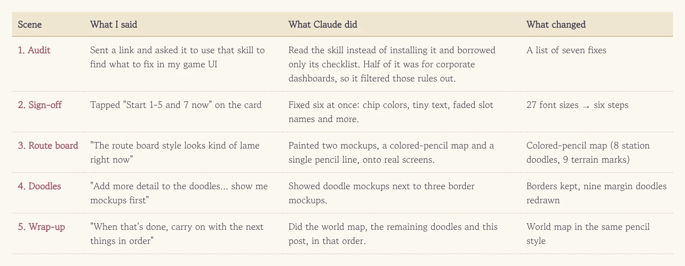
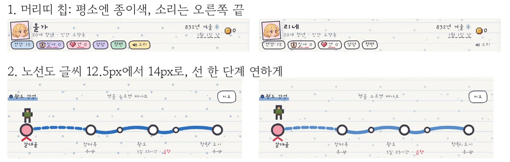
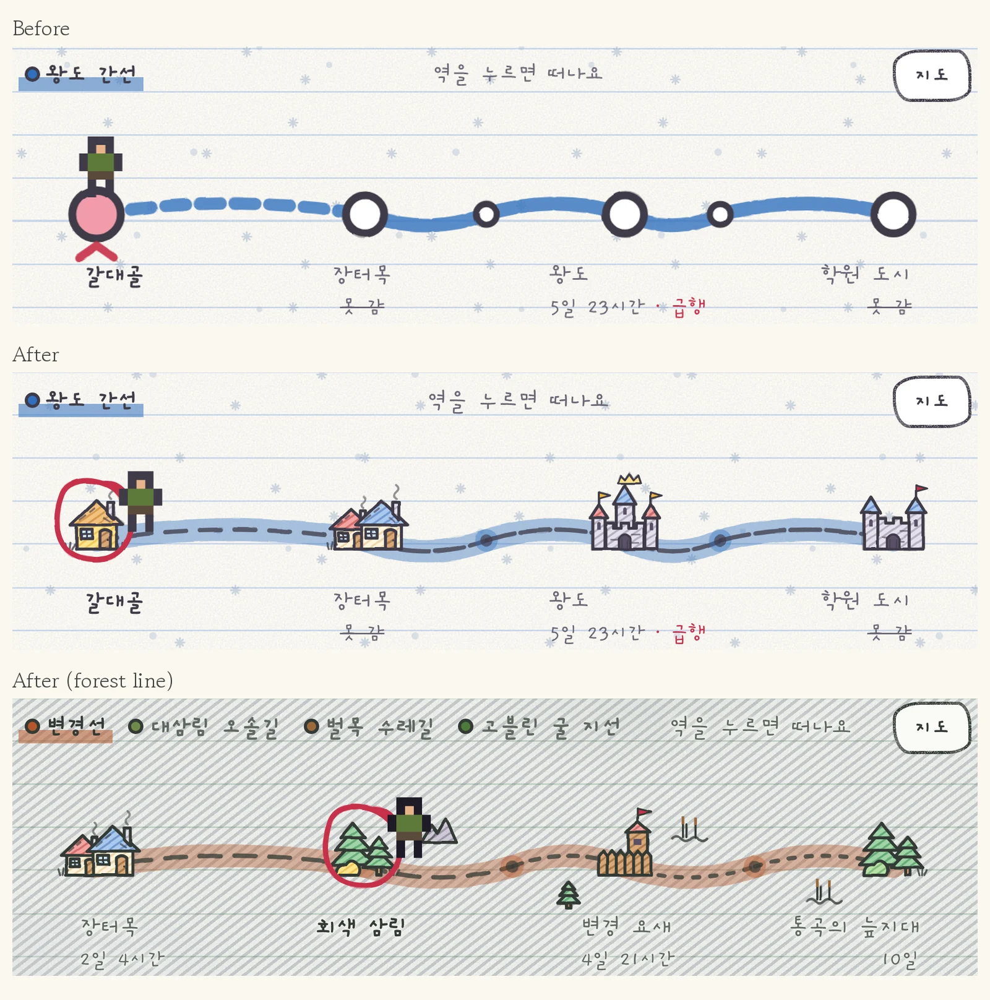
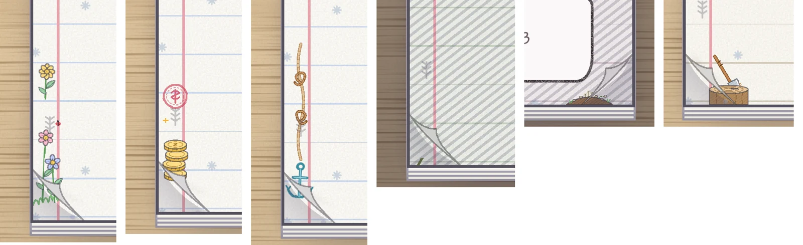
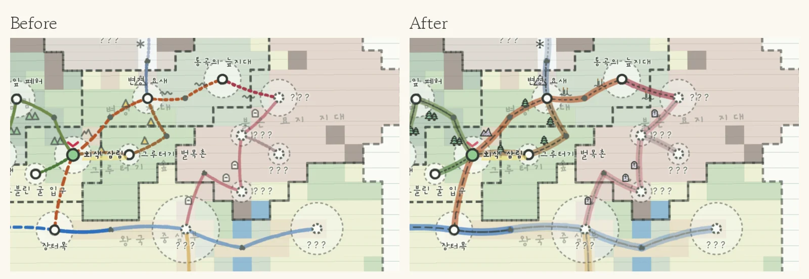
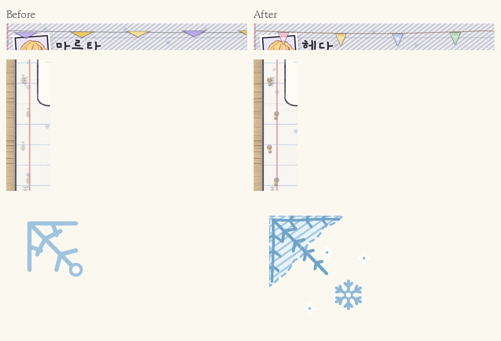

Stare at a screen long enough and your eyes go numb. You know something feels off, but you can't say where. Then I came across a skill called [unslop](https://github.com/heydamir/unslop), a checklist for catching screens that look "AI-made." I passed Claude the link and asked it to use the skill to find what to fix in my game UI.

<figure><figcaption>It started with one link and spread all the way to the world map.</figcaption></figure>

## Borrowing only half of someone else's checklist

Claude didn't install the skill. It just read it. The first verdict was that half of it didn't fit our game. The skill was built for company dashboards and landing pages, so it says to drop emoji and stickers, use gray backgrounds, never draw wobbly corners and avoid looping motion. Our game is a grade-schooler's notebook RPG. **Stickers and wobbly handwriting are the whole personality, and stripping them would turn it into a quarterly report.** So Claude threw out the rules that didn't fit, audited with the rest and came back with seven fixes.

<figure><figcaption>Six header chips used to be six different colors. Now they're plain paper until something matters.</figcaption></figure>

The list went like this: every header chip had its own color so the dangerous one didn't stand out, the route board text was too small, the winter snowflake pattern ran over the text, bag slot names were too faint, one cover button was stuck in the browser's default gray, and the PC diary box was mostly empty. And one more: the game used twenty-seven different font sizes. I hit start on the card, and the font sizes got squeezed into six steps from 12 to 28 pixels.

## Confession #1: the route board was lame

With those fixed, the route board started to bug me. It looked like a subway map, thick blue lines with white circles in a row, and inside a notebook it was way too clean and straight. So I said it the way I felt it: "The route board style looks kind of lame right now. Change it to something stylish that fits the concept."

Instead of describing options, Claude painted two mockups onto real game screens. One was a map with colored-pencil roads and a doodle for every station. The other kept only a thin pencil dotted line. I picked the colored-pencil map without a second thought.

<figure><figcaption>Top is the old board, the two below are the colored-pencil map. Where you are gets a red pen circle.</figcaption></figure>

Now a village is a roof with chimney smoke, the capital is a castle, a fort is a wooden stockade with a flag and a forest is a cluster of pines. There are eight station doodles and nine terrain marks by the road. Forest roads get trees, marsh roads get reeds, cemetery roads get gravestones. **Once the route board stopped being "information" and became "a drawing in a notebook," the whole screen suddenly looked like one kid's notebook.**

## Asking for mockups first kept the borders as they were

I got greedy and pushed further: more detail on the margin doodles, and UI borders that fit the notebook concept. This time I asked for mockups first.

The border mockups came in three flavors: a line drawn twice in pencil, a colored-pencil inner line, and a cut-paper edge. Side by side, though, the current border looked the cleanest. **Seeing mockups first turned "don't change it" into a real decision too.** If it had just gone ahead and repainted everything, undoing it would have taken ages. So the borders stayed, and only the doodles got redrawn.

<figure><figcaption>Flowers, coins, rope and anchor, vines, grave hand, axe in a stump, now with pencil hatching and crayon grain.</figcaption></figure>

A ladybug landed on the flowers, the coins got a red "haggle" stamp, and the axe now sits in a stump with visible tree rings. The crayon texture was too strong at first and made the lines look broken, but Claude screenshotted it, noticed and dialed it down on its own.

## "When that's done, carry on with the next things in order"

By then the leftover chores were nagging at me. The world map still had the old look, and three margin doodles (bunting, footprints, frost) were untouched. Picking them one by one felt like a hassle, so I handed it all over in one line.

<figure><figcaption>The world map now shares the route board's colored-pencil look. The station circles that show where you've been stayed as they were.</figcaption></figure>

On the world map the roads run over colored land tiles, so copying the route board as-is made the bands vanish. The map gets a band one shade darker. The last three doodles were redrawn in the same style.

<figure><figcaption>Bunting, boot prints and a frosted corner. The frost is shown five times bigger.</figcaption></figure>

The bunting hid a fun trap. The old one was a single drawing stretched to the screen width, so on PC the flags were squashed flat. Now only the string stretches, and each flag hangs on its own, so they keep their shape however wide the screen gets.

## Three-line summary

1. Have the AI read someone else's checklist first and filter out the rules that don't fit your project.
2. Even a vague gripe like "it looks kind of lame" works. The AI turns it into a few mockups and you just pick one.
3. Look at mockups first and "leave it as is" becomes a decision too, which saves you the trouble of undoing things.
