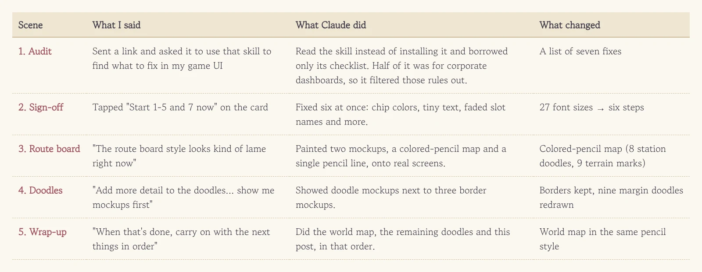
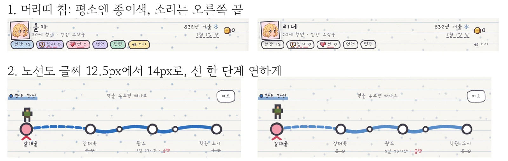
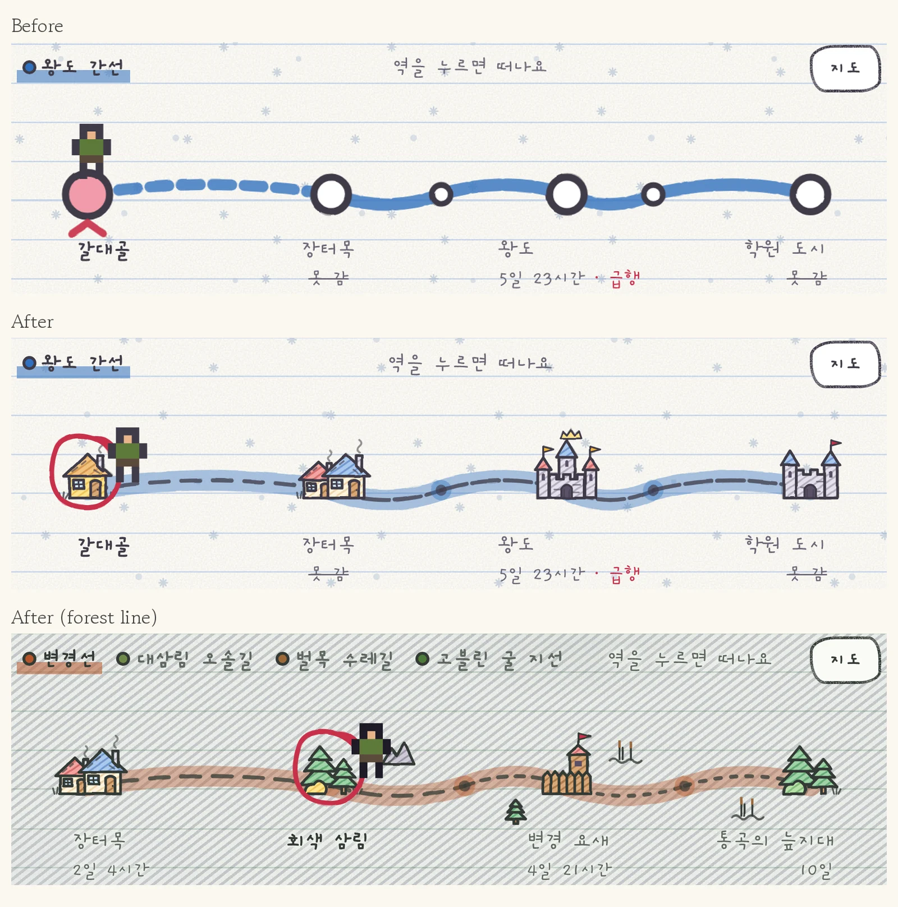
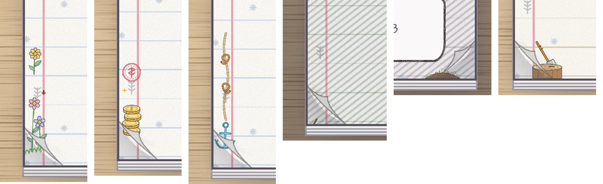
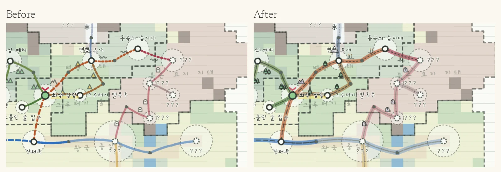
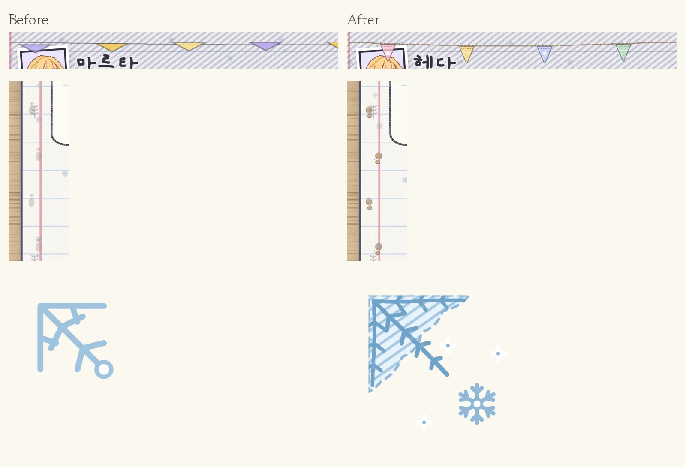

Stare at your own UI long enough and your eyes go completely numb. You can feel something is off, even if you can't point to what. Right around then I stumbled across a skill called [unslop](https://github.com/heydamir/unslop)—a checklist built to catch screens that scream "AI-made." Curious whether my Notebook RPG had picked up any giveaway machine habits, I tossed Claude the link and asked for an audit.

<figure><figcaption>An audit kicked off by one link ended up redrawing everything down to the world map.</figcaption></figure>

## Borrowing only half of someone else's checklist

Rather than blindly installing the skill, Claude read through it first—and came back with a sharp call. Half of it didn't fit our game at all. The checklist was built for corporate dashboards and SaaS landing pages, so it preaches banning emoji and stickers, sticking to neutral grey backgrounds, forbidding wobbly borders, and killing looping animations. Our game is a grade-schooler's hand-scrawled RPG notebook. **Stickers and wobbly lines are the whole point—strip those out and you don't get a cleaner fantasy adventure, you get a quarterly earnings report.** Claude tossed the mismatched rules, audited with the rest, and returned with seven concrete fixes.

<figure><figcaption>Six status chips across the header used to shout in six different colors. Now they stay plain paper until something actually matters.</figcaption></figure>

The list was humbling: every status chip across the header wore a different bright color so genuine warnings blended right in, the travel route board text was tiny, winter snowflakes drifted across the prose, bag slot labels were faint, one cover button was stuck in default browser grey, and the PC diary box had an awkward empty void at the bottom. Best of all, the game was somehow juggling *twenty-seven* different font sizes. I tapped "Start" on the decision card, and those 27 sizes collapsed into six tidy steps from 12 to 28 pixels.

## Confession #1: the route board was lame

With those cleaned up, the travel route board started glaring at me. Thick blue line, neat row of white circles—it looked like a city subway map dropped straight into a kid's sketchbook. Too crisp, too sterile, completely out of place. I didn't sugarcoat it: "The route board style looks kind of lame right now. Change it to something stylish that fits the concept."

Instead of pitching ideas in prose, Claude painted two mockups directly onto live game screens: a colored-pencil path dotted with tiny hand-drawn stops, and a stripped-down dotted pencil line. One glance and I picked the colored-pencil map.

<figure><figcaption>Top is the old board; the two below are the colored-pencil map. Your current stop gets circled in red pen.</figcaption></figure>

Now a village is a pitched roof puffing chimney smoke, the capital is a castle, a fort is a flagged wooden stockade, and a forest is a cluster of pines. There are eight station doodles and nine roadside terrain marks—trees along forest trails, reeds by the marsh, gravestones near cemeteries. **The moment the route board stopped looking like a transit placard and started looking like a map scribbled in the margins, the whole screen finally felt like one person's notebook.**

## Asking for mockups first kept the borders intact

Getting greedy, I pushed further: give the page-margin doodles more detail, and redraw the UI borders to match the notebook vibe. This time, though, I insisted on seeing mockups *before* touching anything.

Three border drafts came back: a double-drawn pencil outline, a colored-pencil inner frame, and a scissor-cut paper edge. Lined up side by side, though, our existing border quietly beat all three. **Previewing mockups first made "leave it alone" an easy, confident call.** Had we charged straight into repainting everything, rolling it back would have been a slog. The borders stayed put, and only the margin doodles got a glow-up.

<figure><figcaption>Flowers, coins, rope and anchor, vines, grave hand, and an axe in a stump—now with pencil hatching and crayon texture.</figcaption></figure>

A ladybug settled onto the petals, the coin stack got a red "haggle" stamp, and the axe now bites into a stump with crisp tree rings. The crayon texture was too coarse on the first pass and broke up the lines, so Claude caught it in its own screenshot and dialed it down a notch before I ever saw it.

## "When that's done, carry on with the next things in order"

By now the remaining holdouts stuck out like sore thumbs. The world map still wore the old style, and three margin doodles—bunting, footprints, and frost—hadn't been touched. Calling them out one by one felt silly, so I bundled them into a single hand-off line.

<figure><figcaption>The world map now shares the route board's colored-pencil look, while keeping the station circles that track where you've been.</figcaption></figure>

Because roads on the world map run across colored land tiles, copying the route board palette verbatim made the bands vanish into the terrain. Pressing the colored pencil one shade darker fixed that, and the final three doodles followed in the same hand.

<figure><figcaption>Bunting, boot prints, and a frosted corner—with the frost shown at 5x scale.</figcaption></figure>

The bunting also hid a funny layout bug. The old version stretched a single image across the screen width, squashing every flag into a flat pancake on wide desktop monitors. Now only the string stretches while each flag hangs individually, keeping every triangle crisp no matter how wide the window gets.

## Three-line summary

1. Have the AI read any external UI checklist first and throw out the rules that would sand off your project's personality.
2. Even a blunt "this looks lame" works—the AI will translate it into side-by-side mockups on your actual screen.
3. Reviewing mockups up front makes "don't touch it" a clean decision and saves you from messy rollbacks.
