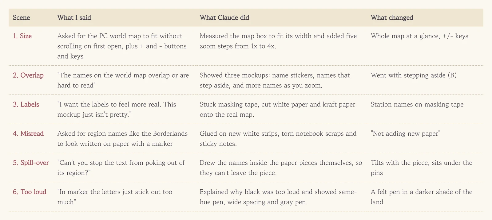
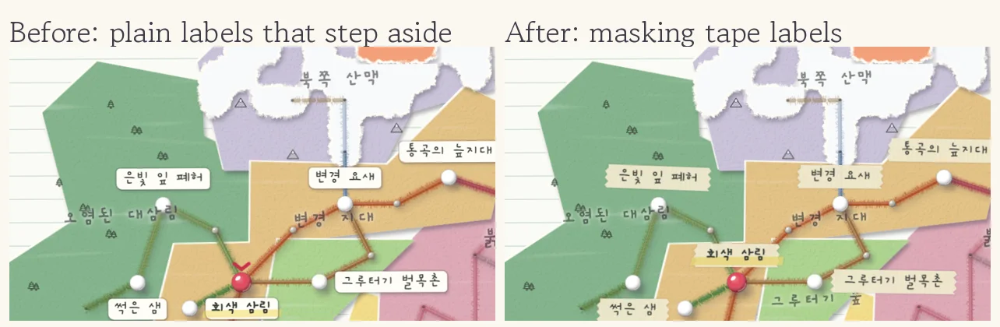
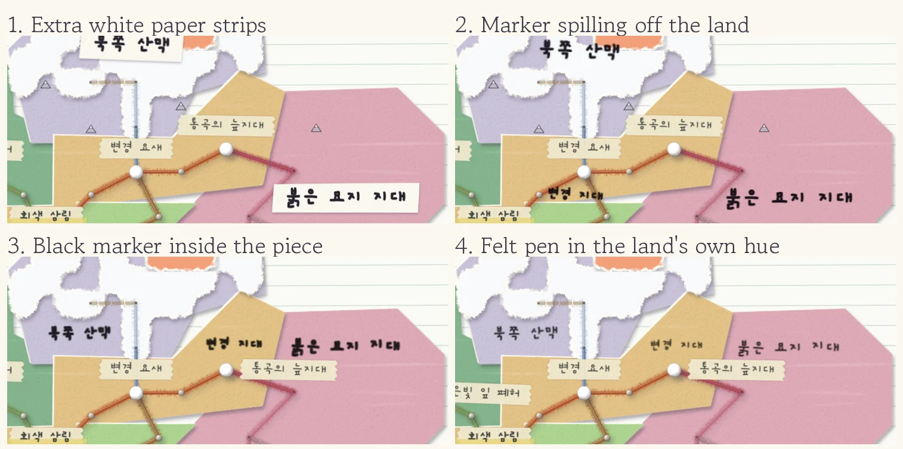
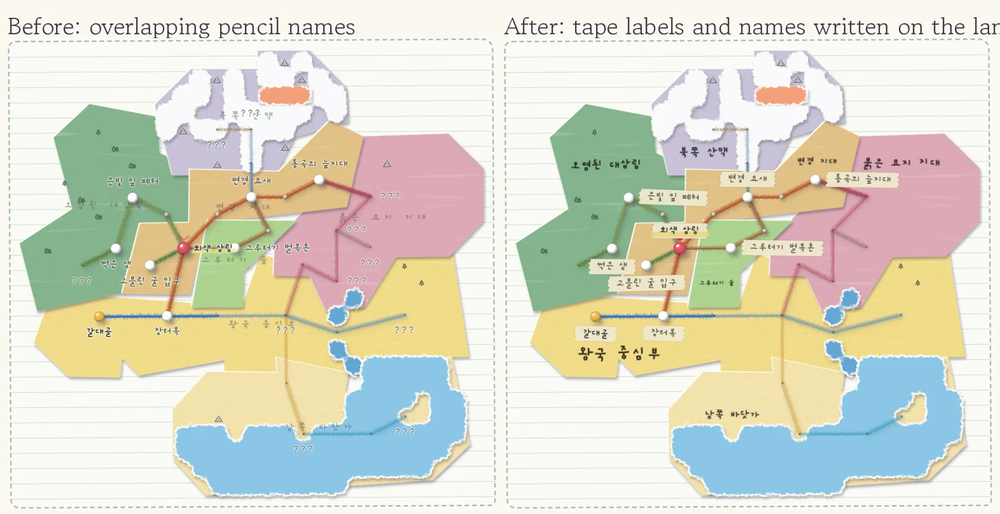

I liked the world map re-glued with colored paper and yarn, but once I opened it on PC the lettering was the new problem. Station names and region names were tangled together, and the faint pencil region names nearly vanished against the colored paper. So I threw this out: "The names on the world map overlap or are hard to read. Give me some ideas to improve this."

<figure><figcaption>From resizing the map to picking a pen for region names, six rounds of back and forth.</figcaption></figure>

## Warm-up: make the map bigger first

Before the names, the map size got fixed. On PC the map opened with a scrollbar, so you couldn't see it all at once, and there was no way to zoom to taste. Claude measured the notebook height to fit the map snugly and added − and + buttons next to the zoom toggle, with five steps from 1x to 4x. The + and − keys on the keyboard work too. When a station note opened and squeezed the map smaller, I pointed out once more that the note should scroll instead, and that got fixed right away.

## One of three, then "not pretty"

For the overlap, Claude brought three mockups: names on name-tag stickers, the same plus a rule that labels step aside to a free spot when they collide, and a third that shows more names as you zoom in. I asked whether C was basically A, B and C mixed together, and it said yes, each one stacks on the previous. I went with B, but the plain white tags felt flat. "I want the labels to feel more real. This mockup just isn't pretty."

<figure><figcaption>Flat white tags turned into hand-torn masking tape.</figcaption></figure>

The next round had masking tape, scissor-cut white paper and kraft paper. I picked the masking tape. The ends are torn into little zigzags and every label sits a bit crooked, so it really looks stuck on by hand. Colliding names step aside on their own, and if there's still no room, the less important ones hide first. The "???" over unknown places is gone too, leaving just a pinhole, and the map got noticeably calmer.

## "Not adding new paper"

Next up were the region names. "I'd like terrain names like the Borderlands or the Red Graveyard to look like someone wrote them on paper with a marker." The mockups that came back weren't what I expected. Brand-new white strips, torn notebook scraps and yellow sticky notes with marker names were glued on top of the map. I meant writing straight on the colored paper the land is made of. **When the AI misreads you, there's no need for a long explanation. A single "not this, that" line is enough.**

<figure><figcaption>The same spot shot four times, from the misread first round to the final pick.</figcaption></figure>

## Text that spills over, text that shouts

With the extra paper gone and the names written on the land, a new problem showed up. The text spilled past the land's edge into the next region and seemed to float above the map. "Can't you stop the text from poking out of its region? And it doesn't feel written on the colored paper at all."

Claude changed the whole approach: instead of laying text over the map, it now draws the names inside the paper pieces themselves. The text tilts with its piece, can never leave it, and sits under the pins and yarn. It looks for an empty spot inside the piece away from stations, and shrinks the text when space is tight, so all seven region names fit inside their own land. Zoom in and the text grows along with it, like paper under a magnifying glass.

Then the jet-black marker started shouting over the pastel paper. "In marker the letters just stick out too much." This time Claude explained the cause before making mockups: pure black, much heavier than the station labels, and far too much contrast against pastels. Hand-drawn maps, it said, usually write region names in a slightly darker shade of the land, and thinly. Out of a same-hue felt pen, wide letter spacing and a light gray pen, I chose the felt pen in a darker shade of each land. Deep magenta on pink land, deep green on green land, and it settled right into the map.

<figure><figcaption>Left is the old map, right has tape labels and region names written on the land.</figcaption></figure>

## Three-line summary

1. Turn complaints like "it overlaps, I can't read it" into a few mockups and just pick one.
2. When the AI misreads you, correct it with one line: "not this, that."
3. When something bugs you, have the AI explain why before making new mockups, and the next round lands closer.
