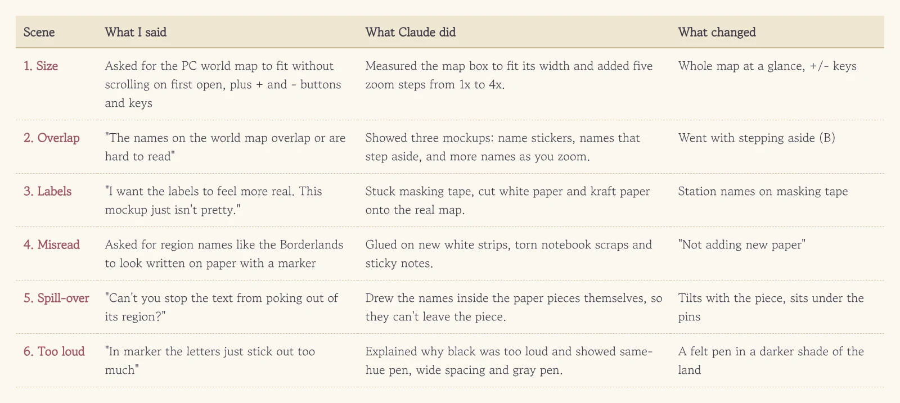
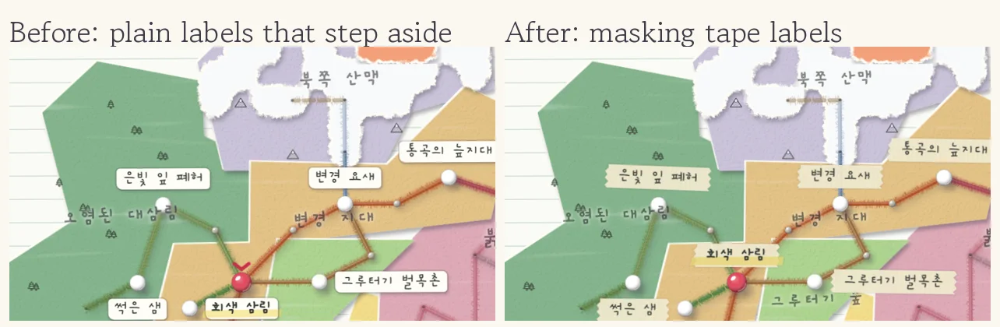
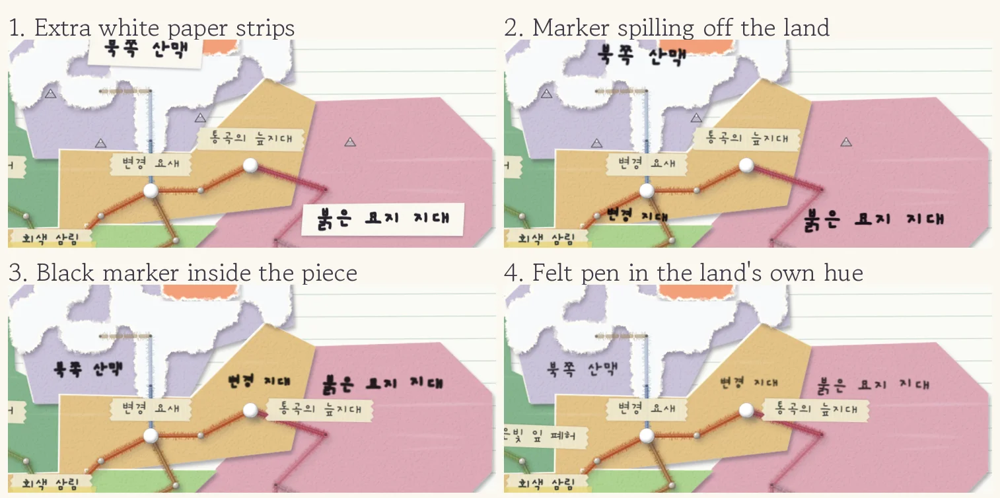
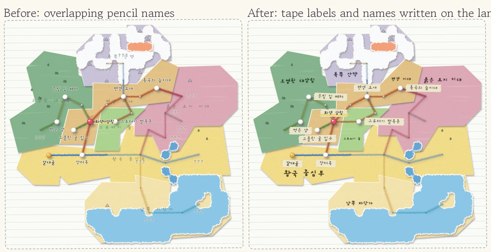

I was thrilled with the colored-paper-and-yarn world map—right up until I opened it on desktop and actually tried to read the labels. Town names and region names were elbowing each other for space, while the faint pencil region titles dissolved into the pastel paper like a hidden-object puzzle. So I tossed the problem to Claude: "The names on the world map overlap or are hard to read. Give me some ideas to improve this."

<figure><figcaption>From resizing the map to picking a pen color for region names—six rounds of back and forth.</figcaption></figure>

## Warm-up: give the map room to breathe

Before touching the lettering, we fixed the canvas itself. On desktop, the map opened inside a cramped scrollbar so you couldn't see the whole world at once, and there was no way to zoom. Claude measured the notebook height to fit the full map cleanly, then added `−` and `+` buttons beside the zoom toggle for five steps from 1x to 4x, plus keyboard `+` and `−` shortcuts. When opening a town note squeezed the map smaller, one quick "scroll the note instead of shrinking the map" sorted it out.

## Pick one of three, then "this isn't pretty"

For the colliding labels, Claude brought three mockups: putting names on sticker tags, adding a rule so colliding tags step aside into open space, and revealing extra names as you zoom in. "So C is basically A, B, and C stacked together?" I asked. Yep—each one built on the last. I went with B, only to realize once it hit the real map that plain white rectangles looked painfully sterile. "I want the labels to feel more real. This mockup just isn't pretty."

<figure><figcaption>Flat white stickers became hand-torn strips of masking tape.</figcaption></figure>

Round two offered masking tape, scissor-cut white paper, and kraft paper. Masking tape won on sight. With jagged torn ends and a slight tilt on each strip, it genuinely looked stuck onto a notebook by hand. Colliding names now step aside automatically, and if space still runs out, less important labels quietly yield. Sweeping away all the "???" tags over unvisited spots—leaving just a tiny pinhole—let the whole map exhale.

## "Not adding new paper"

Region names were next. "I'd like terrain names like the Borderlands or the Red Graveyard to look like someone wrote them on paper with a marker." What came back made me blink. Brand-new white strips, ripped notebook scraps, and yellow sticky notes had been slapped *on top* of the map. I didn't want more paper—I wanted the letters written **straight onto the colored paper that forms the land**. When an AI wanders down the wrong alley, skip the long speech. One crisp correction—"not adding new paper"—swung it right back on course.

<figure><figcaption>The same corner captured four times, from the misread first draft to the final pen choice.</figcaption></figure>

## Text that spills over, text that shouts

Once the extra scraps vanished and the words sat on the land, two new quirks jumped out: letters spilled across borders into neighboring regions, and the whole word seemed to hover above the paper. "Can't you stop the text from poking out of its region? And it doesn't feel written on the colored paper at all."

Claude ditched the overlay layer and started rendering each name *inside* its colored-paper shape. Now the text tilts with its piece, can never leak past the scissor edge, and tucks underneath the pins and yarn. It hunts for an empty pocket away from stations and shrinks when room is tight, so all seven region names sit comfortably inside their own territory—and scale up like ink under a magnifying glass when you zoom in.

One last snag remained: pure black marker was practically shouting over soft pastel paper. "In marker the letters just stick out too much." This time Claude diagnosed before drawing: jet black was way heavier than the station tags and created too harsh a contrast against pastels. Hand-drawn maps, it pointed out, usually write region names thinly in a slightly darker shade of the land itself. Out of a same-hue felt pen, wide letter spacing, and light gray ink, I picked the darker same-hue felt pen. Deep magenta on pink land, deep green on green land—and at last the lettering belonged to the paper.

<figure><figcaption>Left: the cluttered original. Right: torn masking-tape tags and region names written right onto the land.</figcaption></figure>

## Three-line summary

1. When labels collide or disappear, ask for a few side-by-side mockups—picking beats describing every time.
2. If the AI misreads your intent, skip the paragraph and draw one clean line: "not this, that."
3. When a draft feels off, ask the AI *why* it jars before drawing the next round; the diagnosis usually nails the fix in one shot.
