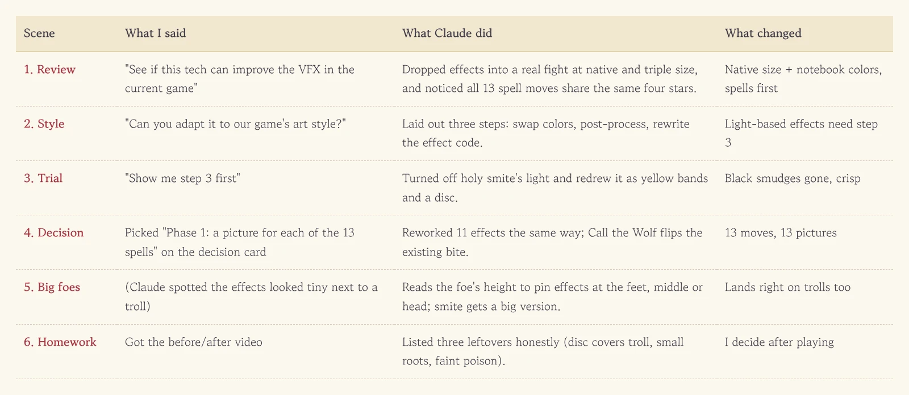
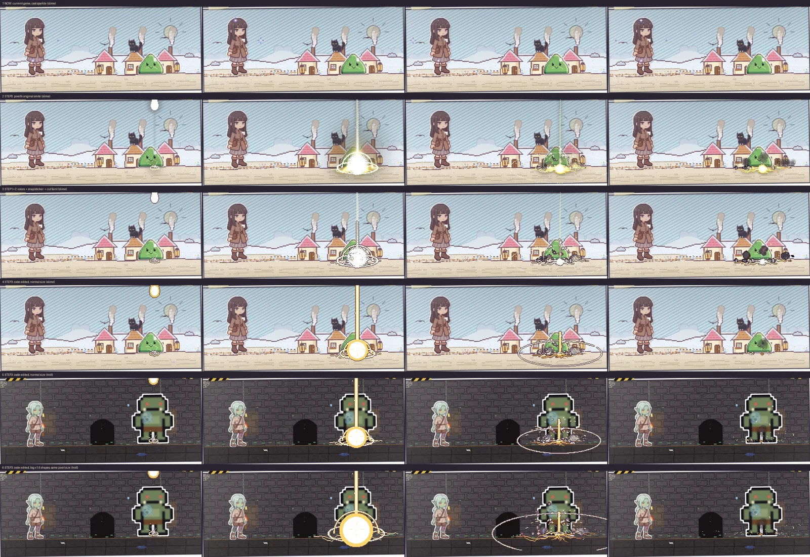
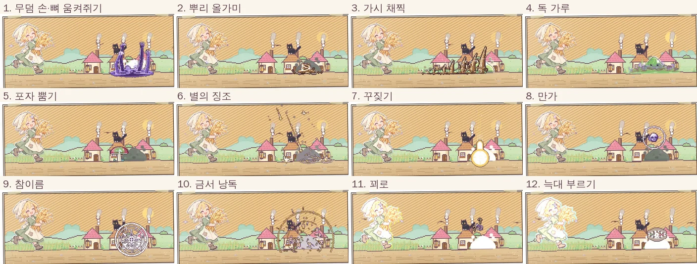
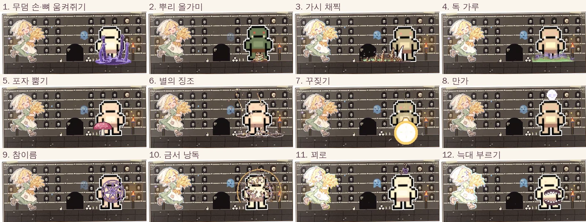

Our game has thirteen spells. You can call hands up out of the ground, bind ankles with roots, throw poison dust, even rebuke a foe in the name of a god. On screen, though, they were all the same: whatever dramatic spell you cast, four tiny stars twinkled next to the hero's head, and that was it. Then I found [pixelfx](https://github.com/patch-gg/pixelfx), 244 pixel effects drawn entirely in code and free to use, and took it straight to Claude.

<figure><figcaption>Three questions and one decision, and thirteen spells got their own pictures.</figcaption></figure>

## "See if this can improve our VFX"

My opening line was roughly: "Use this tech and see whether it can improve the VFX in the current game." Claude didn't stop at reading the repo and writing a report. It dropped the effects onto one of our real fight scenes—once at native size and once tripled to match the hero.

The answer was clear. Tripled, the pixels were three times chunkier than the hero's, like two different games pasted together. At native size with our notebook colors, they sat comfortably right next to a slime. And Claude found an embarrassing bonus: **all thirteen spells were sharing the exact same four stars.** I looked at that screen every day and never noticed.

## "Can you adapt it to our art style?"

The real hurdle was style. pixelfx is built to glow on dark backgrounds, so on a bright notebook page the glow simply vanished into the paper. When I asked if it could fit our look, Claude split the job into three steps:

1. Swap the colors for ours (one option, done).
2. After rendering, snap to the game palette and add our plum outline.
3. Rewrite the effect code itself.

Effects that lean on light needed step 3. That was hard to picture from words alone, so I said: "Show me step 3 first."

## A preview with holy smite

The guinea pig was holy smite, where a hammer of light slams down from the sky. The version with only steps 1 and 2 was a disaster. The light beam shrank to a thin white thread and the smoke turned into black smudges stuck under the slime. Think expensive makeup plus photo retouching, and somehow you end up with ink splattered on your face.

For step 3 Claude flipped the idea on its head. **It switched the light off entirely and redrew whatever the light was doing as yellow bands and a solid disc.** Smoke became notebook cream, and the length trimmed down from 2.8 seconds to 1.5. Suddenly it read clearly in a bright village and a dark dungeon alike.

<figure><figcaption>Row three is the black smudge of steps 1 and 2; from row four down is step 3, light off and redrawn.</figcaption></figure>

## Thirteen spells, thirteen pictures

That sold me, and I picked "Phase 1: a picture for each of the 13 spells" on the decision card. Claude reworked eleven effects the same way: grasping hands, roots, a line of thorns, a poison cloud, a spore mushroom, falling stars, holy smite, a skull curse, a binding sigil, a mana burst and question marks over the head. Call the Wolf didn't get new art at all—it reuses the picture of a wolf biting the hero, flipped to face the foe. A true recycling champion.

<figure><figcaption>All twelve panels catch the moment a spell lands on the slime. The grey slime just means it got hit.</figcaption></figure>

Things changed under the hood too. Before, every spell hit the foe at 0.16 seconds. Now **the foe flinches on the frame where the picture actually connects**—the moment the hands clench or the skull stamps down. The slow-motion on a critical success follows that frame as well.

## Spells that shrank in front of a troll

I thought we were done, until we put a troll on screen. Native size had been tuned for a slime, so on a troll the skull curse popped up near its belly button and the binding sigil hung around its knees. Claude made the game read each foe's height and pin the picture at the feet, the middle of the body or above the head. Holy smite got a separate big version with the shape scaled 1.6 times. The pixel size stays the same, so nothing turns mushy.

<figure><figcaption>Same spells on a troll: the skull floats above its head, the sigil sits at its middle.</figcaption></figure>

<figure><video src="/assets/img/posts/pixelfx-spells/spells.mp4" poster="/assets/img/posts/pixelfx-spells/spells.jpg" controls muted playsinline preload="none"></video><figcaption>Left is the old four stars, middle and right are the new pictures. Each spell runs 2.6 seconds.</figcaption></figure>

Claude didn't hide the rough edges either. The big smite's disc covers the troll's lower body for about 0.1 seconds at impact, the roots are small on big foes and only wrap the ankles, and the poison cloud is fainter than the rest because it's semi-transparent. So I asked, "Is there a next step?" Claude laid out a few paths, and I picked "fix the leftovers, then chests and healing."

## Three bits of homework, two bonuses

Homework first. The smite disc no longer grows on the big version, the roots got their own big version for trolls so they wrap up to the waist, and the poison cloud is painted about twice as thick.

Then the bonuses. Until now, nothing moved on screen when a wound healed or a chest spilled money. A line of text popped up and that was it. Now **when an injury, illness or curse heals, petals open at the hero's feet, a ring of light rises to the head and little hearts pop.** When you get more than 10 coins, or money comes out of a chest, a puff of dust goes up and gold coins bounce on the floor. Events usually pay 1 to 5 coins, so that threshold keeps coins from raining all the time.

The heal effect was built for a tiny doll, so in front of our hero it looked like a wildflower at her ankle. Same rule as before: keep the pixel size, scale the shape 2.5 times. The coins are small next to the hero, but making their pixels chunkier would mix two styles again, so they stay as they are.

<figure><video src="/assets/img/posts/pixelfx-spells/heal-coins.mp4" poster="/assets/img/posts/pixelfx-spells/heal-coins.jpg" controls muted playsinline preload="none"></video><figcaption>1 to 3 are the fixed spells. For 4 (healing) and 5 (coins), left is how it was (nothing happens) and right is the new version.</figcaption></figure>

## Three-line summary

1. When you borrow someone else's effects, match their size to your own pixel scale first. Scale them up blindly and the art stops looking like one game.
2. If a glow disappears on a bright screen, don't crank it up. Ask for it to be switched off and redrawn as solid shapes.
3. "Show me just one first" costs far less than making thirteen and throwing them all out. And when you ask about the next step, bundle the leftover fixes in with it.
