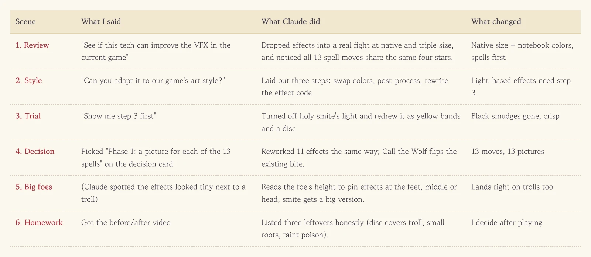
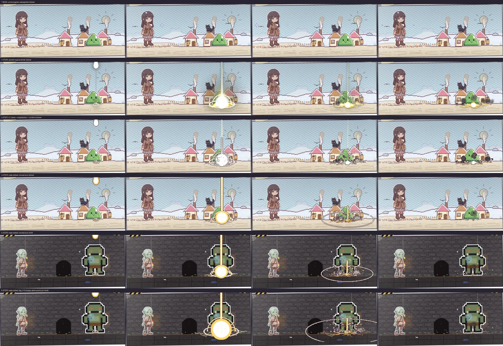
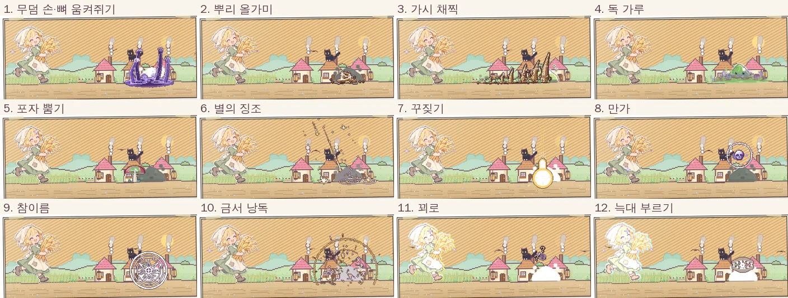
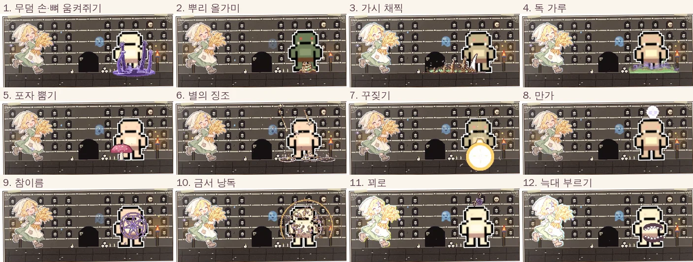

Our notebook RPG has thirteen different spells. You can summon hands out of the earth, snare ankles with roots, scatter poison dust, even smite foes in the name of a god. On screen, though, every last one of them looked identical: four tiny stars twinkled beside the hero's head, and that was the whole show. Rather underwhelming for divine wrath. Then I stumbled across [pixelfx](https://github.com/patch-gg/pixelfx)—244 pixel effects drawn purely in code and free to use—and brought it straight to Claude.

<figure><figcaption>Three questions and one decision later, all thirteen spells finally got their own visuals.</figcaption></figure>

## "See if this can upgrade our VFX"

My opening prompt was simple: "See whether we can use this tech to improve the VFX in the current game." Instead of skimming the README and handing back a memo, Claude dropped the effects straight onto one of our actual combat scenes—once at native size, and once scaled 3× to match our hero.

The verdict jumped off the screen. Tripled, every pixel in the effect was three times chunkier than the hero's pixels, looking like two different games taped together—the classic mixed-pixel-size trap. At native size recolored to our notebook palette, though, it sat right at home next to a slime. Claude also surfaced a mildly embarrassing fact: **all thirteen spells were reusing the exact same four-star animation.** I had stared at that screen every single day and gone completely blind to it.

## "Can you bend it to fit our art style?"

The real obstacle was lighting. pixelfx is built for flashy additive glow over dark arenas; dropped onto bright cream notebook paper, all that glow simply vanished into the page like shining a flashlight at noon. When I asked if we could adapt it, Claude broke the work into three tiers:

1. Swap in our colors (one config option, done).
2. Post-process the rendered frames to snap to our palette and add our plum outline.
3. Rewrite the effect code itself.

Glow-heavy spells needed tier 3. Since that was hard to picture from words alone, I asked for a single proof of concept first: "Show me tier 3 on one spell before we do the rest."

## Testing the water with Holy Smite

Our guinea pig was Holy Smite, where a hammer of light slams down from the sky. Tiers 1 and 2 alone looked grim: the mighty pillar shrank into a hairline white thread, and the smoke turned into muddy black blots under the slime's feet—like spilling ink across a clean page.

For tier 3, Claude inverted the whole approach. **It switched the glow completely off and redrew what the light was doing as opaque yellow bands and a solid impact disc.** Smoke switched to notebook cream, and the animation tightened from 2.8 seconds down to 1.5. Turning the light *off* made the spell pop cleanly in both a sunlit village and a dark dungeon.

<figure><figcaption>Row three shows the black smudges of tiers 1–2; row four and below show tier 3 with the glow turned off and redrawn.</figcaption></figure>

## Thirteen spells, thirteen visuals

Sold on the prototype, I picked "Phase 1: dedicated art for all 13 spells" on Claude's decision card. Using the same playbook, Claude adapted eleven effects: grasping hands, binding roots, a line of thorns, a poison cloud, mushroom spores, falling stars, holy smite, a skull curse, a sealing sigil, a mana burst, and floating question marks. Call the Wolf didn't even need fresh code—Claude took the existing sprite of a wolf biting the hero and flipped it to face the enemy. Peak recycling.

<figure><figcaption>All twelve panels catch the exact impact frame on a slime. Grey just means it took a hit.</figcaption></figure>

Impact timing got an invisible upgrade too. Previously, every spell triggered the enemy's hit reaction at a hardcoded 0.16 seconds. Now **foes flinch on the exact frame the effect actually connects**—the instant the hand clenches or the skull slams down—and the critical-hit slow motion locks onto that same frame.

## Spells that shrank in front of a troll

Just when we thought we were finished, we spawned a troll. Because everything had been sized around a slime, the skull curse floated awkwardly near the troll's belly button and the sealing sigil dangled around its knees.

Claude updated the game to read each enemy's height and anchor every effect properly at the feet, torso, or overhead. For Holy Smite, it built a dedicated large version following one golden pixel-art rule: **keep pixel thickness locked, and scale only the geometry 1.6×.** Bigger impact, zero blurry pixels.

<figure><figcaption>Same twelve spells on a troll: the skull hovers above its head, and the sigil lands squarely on its chest.</figcaption></figure>

<figure><video src="/assets/img/posts/pixelfx-spells/spells.mp4" poster="/assets/img/posts/pixelfx-spells/spells.jpg" controls muted playsinline preload="none"></video><figcaption>Left: the old four stars. Middle and right: the new spell visuals, 2.6 seconds each.</figcaption></figure>

Claude didn't gloss over the rough edges either. It flagged three leftovers on its own: the large smite's disc briefly hid the troll's lower half for ~0.1 seconds on impact, the roots still looked tiny on trolls and barely wrapped their ankles, and the semi-transparent poison cloud read fainter than everything else. When I asked "What's next?", it offered a few routes and I picked "fix the leftovers, plus chests and healing."

## Three bits of homework, two bonuses

Homework first: the large smite disc stopped scaling up, roots got a tall troll-sized variant that climbs to the waist, and the poison cloud got painted roughly twice as opaque.

Then came the bonuses. Until now, healing a wound or cracking open a treasure chest moved zero pixels on screen—just a dry line of text. Now **when an injury, illness, or curse clears, petals bloom at the hero's feet, a ring of light rises overhead, and little hearts pop.** Pull more than 10 coins at once—or loot gold from a chest—and a puff of dust kicks up as gold coins bounce across the floor. Everyday events usually pay 1 to 5 coins, so that 10-coin threshold keeps gold from raining on trivial errands.

The healing graphic was originally scaled for a tiny chibi doll and looked like a stray dandelion at our hero's ankles. Same rule applied: keep pixel thickness intact, scale the shape 2.5×. The coins are slightly small beside the hero, yet fattening their pixels would break the art consistency again, so they stayed native.

<figure><video src="/assets/img/posts/pixelfx-spells/heal-coins.mp4" poster="/assets/img/posts/pixelfx-spells/heal-coins.jpg" controls muted playsinline preload="none"></video><figcaption>1–3 show the fixed spells. For 4 (healing) and 5 (coins), left is before (nothing happens) and right is after.</figcaption></figure>

## Three-line summary

1. When adapting someone else's pixel VFX, match your game's pixel thickness first. To make an effect bigger, keep pixel size locked and scale the shape geometry instead.
2. If glow effects vanish on a bright background, stop cranking the brightness—turn the glow off and redraw it with crisp opaque shapes.
3. Asking "show me just one first" is far cheaper than reworking thirteen effects twice, and bundling small polish fixes into the next milestone keeps rough edges from piling up.
