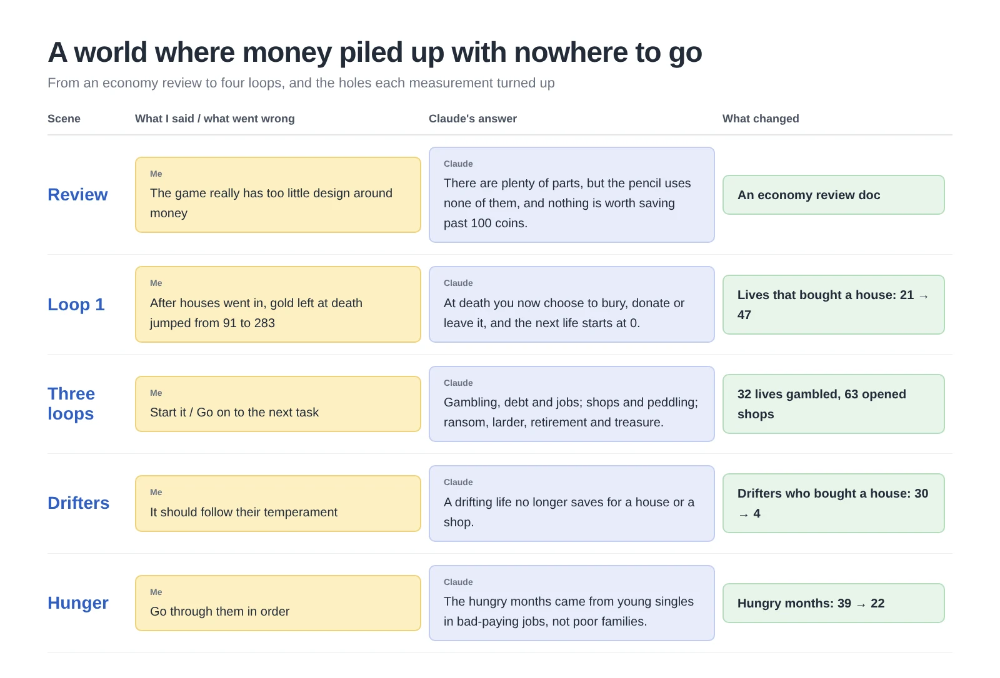
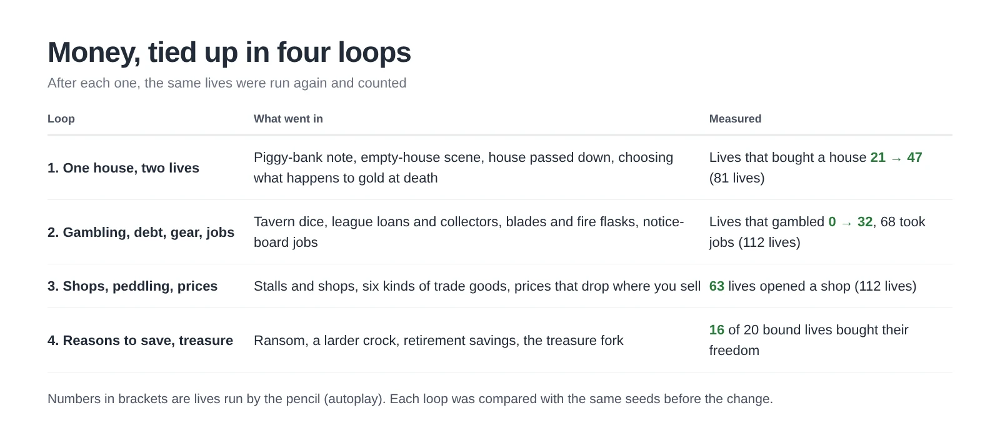
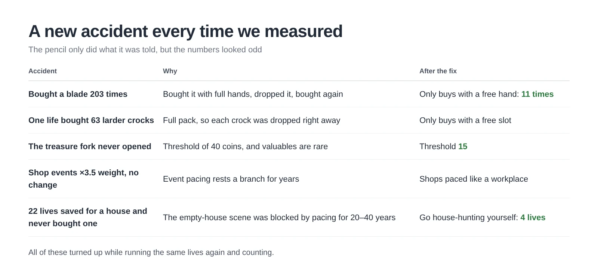
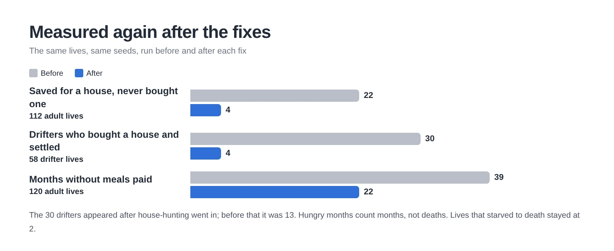
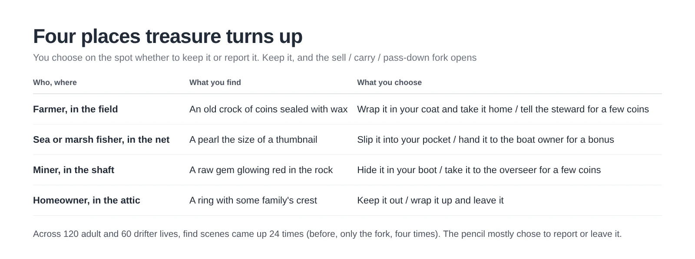

The folks in my notebook RPG were model citizens. They worked hard from youth to old age, piling up hundreds of gold coins—and then died clutching every single one, because there was practically nothing to buy. Watching character after character leave this world with a small fortune in their pockets eventually got on my nerves. I complained to Claude, and a two-day economic overhaul began.

<figure><figcaption>My job was a handful of sentences. Wiring the loops, counting, and recounting was all Claude.</figcaption></figure>

## "The game really has too little design around money"

I opened bluntly: "The game really has too little design around money." Apart from steady wages, there was no high-risk, high-reward way to get rich, and nowhere meaningful to spend what you earned. "It looks like it needs a full review," I added.

Before touching a line of code, Claude took inventory of what was already sitting in the game. Market selling, loot, station shop shelves, tavern dice tables—there were more pieces than I remembered. The problem was that our autoplay bot—we call it "the pencil"—ignored every single one of them. It never bought, never sold, and big-ticket items like houses or shops didn't even exist. Worse, leftover gold at death converted into 1 soul point per 10 coins, capped at 10, so saving past 100 gold was completely pointless. **It was a paycheck landing every month in a bank account with no stores to visit and no interest to earn.**

## A shopping menu, or a piggy bank?

That left us with a design fork. Should every purchase pop up as a manual choice, or could we fit spending into the game's rhythm? I had zero interest in turning my RPG into a grocery-clicking simulator. Claude proposed a "piggy bank" instead. You jot one savings goal onto a note, the pencil quietly earns and saves through ordinary days, and you only take the wheel at dramatic crossroads: the dice table, a debt collector at the door, or an empty house going cheap. Any house or shop you buy stays in the world for the next generation to inherit.

After two outside reviews I locked in version two of the spec and split the build into four loops. One rule governed the whole sprint: after each loop, re-run the exact same lives and count what happened.

<figure><figcaption>For loops two and three, my entire contribution was typing "Start it" and "Go on to the next task."</figcaption></figure>

Right after loop one, money overflowed in the opposite direction: median gold left at death jumped from 91 to 283 coins. So now, on your deathbed, you decide whether to bury the stash, donate it, or leave it behind. The next life starts fresh at zero, inheriting only the house and family heirlooms.

## One bizarre accident per loop

Every recount surfaced a fresh piece of bot comedy. In one run, the pencil kept buying a blade while its hands were already full, tossing it on the ground, and buying another—203 times. In loop four, a single character with a packed bag bought a larder crock and immediately threw it away 63 times in one lifetime. Imagine standing in front of an overflowing fridge and stubbornly checking out another cart of groceries.

Elsewhere, a treasure scene with a 40-coin threshold never triggered once, and shop events refused to budge even after cranking their weight up 3.5×. The culprit was our cooldown rule, which benches an entire event branch for years after it fires.

<figure><figcaption>The pencil only obeyed orders. Our orders just happened to be full of holes.</figcaption></figure>

**Whenever an AI says "all done," have it re-run the same simulation and show you the counts.** Bugs like 203 discarded blades or 63 larder crocks almost never jump out when you skim code. They practically wave at you from a table of numbers.

## "It should follow their temperament"

Even after loop four, 22 lives saved up the full price of a house and still died homeless. The empty-house event had been locked behind cooldowns for 20 to 40 years straight. Letting characters actively go house-hunting once they had the cash dropped that number to 4—and promptly broke the opposite end of the spectrum. Out of 58 drifters, 30 bought houses and settled down. So much for a life on the open road; our wanderers had caught the real-estate bug.

Claude even tripped over a classic stats fallacy here. It reported that "drifters who bought a house lived 24 years longer," flipping cause and effect upside down—people who survived longer simply had more chances to buy, plus other changes had landed in between. To its credit, Claude caught the mistake almost immediately and pulled the claim from the notes.

My fix was one sentence: "It should follow their temperament." Drifters should drift. Now a wandering pencil ignores houses and shops altogether, saving only for ransom money, a larder, and retirement.

<figure><figcaption>Grey is before, blue is after. The homeowning drifters are back on the road.</figcaption></figure>

## Turns out it wasn't poor families going hungry

I asked, "Anything else left to work on?" Claude pitched four ideas, and I replied, "Go through them in order." First up: tweaking the larder so poor families wouldn't go hungry.

Before changing a thing, Claude pulled all 69 hungry months from the logs and inspected them one by one. Every single one belonged to a young, childless single—mostly 14 to 17 years old—stubbornly clinging to entry-level jobs like first-rank bard or peddler that didn't even cover meals. The "poor families" Claude had guessed at when writing the proposal didn't exist in the data. Claude owned up to the bad guess right away and pivoted the fix from larders to jobs.

Now, after two straight months without covering meals, the pencil looks for work that includes room and board or pays better, pausing to ask me before switching careers. Across 120 adult lives, hungry months dropped from 39 to 22. We also added a floor for retirees so they don't burn through their savings and starve: dip below 100 gold, and it's back to work.

Treasure came last. Valuables were so scarce that the treasure branch only opened four times in 180 lives. Now farmers turn up old coins in the field, fishers haul pearls in the net, miners strike gems in the shaft, and homeowners stumble on heirlooms in the attic.

<figure><figcaption>Funnily enough, the pencil almost always reported the find to its rightful owner. Deciding whether to pocket it stays a human call.</figcaption></figure>

## Three-line summary

1. When designing a game economy, build reasons to save and places to spend before adding more ways to earn—that's when gold turns into story.
2. When an AI declares a feature done, have it replay the same lives and count the outcomes. Absurdities like 203 dropped blades show up in numbers long before code review.
3. Inspect the logs before fixing on a hunch. The hunger we blamed on struggling families turned out to be broke teenagers stuck in dead-end starter jobs.
