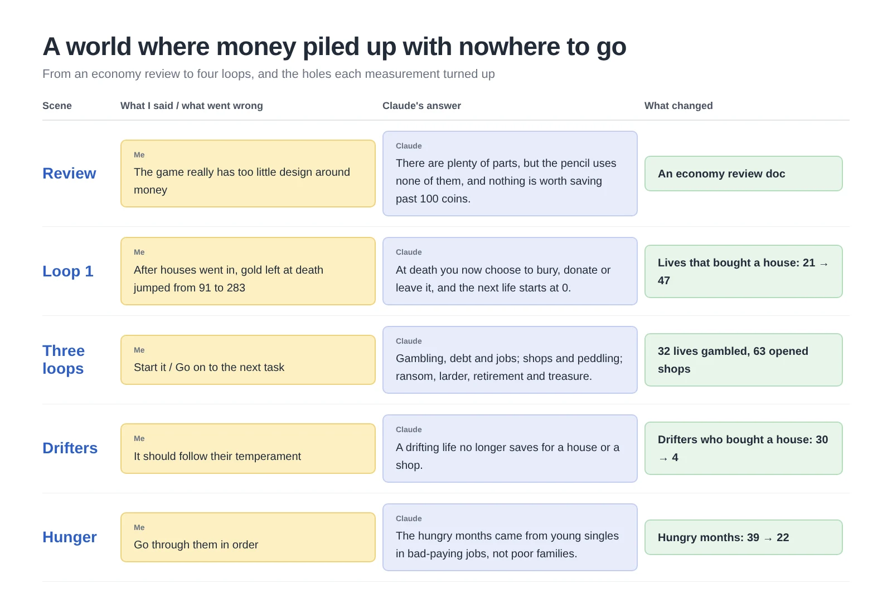
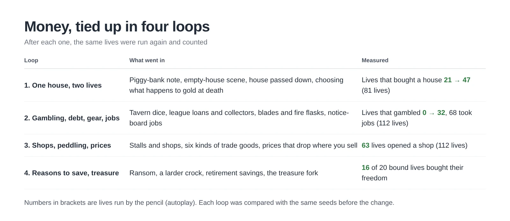
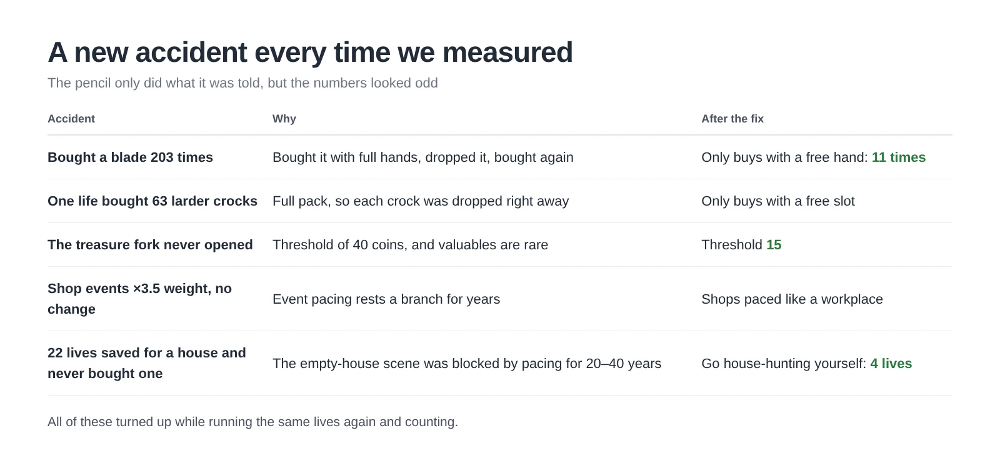
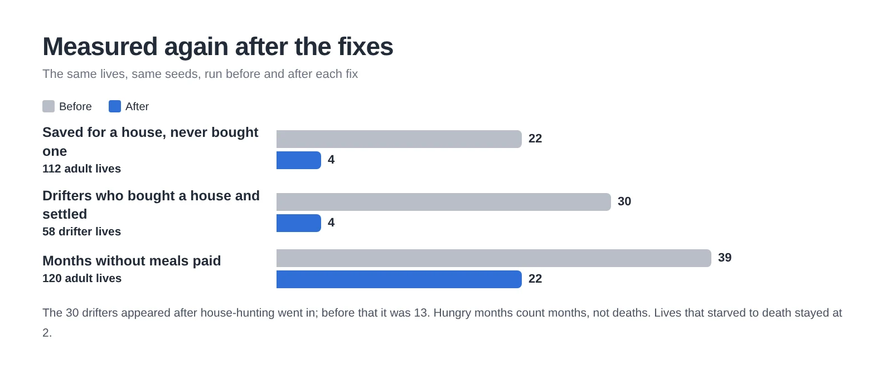
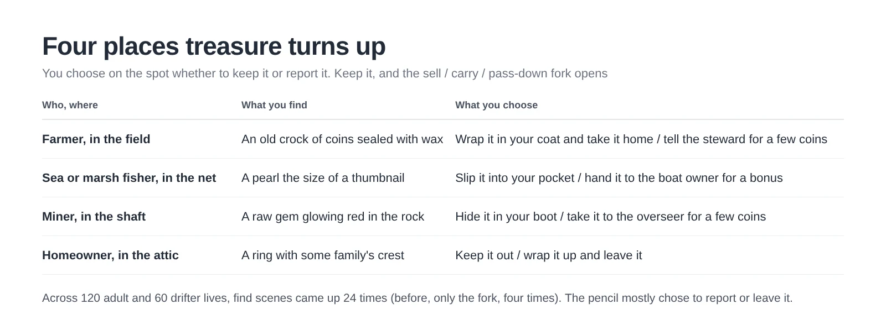

The people in my notebook RPG worked hard all their lives. The trouble was there was almost nothing to do with the money. Plenty of them died clutching hundreds of gold coins. One day that started to bug me enough that I said so to Claude, and a two-day economic overhaul began.

<figure><figcaption>My part was a few sentences. Building the loops, counting, and counting again was Claude's.</figcaption></figure>

## "The game really has too little design around money"

My first message was blunt: "The game really has too little design around money." I added that apart from steady wages there was no high-risk, high-reward way to earn, and nowhere to spend what you made. I closed with "it looks like it needs a full review."

Before fixing anything, Claude counted what already existed. Selling at the market, loot, the shelf at each station, the tavern dice table—there were more pieces than I expected. But the pencil (autoplay) touched none of them. It never bought or sold, and there was no house or shop anyone could buy. On top of that, leftover money at death turned into 1 soul point per 10 coins, capped at 10, so there was no reason to save past 100. **A salary arriving every month into an account with nothing to spend on and nothing to save for.**

## A menu of choices, or a piggy bank?

That raised a dilemma. Should every bit of spending be a choice you click by hand, or should it work through something that felt like our game? I didn't want to play a game of pressing the shopping button all day either. Claude's answer was a piggy bank. You write one savings goal on a note, the pencil quietly earns and saves day to day, and I only choose at the turning points: the dice table, the debt collector, an empty house up for a quick sale. Houses and shops you buy stay in your world for the next life to inherit.

After two outside reviews I revised it into a second version and split the work into four loops. After each loop, the same lives were run again and counted.

<figure><figcaption>For loops two and three, all I said was "Start it" and "Go on to the next task."</figcaption></figure>

Once the first loop was done, money started piling up the other way. The median gold left at death jumped from 91 to 283. So now, on your deathbed, you choose to bury it, donate it or leave it. The next life starts fresh at zero, and only the house and heirlooms carry over.

## An accident for every loop

Every recount turned up some odd accident. The pencil bought a blade with its hands full, dropped it, and bought another—203 times. In loop four, with a full pack, one life bought a larder crock and dropped it on the spot, 63 times. Picture someone filling the shopping cart in front of a fridge that's already bursting. The treasure scene never opened once with its threshold at 40 coins, and shop events stayed flat even at 3.5 times the weight. The culprit was the pacing rule that rests a branch of events for years at a time.

<figure><figcaption>The pencil only did what it was told. What it was told was sloppy.</figcaption></figure>

**When an AI says "all done," have it run the same lives again and count.** Accidents like these rarely show up when you read the code. They jump out of the numbers first.

## "It should follow their temperament"

Even after loop four, 22 lives saved the full price of a house and never bought one. The empty-house scene had been blocked by the pacing rule for 20 to 40 years. So once you had saved enough, you could go house-hunting yourself, and that dropped it to 4. Then the other side broke: 30 of 58 drifters bought a house and settled down.

Claude slipped up here too. It reported that "drifters who bought a house lived 24 years longer," which read it backwards: people who lived longer simply had more chances to buy, and other work had landed in between. Claude caught it right away and pulled it from the docs.

My answer was one line: "It should follow their temperament." Drifters ought to drift. Now a drifting pencil no longer saves for a house or a shop, only for ransom, a larder and retirement.

<figure><figcaption>Grey is before, blue is after.</figcaption></figure>

## I assumed poor families went hungry

I asked, "Anything else left to work on?" Claude offered four candidates, and I said "Go through them in order." The first was making the larder help poor families more. Before touching it, though, Claude went through all 69 hungry months one by one, and every single one belonged to a young single with no children. Most were 14 to 17, clinging to work that didn't cover meals, like a first-rank bard or peddler. The "poor families" Claude had guessed at when listing the candidates were wrong. Claude owned up to that first and turned the fix away from the larder and toward jobs.

So now, after two months without meals paid, the pencil looks for work that comes with room and board or pays more, and stops to ask me before changing jobs. Across 120 adult lives, hungry months fell from 39 to 22. I also added a floor so a retiree doesn't spend their savings to the bone and starve: once savings drop under 100, they go back to work.

Last came treasure. Valuables were rare to begin with, so the treasure fork opened only four times in 180 lives. Now farmers find treasure in the field, fishers in the net, miners in the shaft, and homeowners in the attic.

<figure><figcaption>Funnily enough, the pencil almost always reported the find to the owner. Whether to keep it is a call for a person to make.</figcaption></figure>

## Three-line summary

1. When you add money to a game, build places to spend it and reasons to save before more ways to earn it. That is when money turns into story.
2. When an AI says "all done," ask it to run the same lives again and count. Accidents like a blade bought 203 times or 63 larder crocks show up in the numbers first.
3. Don't fix things on a hunch; have the records taken apart. The hunger I blamed on poor families turned out to be young singles stuck in bad-paying jobs.
